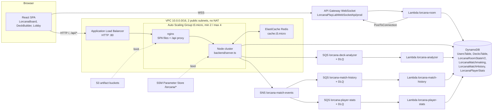

# Disney Lorcana PlayLab Cloud: Codebase Analysis

Audit date: 2026-10-11. Branch: `claude/laughing-ramanujan-8o8olp`, head `384cab2`.
Method: static reading of the repository. Nothing was built, installed, deployed or executed against AWS. The local clone is shallow (`git rev-parse --is-shallow-repository` returned `true`, 50 commits visible), so history-based statements cover only those commits.

Labels used in this document:

- **Verified**: read directly in the source at the cited path and line.
- **Inferred**: a reasonable conclusion from code, not directly observable.
- **Unknown / Requires verification**: depends on deployed AWS state or runtime behavior that cannot be read from the repository.

Line numbers refer to the file at the commit above.

**Update (same day, after merging `t15-e2e-final-report`):** the follow-up PR fixes S1 (admin role by username), S7 (internal error messages), S9 (register race), the leaderboard 100-item scan, the biased board shuffle, the `lore || 1` quest bug, the dev WebSocket rejoin rule, TC-E2E-08, the stray `-` and `.bak` files, and adds CI. The findings below describe the code before those fixes.

---

## Five-minute overview

**What it is.** A browser-based practice environment for the Disney Lorcana trading card game, built as a university cloud-computing course project (KMITL, Cloud Technology 1/2569). Players can browse 3,242 real cards, build decks, open simulated booster packs, practice alone on a virtual table, and play two-player online matches in real time. Results feed a match history, per-player stats and a cached leaderboard.

**Why it exists.** The product is the vehicle; the graded subject is the AWS architecture. Much of the repository (scripts, reports, evidence files) exists to prove cloud properties: Multi-AZ availability, auto scaling, decoupling with queues, caching, dead-letter queues, and cost control inside an AWS Academy Learner Lab budget.

**How it is built, in one paragraph.** A React 19 single-page app (Vite, Tailwind v4, Zustand) is served by nginx on EC2 instances behind an Application Load Balancer. The same instances run one Express server (`backend/server.ts`, launched through `backend/cluster.ts`) that handles all REST calls: auth, decks, playmat preference, match reporting, stats and leaderboard. Data lives in DynamoDB. Realtime play does not touch EC2 in production: the browser talks to an API Gateway WebSocket API, handled by one Lambda (`backend/serverless/room/handler.ts`) that relays messages between the two players. Finished matches are published to SNS, fanned out to two SQS queues, and consumed by two Lambdas that write match history and player stats. Deck analysis goes through another SQS queue and Lambda. The leaderboard is cached in a single-node ElastiCache Redis cluster.

**The five things to understand first.**

1. **The game is not server-authoritative.** Each browser holds its own board state in React `useState` (`src/components/LorcanaBoard.tsx`) and broadcasts events like `CARD_MOVED` or `TURN_PASSED`. The servers only relay. The winner's browser reports the result.
2. **There are two rule implementations.** `src/game/engine.ts` is a pure, tested reducer (`applyAction`) that implements Lorcana rules. The live board does not call it. The board has its own handlers and its own regex-based ability resolver (`src/components/board/abilityResolver.ts`) and imports only a few helpers from `src/game`.
3. **There are two realtime backends.** Production uses API Gateway WebSocket + Lambda. Local development uses the `ws` server inside `backend/server.ts` (lines 736-1166). They handle the same message names with small differences.
4. **One backend file holds every REST route.** `backend/server.ts` is the hub; `AGENTS.md` states this is intentional ("Unified Backend").
5. **Infrastructure is defined in PowerShell scripts, not in a declarative IaC tool.** `scripts/deploy_ec2_vpc_asg.ps1`, `scripts/ensure_pipeline.ps1`, `scripts/ensure_cache.ps1` and `scripts/lab.ps1` create, update and destroy everything by calling the AWS CLI. The SAM template in `backend/serverless/template.yaml` describes an older, purely serverless layout and does not match the current deployment.

**Maturity.** A working MVP with measured cloud experiments (`docs/01_Reports/STAGE3_EXPERIMENT_RESULTS.md`). It is not production-ready: no HTTPS, unauthenticated WebSocket traffic, client-reported match results, no CI pipeline, and a 1,599-line board component.

---

## 1. Executive Summary

| Question | Answer | Evidence |
|---|---|---|
| Type of system | Web application (SPA) with a REST API, a WebSocket relay, and event-driven background workers | `src/main.tsx`, `backend/server.ts`, `backend/serverless/*` |
| Domain | Digital practice table and deck tooling for the Disney Lorcana TCG | `README.md`, `src/game/*`, `src/assets/lorcana_cards.json` |
| Primary audience | Course evaluators first, Lorcana players second | `README.md` lines 18-28, `TEAM_WORKFLOW.md` |
| Maturity | MVP / academic prototype with real AWS deployment evidence | `docs/01_Reports/stage3_evidence/*` |
| Main languages | TypeScript (frontend, backend, Lambdas), PowerShell (infra), Bash (EC2 boot), Python (report builders) | file tree |
| Biggest strength | Clear cloud story backed by measured experiments; shared pure `analyzeDeck` used by EC2, Lambda and browser | `backend/shared/deckAnalysis.ts` lines 1-3 |
| Biggest weakness | Trust model: the client decides game state and results; the WebSocket layer has no authentication | `backend/serverless/README.md`, `backend/server.ts` lines 549-614 |

Implemented capabilities (verified in code): registration and login with bcrypt and JWT; deck building with filters and the four-copy limit; deck save, list, delete and analysis; booster pack simulation; 3D card inspection; single-player sandbox; private rooms with 6-digit codes; matchmaking queue; reconnect with a 60-second grace window; undo voting; in-match chat; dice roll for first player; mulligan; match result publishing; match history; player stats; leaderboard with Redis cache-aside; account-bound playmat; Thai/English UI; admin passcode elevation with a static billing snapshot.

---

## 2. Project Purpose and Core Use Cases

### Plain-language explanation

Lorcana is a two-player card game. Each player brings a 60-card deck, puts some cards face-down as "ink" (a resource), spends ink to play characters, and sends characters on "quests" to collect "lore". The first player to 20 lore wins. Characters can also "challenge" exhausted opposing characters and deal damage.

This application lets someone:

1. Look up any card and read its text, in English or with a Thai translation.
2. Build a deck and get a quick health check of it (cost curve, ink colors, character ratio).
3. Practice on a virtual table without an opponent.
4. Play a real opponent online, either by sharing a room code or by joining a queue.
5. See their win/loss record and where they rank.

### Core use cases

| Use case | Actor | Outcome |
|---|---|---|
| Register / log in | Visitor | JWT stored in `sessionStorage`, user record in DynamoDB `UsersTable` |
| Build and save a deck | Logged-in user | Deck item in `DecksTable` with an embedded analysis |
| Analyze a deck | Logged-in user | Analysis computed synchronously on save, again asynchronously via SQS/Lambda, and on demand in the browser |
| Practice in sandbox | Anyone | Local-only board; opponent is simulated by a timer that adds 1 lore per turn |
| Play an online match | Two users (guests allowed in the lobby) | Messages relayed through API Gateway WebSocket; state mirrored in each browser |
| Report a finished match | Winner's browser | SNS event, then history and stats rows written by Lambdas |
| View leaderboard | Anyone | Top 25 from `LorcanaPlayerStats`, cached 60 seconds in Redis |
| Admin billing view | User holding the admin passcode | Static cost snapshot (not live AWS data) |

### Value proposition

For players: a free, browser-based way to try decks against a friend. For the course: a compact system that exercises most of the AWS services the syllabus asks for, inside a fixed budget.

---

## 3. Technology Stack

Versions are the resolved versions from `package-lock.json` and `backend/package-lock.json`.

| Layer | Technology | Version | Purpose | Evidence |
|---|---|---|---|---|
| Language | TypeScript | 5.9.3 | All application code | `tsconfig.json`, `backend/tsconfig.json` |
| Frontend framework | React | 19.2.8 | UI | `src/main.tsx` |
| Build tool / dev server | Vite | 6.4.3 | Bundling, `?url` asset hashing for card data | `vite.config.ts`, `src/data/cardPool.ts` line 8 |
| Styling | Tailwind CSS (v4 via `@tailwindcss/vite`) | 4.3.3 | Utility classes, theme tokens in `@theme` | `src/index.css` lines 1-29 |
| Animation | framer-motion | 12.43.0 | Card movement, modals | `src/components/LorcanaBoard.tsx` line 2 |
| Icons | lucide-react | 0.474.0 | Icons | `src/App.tsx` line 18 |
| Client state | Zustand | 5.0.14 | Auth, deck-in-progress, playmat, language | `src/store/*` |
| Graphics | WebGL (native) | n/a | Animated background shader | `src/components/GoldInkShaderCanvas.tsx` |
| HTTP client | `fetch` (native) | n/a | REST calls | `src/services/api.ts` |
| Realtime client | `WebSocket` (native) | n/a | Match traffic | `src/services/websocket.ts` |
| Backend runtime | Node.js | 20 (Docker image, Lambda runtime); bundle targets node18 | Server and Lambdas | `Dockerfile` line 4, `scripts/lab.ps1` line 95 |
| Backend framework | Express | 4.22.2 | REST routing | `backend/server.ts` line 1 |
| WebSocket server (dev only) | ws | 8.21.3 | Local realtime relay | `backend/server.ts` lines 736-737 |
| Process model | Node `cluster` | stdlib | One worker per vCPU | `backend/cluster.ts` |
| Auth | bcryptjs + jsonwebtoken (HS256) | 2.4.3 / 9.0.3 | Password hashing, tokens | `backend/server.ts` lines 168, 252-256 |
| Database | Amazon DynamoDB via `@aws-sdk/lib-dynamodb` | 3.1110.0 | All persistent data | `backend/server.ts` lines 8-28 |
| Queue | Amazon SQS | 3.1110.0 | Deck analysis jobs, match fan-out targets, DLQs | `backend/server.ts` line 378, `scripts/ensure_pipeline.ps1` |
| Pub/sub | Amazon SNS | 3.1142.0 | `match.finished` fan-out | `backend/server.ts` lines 592-611 |
| Cache | ElastiCache Redis (single `cache.t3.micro` node) via ioredis | 6.0.0 | Leaderboard cache-aside | `backend/shared/cache.ts`, `scripts/ensure_cache.ps1` |
| Serverless compute | AWS Lambda (Node 20) | n/a | WebSocket room relay, analyzer, match history, player stats; legacy auth and deck | `backend/serverless/*` |
| Realtime transport (prod) | API Gateway WebSocket API `LorcanaPlayLabWebSocketApi`, stage `prod` | n/a | Match relay | `backend/serverless/README.md`, `scripts/lab.ps1` lines 85-92 |
| Web server | nginx | Amazon Linux 2023 package | SPA hosting, `/api/` reverse proxy, gzip, cache headers | `scripts/ec2_user_data.sh` lines 58-119 |
| Compute | EC2 `t3.micro`, Auto Scaling Group (min 2, max 4) | n/a | Web + API tier | `scripts/deploy_ec2_vpc_asg.ps1` |
| Load balancer | Application Load Balancer, health check `/api/health` | n/a | Multi-AZ entry point | `scripts/deploy_ec2_vpc_asg.ps1` line 119 |
| Network | Custom VPC 10.0.0.0/16, two public subnets, no NAT gateway | n/a | Cost control | `scripts/deploy_ec2_vpc_asg.ps1` lines 9-11 |
| Secrets | SSM Parameter Store (`/lorcana/*`) | n/a | JWT secret, admin passcode, queue URL, topic ARN, cache endpoint | `scripts/ec2_user_data.sh` lines 14-22 |
| Artifact storage | S3 buckets `lorcana-playlab-static-<acct>` and `lorcana-playlab-assets-<acct>` | n/a | Built SPA and backend bundle pulled at boot | `scripts/ec2_user_data.sh` lines 10-11 |
| Monitoring | CloudWatch target-tracking alarm (CPU 60%), `UnHealthyHostCount` alarm | n/a | Scaling and HA evidence | `scripts/deploy_ec2_vpc_asg.ps1` lines 215-228 |
| Logging | `console.log` to stdout (journald on EC2, CloudWatch Logs for Lambda) | n/a | Debugging | `backend/server.ts` line 76 |
| Unit tests | Vitest + jsdom + Testing Library | 4.1.11 | Frontend and backend tests | `vitest.config.ts` |
| E2E tests | Playwright | 1.62.1 | Browser tests, locally or against the ALB | `playwright.config.ts` |
| Infra automation | PowerShell + AWS CLI; esbuild via `npx` | n/a | Deploy, publish, destroy | `scripts/*.ps1` |
| Containers | Docker (multi-stage) | node:20-alpine | Present but not the deployment path | `Dockerfile`, `docker-compose.yml` |
| CI/CD | None in repository | n/a | No `.github/` directory | repository root |

How the pieces interact: Vite builds the SPA with `VITE_WS_ENDPOINT` pointing to API Gateway and `VITE_API_BASE_URL=/api` (`scripts/lab.ps1` lines 91-92). esbuild bundles `backend/cluster.ts` into `server.cjs`. Both go to S3. EC2 boot pulls them, writes `/etc/lorcana.env` from SSM, and starts the backend with systemd.

Not actively used despite appearing in the repository:

- **Docker**: `Dockerfile` builds a backend image, but EC2 runs `server.cjs` directly with systemd. `docker-compose.yml` references `Dockerfile.backend` and `Dockerfile.frontend`, which do not exist. `AGENTS.md` still lists Docker in the architecture line. Verified.
- **SAM template**: `backend/serverless/template.yaml` defines tables named `LorcanaUsers`, `LorcanaDecks`, `LorcanaRoomState` and an HTTP API. The running code uses `UsersTable`, `DecksTable`, `LorcanaRoomStateV2`. Treat the template as historical. Verified.
- **Chart.js**: mentioned in `TEAM_WORKFLOW.md`, not a dependency. Charts are hand-built.
- **S3 static website hosting / CloudFront**: CloudFront is blocked in Learner Lab (`STAGE3_EXPERIMENT_RESULTS.md` section 12, item 8). S3 is used only as an artifact store.

---

## 4. Repository Map

### Top level

| Path | Responsibility |
|---|---|
| `src/` | React SPA, client services, stores, game engine, tests |
| `backend/` | Express server, cluster entry, shared modules, Lambda sources, backend tests |
| `scripts/` | Infrastructure lifecycle (PowerShell), EC2 user data (Bash), measurement scripts, report builders |
| `e2e/` | Playwright specs |
| `qa/` | Custom Playwright reporter, master test sheet, AWS runner, dashboard server |
| `docs/` | Reports (LaTeX, PDF, DOCX, Markdown), slides, QA plans, rules PDF, evidence logs, specs |
| `public/` | Static images: card back, ink symbols, artwork, logos |
| `SymbolDisneylorcana/` | Duplicate of ink symbol images also in `public/SymbolDisneylorcana/` |
| `scratch/` | Planning notes; listed in `.gitignore` but tracked |
| `-` | A 11 KB DOCX file committed under the filename `-` (verified by its `PK`/`[Content_Types].xml` header). Almost certainly an accident |
| Root docs | `README.md`, `AGENTS.md`, `CASE_STUDY.md`, `PLAN_PROJECT.md`, `TEAM_WORKFLOW.md`, `design.md` |
| Root config | `package.json`, `vite.config.ts`, `vitest.config.ts`, `playwright.config.ts`, `tsconfig.json`, `nginx.conf`, `Dockerfile`, `docker-compose.yml`, `.env.example` |

Generated or bulky content you can skip: `docs/01_Reports/*.pdf|.docx`, `docs/04_References/extracted_ref_images/`, `docs/02_Slides/*.html`, `src/assets/lorcana_cards.json` (2.28 MB data), `src/components/LorcanaBoard.tsx.bak`.

### Frontend: `src/`

| File | Purpose | Key exports | Imported by | Depends on | Why it matters |
|---|---|---|---|---|---|
| `main.tsx` | Mounts React in `StrictMode` | none | `index.html` | `App.tsx`, `index.css` | Entry point |
| `App.tsx` | Top-level layout and "router" | `App` | `main.tsx` | All page components, `webSocketService`, stores | Navigation is a `useState` tab (`activeTab`, line 21), seeded from `?tab=` |
| `services/api.ts` | REST client | `apiService` | Pages, stores | `fetch`, `types/lorcana` | Every HTTP call goes through here; base URL from `VITE_API_BASE_URL` (line 3) |
| `services/websocket.ts` | WebSocket client singleton | `webSocketService` | Lobby, board, dice, chat, navbar | Native `WebSocket` | Connection, queueing, reconnect, heartbeat, pub/sub by action name |
| `store/useAuthStore.ts` | Auth state | `useAuthStore` | Most components | `sessionStorage`, `localStorage` | Source of `token` and `user` |
| `store/useDeckStore.ts` | Deck being edited | `useDeckStore` | `DeckBuilder`, `AnalyticsDashboard` | Zustand | Enforces 4 copies per card (line 31) |
| `store/usePlaymatStore.ts` | Selected playmat | `usePlaymatStore` | `App`, board | `apiService`, `useAuthStore` | Persists to the server, not the browser |
| `store/useLanguageStore.ts` | Thai/English strings | `useLanguageStore` | Most components | Zustand | 598 lines of translation keys |
| `game/types.ts` | Engine types | `GameState`, `GameAction`, `GamePrompt`, ... | Engine, board, tests | `types/lorcana` | Contract of the pure engine |
| `game/rules.ts` | Legality checks | `isCardInkable`, `canInkCard`, `canPlayCard`, `canQuest`, `canChallenge` | Engine, board | `keywords.ts` | Shared by engine and board |
| `game/keywords.ts` | Parses 14 keywords from card text | `parseCardKeywords`, `getEffectiveStrength`, `getEffectiveDamage` | Engine, rules, board | none | Regex with word boundaries |
| `game/abilities.ts` | Parses ability timing and effect | `parseAbility`, `parseCardAbilities` | Engine, coverage script | `keywords.ts` | Basis of the 16.16% "full support" figure |
| `game/engine.ts` | Pure reducer `applyAction(state, action)` | `applyAction`, `createInitialState` | Tests only (verified by grep) | rules, keywords, abilities | Well-structured, but not wired to the UI |
| `components/LorcanaBoard.tsx` | The game table (1,599 lines) | `LorcanaBoard`, `LorcanaCard`, `SavedBoardState` | `App.tsx` | 20 board subcomponents, stores, services, `src/game` helpers | Owns all live game state |
| `components/board/useLorcanaWebSocket.ts` | Subscribes the board to ~30 WS events | `useLorcanaWebSocket` | `LorcanaBoard` | `webSocketService`, `apiService` | Remote-to-local state mapping |
| `components/board/abilityResolver.ts` | Regex-based ability effects for the live board | `resolveCardAbilities` | `LorcanaBoard` | `parseCardKeywords`, `webSocketService` | Second ability implementation |
| `components/board/*` (others) | Presentational pieces: top bar, battlefields, hand dock, inkwell, modals, chat, log, undo vote, disconnect overlay | various | `LorcanaBoard` | props | Result of a refactor (`scripts/refactor_board.py`) |
| `components/MatchLobby.tsx` | Create/join room, matchmaking, rejoin | `MatchLobby` | `App` | `webSocketService`, `apiService`, `matchSession` | Entry to online play |
| `components/DeckBuilder.tsx` | Card search, deck editing, save, analysis polling | `DeckBuilder` | `App` | `useDeckStore`, `apiService`, card pool | Main deck feature |
| `components/AnalyticsDashboard.tsx` | Deck analysis view | `AnalyticsDashboard` | `App` | `analyzeDeck` imported from `backend/shared` (line 7) | Same function as server and Lambda |
| `components/UserDashboard.tsx` | Profile, decks, match history, stats, leaderboard, login form | `UserDashboard` | `App` | `apiService` | Read side of the event pipeline |
| `components/AdminBillingDashboardModal.tsx` | Admin passcode and billing view | modal | `UserDashboard` | `apiService` | Displays static data |
| `components/BoosterPackModal.tsx` | Pack opening with Fisher-Yates shuffle | modal | `DeckBuilder` | card pool | Only true Fisher-Yates in the codebase (line 59) |
| `components/Card3DInspectorModal.tsx`, `DeckViewerModal.tsx`, `DiceDuelModal.tsx`, `GameOverModal.tsx`, `MulliganModal` | Feature modals | modals | various | framer-motion, WS service | UX layer |
| `components/GameHub.tsx`, `Navbar.tsx`, `RulesGuide.tsx`, `PatchNotesModal.tsx`, `ArtworkCarousel.tsx`, `GoldInkShaderCanvas.tsx` | Landing, navigation, static content, visuals | components | `App` | stores | Marketing/UX |
| `data/cardPool.ts` | Loads and normalizes the 3,242-card dataset once | `fetchRawDataset`, `fetchCardPool`, `toPoolCard`, `enrichCard`, `STARTER_POOL` | Board, deck builder | `assets/lorcana_cards.json?url` | Shared download promise (line 13-26) |
| `data/recommendedDecks.ts`, `playmats.ts`, `lorcanaKeywords.ts`, `patchNotes.ts` | Static data | constants | various | none | Content |
| `utils/cardTranslator.ts` | Thai translations of ability text | translate functions | Board, inspectors | none | 662 lines of mapping |
| `utils/matchSession.ts` | Per-account rejoin key | `activeSessionKey` | `App`, lobby | none | Prevents two tabs sharing rejoin data |
| `utils/copyText.ts` | Clipboard with HTTP fallback | `copyText` | lobby | DOM | Needed because the ALB serves plain HTTP |
| `types/lorcana.ts` | Shared app types | `LorcanaCard`, `UserProfile`, WS payload types | everywhere | none | Frontend contract |
| `__tests__/*`, `tests/setup.ts`, `tests/mocks/awsMocks.ts` | Unit and component tests, jsdom polyfills | n/a | Vitest | n/a | See section 13 |

### Backend: `backend/`

| File | Purpose | Notes |
|---|---|---|
| `cluster.ts` | Production entry. Forks one worker per `os.availableParallelism()`; any worker exit kills the primary so systemd restarts the whole service | Lines 6-15. Added after measuring a 50% CPU ceiling on 2-vCPU instances |
| `server.ts` | All REST routes, auth middleware, in-memory login rate limiter, dev-only WebSocket relay | 1,178 lines. Router mounted at `/` and `/api` (lines 732-733) |
| `shared/deckAnalysis.ts` | Pure `analyzeDeck(cards, now)` | Imported by `server.ts`, `serverless/analyzer`, and the frontend |
| `shared/cache.ts` | Lazy ioredis singleton, fail-fast options, get/set leaderboard | `enableOfflineQueue: false` and `retryStrategy: () => null` (lines 33-75) |
| `serverless/room/handler.ts` | Production WebSocket Lambda | 571 lines |
| `serverless/analyzer/handler.ts` | SQS consumer: recompute deck analysis | Partial batch failure reporting |
| `serverless/match-history/handler.ts` | SQS consumer (from SNS): write two history rows | Not idempotent by design; `PutCommand` overwrites the same key |
| `serverless/player-stats/handler.ts` | SQS consumer (from SNS): idempotent stats increments | Dedupe marker row `DEDUPE#<matchId>` |
| `serverless/auth/*`, `serverless/deck/handler.ts` | Legacy HTTP API Lambdas | Still deployed per README; not called by the current SPA (which uses same-origin `/api`) |
| `serverless/template.yaml`, `mkdeckzip.py` | Historical SAM template, zip helper | Out of sync with deployment |
| `__tests__/*` | Backend tests | `auth.test.ts` boots the real server with `tsx` |

### Infrastructure: `scripts/`

| File | Responsibility |
|---|---|
| `deploy_ec2_vpc_asg.ps1` | One-time stack creation: SSM secrets (random 48-byte), pipeline, VPC, subnets, IGW, security groups, ALB, target group, launch template (IMDSv2 required), ASG, scaling policy, alarm. Refuses to run if the VPC already exists |
| `ensure_pipeline.ps1` | Idempotent: `LorcanaMatchHistory` and `LorcanaPlayerStats` tables, SQS queues with DLQs (maxReceiveCount 3), SNS topic and subscriptions, Lambda creation/update, event source mappings with `ReportBatchItemFailures` |
| `ensure_cache.ps1` | ElastiCache subnet group, security group, single-node Redis, writes `/lorcana/cache-endpoint` |
| `lab.ps1` | `start`, `stop`, `status`, `publish`, `lambdas`, `destroy`. `publish` is the deploy pipeline (section 14) |
| `lab_start.ps1`, `lab_stop.ps1`, `lab_destroy.ps1` | Three-line wrappers around `lab.ps1` |
| `ec2_user_data.sh` | EC2 boot: install packages, pull artifacts from S3, read SSM, write systemd unit and nginx config |
| `stress_test.ps1`, `test_asg_recovery.ps1`, `test_dlq.ps1` | Experiments for scaling, failover and DLQ |
| `measure_ability_coverage.ts`, `measure_leaderboard.mjs` | Measurement scripts that produced evidence JSON |
| `build_stage2_report_latest.py`, `build_stage3_report.py`, `refactor_board.py` | One-off tooling |

---

## 5. Architecture Overview

### Pattern

The code implements a **client-server system with a modular monolith for REST, a serverless relay for realtime, and an event-driven back end for derived data**. The frontend is a **thick client**: it contains the game logic and is the source of truth for match state.

It is not Clean or Hexagonal Architecture in the code, despite `CASE_STUDY.md` describing "Hexagonal Architecture (Ports & Adapters)". Route handlers call the DynamoDB client directly; there is no port/adapter layer. The one clean seam is `backend/shared/deckAnalysis.ts`, which is a pure function with an injected clock.

### Diagram



### Layers and responsibilities

| Layer | Owns | Does not own |
|---|---|---|
| SPA (`src/`) | UI, navigation, game rules as played, match state, deciding the winner | Persistence, authentication decisions |
| nginx | Static files, compression, cache headers, `/api/` proxy, security headers | Business logic |
| Express (`backend/server.ts`) | Input validation, JWT verification, DynamoDB reads/writes for users/decks/playmat, publishing events, leaderboard cache-aside | Realtime relay in production, history/stats writes |
| Room Lambda | Room membership, matchmaking, relaying arbitrary messages, disconnect/rejoin bookkeeping | Game rules, authentication |
| Worker Lambdas | Deck analysis, match history rows, stats counters | Anything synchronous |
| DynamoDB | All durable state | Cross-item transactions (none used) |

### Dependency direction

`src/components` → `src/services`, `src/store`, `src/game`, `src/data`. `src/game` depends on nothing outside itself except `src/types`. The frontend also imports `backend/shared/deckAnalysis.ts` (one upward cross-boundary import, intentional to share code). Backend modules depend on `backend/shared`. No module depends on `src/components`.

### Strengths

- Stateless EC2 tier: sessions are JWTs, realtime is off-box. Any instance can be terminated without dropping a match. Verified by the failover experiment (`STAGE3_EXPERIMENT_RESULTS.md` section 4).
- One pure analysis function used in three runtimes.
- Asynchronous paths have DLQs and partial batch failure reporting.
- Cache client fails fast so Redis outages degrade to DynamoDB instead of hanging.

### Weaknesses and coupling

- `LorcanaBoard.tsx` couples UI, rules, networking, persistence and undo in one component with roughly 60 `useState` hooks.
- Message names are strings shared informally by four places: `websocket.ts`, `useLorcanaWebSocket.ts`, `server.ts` WS block, and `room/handler.ts`. No shared enum or schema.
- Every outbound message sets `action`, `gameAction`, `realAction` and `type` to the same value (`websocket.ts` lines 338-354). Receivers check all four. This is defensive duplication left over from route mismatches.
- Two rule engines (section 11).
- Infra is imperative; drift between scripts, SAM template and README is already visible.

---

## 6. Feature Inventory

Status values: **Implemented**, **Partial**, **Static/Mock**, **Legacy**, **Dev-only**.

| Feature | Purpose | Status | Entry Point | Main Components | API / Data Dependencies |
|---|---|---|---|---|---|
| Registration | Create account | Implemented | `AuthModal`, `UserDashboard` | `apiService.register` | `POST /auth/register` → `UsersTable` |
| Login | Get JWT | Implemented | `AuthModal`, `UserDashboard` | `apiService.login`, `useAuthStore.setAuth` | `POST /auth/login` |
| Card browser and search | Find cards | Implemented | `DeckBuilder` | `fetchFullDataset`, filters in `useDeckStore` | Hashed JSON asset |
| Deck editing | Build 60-card deck | Implemented | `DeckBuilder` | `useDeckStore.addCard/removeCard` | In memory |
| Deck save | Persist deck | Implemented (always creates a new deck) | `DeckBuilder` | `apiService.saveDeck` | `POST /decks` → `DecksTable` + SQS |
| Deck list / delete | Manage decks | Implemented | `UserDashboard`, `MatchDeckSelect` | `getUserDecks`, `deleteDeck` | `GET /decks`, `DELETE /decks/:id` |
| Deck analysis | Cost curve, inks, synergy score | Implemented (three paths) | `DeckBuilder`, `AnalyticsDashboard` | `analyzeDeck` | `POST /decks/:id/analyze`, `GET /decks/:id/analysis`, SQS analyzer |
| Recommended decks | Starter lists | Implemented (static) | `DeckBuilder` / dashboard | `data/recommendedDecks.ts` | none |
| Booster pack | Simulated pack opening | Implemented (client only) | `DeckBuilder` | `BoosterPackModal` | Card dataset |
| 3D card inspector | Tilt and foil effect | Implemented | `DeckBuilder`, `DeckViewerModal` | `Card3DInspectorModal` | none |
| Sandbox play | Practice alone | Implemented | `App` tab `board` without `matchInfo` | `LorcanaBoard` (`matchMode=false`) | none; fake opponent adds 1 lore per turn |
| Private room | Play a friend | Implemented | `MatchLobby` | `createRoom`, `joinRoomWithDeck` | WS `CREATE_ROOM`, `JOIN_ROOM` |
| Matchmaking queue | Auto pairing | Implemented (first-in-scan pairing) | `MatchLobby` | `findMatch`, `cancelMatchmaking` | WS `MATCHMAKING_JOIN/LEAVE`, `LorcanaMatchmaking` table |
| Dice roll for first player | Decide turn order | Implemented | `DiceDuelModal` | WS `DICE_*`, `FIRST_PLAYER_CHOSEN` | relay only |
| Mulligan | Redraw opening hand | Implemented (local) | `MulliganModal` | board state | none |
| Live match actions | Ink, play, quest, challenge, pass | Implemented (client rules) | `LorcanaBoard` | handlers lines 799-1218 | WS relay |
| Ability resolution | Apply card text | Partial | `abilityResolver.ts`, `ManualResolvePanel` | regex effects + manual tools | none |
| Undo voting | Revert last action with consent | Implemented, 2 per match | `UndoVoteModal` | `requestUndo`, `respondUndo` | WS `UNDO_REQUESTED/RESOLVED` |
| Chat | Talk in match | Implemented | `BoardChatPanel` | `sendChat` | WS `CHAT_MESSAGE` |
| Disconnect / rejoin | Survive network loss | Implemented, 60 s grace | `OpponentDisconnectOverlay`, lobby rejoin | `REJOIN_ROOM`, `REQUEST_STATE_SYNC`, `localStorage` board snapshot | `LorcanaRoomStateV2` |
| Exit match | Leave deliberately | Implemented | `App.handleExitMatch` | `leaveRoom` | WS `LEAVE_ROOM` |
| Match result recording | Persist outcome | Implemented, client-reported | `LorcanaBoard.handleTriggerGameOver` | `apiService.recordMatch` | `POST /matches` → SNS |
| Match history | List last 20 | Implemented | `UserDashboard` | `getMatches` | `GET /matches` → `LorcanaMatchHistory` |
| Player stats | W/L/games | Implemented | `UserDashboard` | `getPlayerStats` | `GET /users/:u/stats` |
| Leaderboard | Top 25 by wins | Implemented | `UserDashboard` | `getLeaderboard` | `GET /leaderboard`, Redis 60 s TTL |
| Playmat skin | Table theme per account | Implemented | `PlaymatSelectorModal` | `usePlaymatStore` | `GET/PUT /users/me/playmat` |
| Language toggle | Thai / English | Implemented | Navbar, board | `useLanguageStore`, `cardTranslator` | none |
| Rules guide | Learn the game | Implemented (static) | `RulesGuide` | static content | none |
| Patch notes | Version history | Implemented (static) | `PatchNotesModal` | `data/patchNotes.ts` | none |
| Admin elevation | Grant admin role | Implemented | `AdminBillingDashboardModal` | `elevateToAdmin` | `POST /admin/elevate` |
| Admin billing | Show costs | Static snapshot | same | `getAdminBilling` | `GET /admin/billing` returns hard-coded numbers (`server.ts` lines 320-354) |
| Legacy HTTP API | Old serverless auth/deck | Legacy | none in current SPA | `serverless/auth`, `serverless/deck` | API Gateway HTTP API |
| Local WS relay | Dev realtime | Dev-only | `npm run dev` + backend | `server.ts` lines 736-1166 | DynamoDB room tables |

### Feature details for the most important flows

**Deck save and analysis.**
1. User clicks save in `DeckBuilder`.
2. `apiService.saveDeck(deckName, currentDeck, token)` posts `{ name, cards }` where `cards` is `{ card, count }[]`.
3. `POST /decks` (`server.ts` line 357) requires a JWT, creates `deckId = deck_${Date.now()}` (line 361), computes `analyzeDeck` synchronously, writes the item, and sends an SQS message without awaiting it (lines 378-387).
4. `DeckBuilder` then calls `POST /decks/:id/analyze` (which recomputes and writes again, returning 202) and polls `GET /decks/:id/analysis`.
5. Meanwhile the analyzer Lambda receives the SQS message and writes the same analysis a third time.
- Business rules: four copies per card (client only); 60-card size is not enforced on the server.
- Gaps: no update path, so every save creates a new deck; the server does not validate `cards` shape or size; three writers compute the same value.

**Online match lifecycle.** Covered as a sequence in section 7.

**Leaderboard.**
1. `GET /leaderboard` (no auth).
2. Try Redis key `lorcana:leaderboard:v1`. Hit returns with `X-Cache: HIT`.
3. Miss: `Scan` up to 100 items of `LorcanaPlayerStats`, drop `DEDUPE#` rows, sort by wins then win rate, keep 25, write to Redis with 60 s TTL without awaiting, return `X-Cache: MISS`.
4. Database failure returns HTTP 200 with an empty list and `source: 'fallback'`.
- Gap: `Scan` with `Limit: 100` reads the first 100 items in storage order, not the top 100 players. Once the table holds more than 100 items (players plus dedupe markers), the leaderboard can miss real leaders. Verified in code (`server.ts` lines 678-683).

---

## 7. Critical Execution Paths

### 7.1 Application startup (production)

1. ASG launches an instance from the launch template.
2. `scripts/ec2_user_data.sh` runs: `yum update -y` and installs nginx, Node, git, AWS CLI (lines 2-3).
3. Pulls the SPA from `s3://lorcana-playlab-static-<acct>` and `server.cjs` from the assets bucket (lines 10-11). Both use `|| true`, so a failed download does not stop boot.
4. Reads `/lorcana/jwt-secret`, `/lorcana/admin-passcode`, `/lorcana/sqs-url` (required) and topic ARN and cache endpoint (optional) from SSM into `/etc/lorcana.env` with `umask 077` (lines 14-23).
5. Writes and starts `lorcana-backend.service` with `Restart=always` (lines 27-56). If `/etc/lorcana.env` was not written, systemd fails to start the unit, which is the intended fail-closed behavior.
6. `server.cjs` is `cluster.ts` bundled: the primary forks one worker per vCPU; each worker runs `server.ts`.
7. `server.ts` checks `NODE_ENV=production` and exits with code 1 if `JWT_SECRET` or `ADMIN_PASSCODE` is missing (lines 40-46). On listen, it calls `warmCache()` so the Redis connection opens before the first request (line 1169).
8. nginx serves `/`, proxies `/api/` to `127.0.0.1:3001/` (the trailing slash strips the `/api` prefix; the router is also mounted at `/api` as a fallback).
9. The ALB health check calls `/api/health`, which reaches Node, so a dead Node process marks the instance unhealthy.

### 7.2 Startup (browser)

`index.html` → `main.tsx` → `App`. `useAuthStore` restores token and user from `sessionStorage`, falling back to `localStorage` (lines 6-13). If a token exists, `App` loads the playmat from the server (`App.tsx` lines 49-52). The card dataset is fetched once on first use by `fetchRawDataset()`.

### 7.3 Authentication

```
AuthModal submit
  → apiService.login(username, password)             src/services/api.ts:30
  → POST /api/auth/login                             nginx → Express
  → router.post('/auth/login')                       backend/server.ts:197
      rate-limit key `${ip}:${username}`, 5 fails → 5 min lockout (per process)
      GetCommand UsersTable { username }
      bcrypt.compare
      jwt.sign({ username, email, role, iss }, JWT_SECRET, 7d, HS256)
  ← { token, user }
  → useAuthStore.setAuth(user, token)                 sessionStorage only
```

Data in: username and password in plain JSON over HTTP. Data out: a 7-day JWT. Logout clears both storages; there is no server-side revocation.

### 7.4 Online match: create, join, play, finish

```mermaid
sequenceDiagram
  participant A as Browser A (host)
  participant B as Browser B (guest)
  participant GW as API Gateway WS
  participant L as Lambda lorcana-room
  participant R as DynamoDB LorcanaRoomStateV2
  participant API as Express /api
  participant SNS as SNS match-events
  participant Q as SQS history + stats
  participant W as Lambdas history/stats
  participant S as DynamoDB History/Stats

  A->>GW: CREATE_ROOM {username, deckId}
  GW->>L: $default route
  L->>R: Query random 6-digit roomId until free, Put player1
  L-->>A: ROOM_CREATED {roomId}
  B->>GW: JOIN_ROOM {roomId, username}
  L->>R: getOccupyingMembers (purge expired grace), Put player2
  L-->>A: ROOM_STATE, GAME_START
  L-->>B: ROOM_STATE, GAME_START
  A->>GW: DICE_ROLLED / FIRST_PLAYER_CHOSEN / CARD_MOVED / TURN_PASSED ...
  L->>R: Query room members
  L-->>B: same message relayed
  Note over A,B: Each browser applies the event to its own useState board
  A->>A: lore reaches 20, handleTriggerGameOver('me')
  A->>GW: GAME_OVER (relayed to B)
  A->>API: POST /matches {matchId, winner, loser, lore, turns} + JWT
  API->>API: validate, require caller is winner or loser
  API->>SNS: Publish match.finished
  SNS->>Q: fan-out to 2 queues
  Q->>W: SQS event batch
  W->>S: 2 history rows; dedupe marker + ADD wins/losses/games
```

Code at each step:

| Step | File and symbol |
|---|---|
| Connect | `webSocketService.connect` (`websocket.ts` line 72); endpoint from `VITE_WS_ENDPOINT` |
| Create room | `MatchLobby` → `webSocketService.createRoom` (line 199) → `room/handler.ts` lines 284-313 |
| Join room | `joinRoomWithDeck` (line 211) → handler lines 316-378 |
| Lobby to board | `MatchLobby` `GAME_START` subscription → `App.handleStartMatch` (`App.tsx` line 32) → `LorcanaBoard` with `matchMode` |
| In-game action (example: quest) | `LorcanaBoard.handleQuest` (line 904): exerts card, adds lore, sends `CARD_EXERTED`, `LORE_UPDATED`, `QUEST_DONE` |
| Relay | handler lines 464-512: any message carrying `roomId` is relayed to every other member |
| Receive | `useLorcanaWebSocket` subscriptions (lines 190-710) map messages to setters such as `setOpponentLore` |
| End turn | `handleEndTurn` (line 1130) sends `TURN_PASSED` with the sender's ink, lore, exerted map and field cards |
| Game over | `handleTriggerGameOver` (line 259): only the winner sends `GAME_OVER` and calls `recordMatch` once (`matchReportedRef`) |
| Publish | `POST /matches` (`server.ts` lines 549-614) |
| History | `match-history/handler.ts`: two `Put`s keyed `userId` + `finishedAt#matchId` |
| Stats | `player-stats/handler.ts`: conditional put of `DEDUPE#<matchId>` with 7-day TTL, then `ADD` counters |

### 7.5 Disconnect and rejoin

- Network drop: API Gateway fires `$disconnect`. The Lambda scans `LorcanaRoomStateV2` for the connection (a full table `Scan`, handler lines 40-46), marks the row `disconnected` with `disconnectedAt`, and sends `OPPONENT_DISCONNECTED` to the other player.
- Client side: `websocket.ts` `onclose` triggers exponential backoff reconnect, up to 5 attempts, capped at 10 s (lines 374-386). On reopen, if a room is remembered, it sends `REJOIN_ROOM` and also a relayed `PLAYER_RECONNECTED` (lines 267-288).
- Server side: `REJOIN_ROOM` finds the seat by **username only** (handler line 151; a comment explains a previous bug when matching by role), replaces the connection id, and notifies both sides.
- State recovery: the board saves a snapshot to `localStorage` under `lorcana_board_state_<roomId>_<username>` and restores it if younger than 2 hours (`LorcanaBoard.tsx` lines 139-153). It also asks the peer with `REQUEST_STATE_SYNC`; the peer answers with `STATE_SYNC_RESPONSE`.
- Grace: `JOIN_ROOM` treats a disconnected member older than 60 s as gone and deletes it (handler lines 531-553). Rows expire through DynamoDB TTL after 2 hours.
- Deliberate exit: `LEAVE_ROOM` hard-deletes the row and sends `OPPONENT_LEFT`.

### 7.6 Error propagation

- `apiService` methods catch everything and return `{ error }` objects; they never throw. Components check `res.error`.
- Express handlers wrap in `try/catch` and return `500` with `error.message` (which can leak internal AWS SDK messages).
- Some reads deliberately return `200` with empty data on failure (`GET /matches`, `GET /users/:u/stats`, `GET /leaderboard`). This keeps the UI calm but hides outages from clients and from ALB metrics.
- SQS consumers return `batchItemFailures`; after 3 receives a message goes to the DLQ (14-day retention).
- WebSocket send failures with HTTP 410 (stale connection) are logged and ignored (handler lines 556-571).

---

## 8. API and Integrations

### 8.1 REST endpoints (implemented in `backend/server.ts`)

All routes are reachable at both `/<path>` and `/api/<path>`. In production the browser uses `/api/...`.

| Method and path | Auth | Request | Response | Validation and errors | DynamoDB / downstream | Line |
|---|---|---|---|---|---|---|
| `GET /health`, `GET /api/health` | none | none | `{status, timestamp, uptime, service, nodeVersion}` | none | none | 111-122 |
| `POST /auth/register` | none | `{username, email, password}` | 201 `{message, user}` | username 3-30 chars, email regex, password ≥ 6; 409 if exists | `Get` + `Put` UsersTable | 128-194 |
| `POST /auth/login` | none | `{username, password}` | 200 `{token, user}` | 400 missing fields; 401 bad creds (150 ms delay); 429 after 5 failures | `Get` UsersTable | 197-267 |
| `POST /admin/verify-passcode` | none | `{passcode}` | 200 `{valid, role}` or 401 | No rate limit | none | 270-277 |
| `POST /admin/elevate` | JWT | `{passcode}` | 200 `{token}` with `role: admin` | 401 bad passcode | `Update` UsersTable `role` | 280-317 |
| `GET /admin/billing` | JWT + admin | none | Static object, `source: 'static-snapshot'` | 403 non-admin | none | 320-354 |
| `POST /decks` | JWT | `{name, cards[]}` | 201 `{deckId, deck}` | none on `cards` | `Put` DecksTable; SQS send (fire and forget) | 357-398 |
| `GET /decks` | JWT | none | `{decks}` | Query GSI `userId-index`; falls back to `Scan` + filter on any error | Query/Scan DecksTable | 401-428 |
| `DELETE /decks/:deckId` | JWT | path | `{message}` | none (always 200 if no exception) | `Delete` key `{deckId, userId}` | 431-448 |
| `POST /decks/:deckId/analyze` | JWT | path | 202 `{analysis}` | 404 if not owned | `Get` + `Update` | 451-481 |
| `GET /decks/:deckId/analysis` | JWT | path | `{analysis}` | 404 | `Get` | 484-500 |
| `GET /users/me/playmat` | JWT | none | `{playmatId}` | none | `Get` projection | 505-516 |
| `PUT /users/me/playmat` | JWT | `{playmatId}` | `{playmatId}` | `^[a-z0-9-]{1,64}$`; 404 if user missing (conditional update) | `Update` UsersTable | 518-544 |
| `POST /matches` | JWT | `{matchId, winner, loser, winnerLore, loserLore, turns}` | `{ok, matchId, status}` | type checks; caller must be winner or loser (403) | SNS publish | 549-614 |
| `GET /matches` | JWT | none | `{matches}` (≤ 20, newest first) | errors return 200 `[]` | `Query` LorcanaMatchHistory | 616-633 |
| `GET /users/:username/stats` | none | path | `{stats}` | errors return zeros | `Get` LorcanaPlayerStats | 635-650 |
| `GET /leaderboard` | none | none | `{leaderboard, source, count, durationMs}` + `X-Cache` | errors return 200 `[]` | Redis, then `Scan` | 655-729 |

The JWT middleware (`authenticateToken`, lines 81-98) accepts `Authorization: Bearer <token>`, pins the algorithm to HS256, and attaches the payload to `req.user`. There is no schema validation library; checks are hand-written per route.

### 8.2 WebSocket messages (production: `backend/serverless/room/handler.ts`)

Route selection is `$request.body.action` (SAM template line 98). Messages from the SPA put the event name in `action`, which matches no custom route except `sendAction`, so they arrive on `$default`. The handler then reads `gameAction || realAction || type || action`.

| Client → server | Effect | Server → client |
|---|---|---|
| `$connect` | Accept, no auth | none |
| `$disconnect` | Scan for connection, mark `disconnected`, notify peer | `OPPONENT_DISCONNECTED` |
| `CREATE_ROOM` | Allocate unused 6-digit code (10 tries), put `player1` | `ROOM_CREATED` |
| `JOIN_ROOM` | Check occupancy and same-username rule, put `player2` | `ROOM_STATE`, `GAME_START` to both; `ERROR` on full/missing/self |
| `MATCHMAKING_JOIN` | Scan waiting entries; pair with first other user or enqueue | `MATCH_FOUND` to both, or `WAITING` |
| `MATCHMAKING_LEAVE` | Delete queue entry | none (EC2 dev server replies `MATCHMAKING_LEFT`) |
| `LEAVE_ROOM` | Delete member row | `OPPONENT_LEFT` |
| `REJOIN_ROOM` | Rebind seat by username | `PLAYER_RECONNECTED` (self and peer) or `ERROR` |
| `REQUEST_UNDO` / `UNDO_REQUESTED` | Forward to peer | `UNDO_REQUESTED` |
| `RESPOND_UNDO` / `UNDO_RESOLVED` | Broadcast to all members | `UNDO_RESOLVED` |
| Anything else with `roomId` (e.g. `CARD_MOVED`, `CARD_EXERTED`, `CARD_DRAWN`, `INK_PLAYED`, `LORE_UPDATED`, `QUEST_DONE`, `CHALLENGE_DONE`, `TURN_PASSED`, `CHAT_MESSAGE`, `DICE_*`, `FIRST_PLAYER_CHOSEN`, `GAME_RESTART`, `GAME_OVER`, `REQUEST_STATE_SYNC`, `STATE_SYNC_RESPONSE`, `ACTION_PLAYED`, `ABILITY_TRIGGERED`) | Relay unchanged to every other member | same message |
| `PING` (every 20 s) | Invokes the Lambda; no `roomId`, falls through | none (the EC2 dev server replies `PONG`) |

Two oddities in the handler: `JOIN_ROOM` and the relay branch default `roomId` to the literal `'108249'` when the body has none (lines 317, 490). This is leftover test scaffolding.

Differences between the production Lambda and the dev `ws` server in `server.ts`:

| Behavior | Lambda | Dev server |
|---|---|---|
| Rejoin seat matching | username only | username **or** role (line 1056), the bug the Lambda fixed |
| State cache for rejoin | none; relies on peer sync and localStorage | in-memory `roomGameStates` map |
| Grace window purge on join | yes | no (filters `disconnected` only) |
| `PONG` reply | no | yes |

### 8.3 Third-party integrations

| Integration | How configured | Notes |
|---|---|---|
| DynamoDB | Table names from env (`USERS_TABLE`, ...), region `us-east-1`; credentials from the EC2 instance profile `LabInstanceProfile` or Lambda role `LabRole` | No access keys in code |
| SQS | `LORCANA_SQS_URL` from SSM `/lorcana/sqs-url` | Empty value disables sending |
| SNS | `MATCH_EVENTS_TOPIC_ARN` from SSM | Empty value logs and returns success (dev mode) |
| ElastiCache | `CACHE_ENDPOINT` (`host:port`) from SSM | Empty value disables caching |
| API Gateway WebSocket | `VITE_WS_ENDPOINT` baked into the SPA at build time | Endpoint ID is written in `backend/serverless/README.md` |
| Ravensburger image CDN | `imageUrl` fields in the card dataset point to `api.lorcana.ravensburger.com` | Images load directly from a third party; availability not under project control |
| Google Fonts or local fonts | Font families declared in `index.css` | Source of font files not audited |

Secret values were not read or reproduced in this document. Names only: `/lorcana/jwt-secret`, `/lorcana/admin-passcode`, `/lorcana/sqs-url`, `/lorcana/match-events-topic-arn`, `/lorcana/cache-endpoint`.

---

## 9. Database and Data Model

### Storage technologies

DynamoDB (on-demand) for all durable data. Redis for one cached value and one sorted set. Browser `localStorage`/`sessionStorage` for tokens, guest name, rejoin session, and board snapshots.

### Tables

Key schemas below are verified where a script or `Key:` expression shows them, and inferred elsewhere. The six tables used at runtime are not all created by scripts in this repository: `UsersTable`, `DecksTable`, `LorcanaRoomStateV2` and `LorcanaMatchmaking` already existed in the account (Requires verification).

| Table | Partition key | Sort key | Indexes | Created by | Confidence |
|---|---|---|---|---|---|
| `UsersTable` | `username` (S) | none | none | Not in repo | Inferred from `Key: { username }` (`server.ts` line 159) |
| `DecksTable` | `deckId` (S) likely | `userId` (S) likely | GSI `userId-index` (queried, line 408) | Not in repo | Inferred. Code uses `Key: { deckId, userId }`; the GSI query only makes sense if `userId` is not the partition key. The SAM template's `LorcanaDecks` uses the reverse order and no GSI, so it does not describe this table |
| `LorcanaRoomStateV2` | `roomId` (S) | `connectionId` (S) | none | Not in repo | Verified by `Key: { roomId, connectionId }` and `Query` on `roomId` |
| `LorcanaMatchmaking` | `connectionId` (S) | none | none | Not in repo | Verified by `Key: { connectionId }` |
| `LorcanaMatchHistory` | `userId` (S) intended | `finishedAt#matchId` (S) intended | none | `ensure_pipeline.ps1` line 57 | Intended schema only. Commit `7d36af0` found that under PowerShell 7 the unquoted arguments created the table with the literal key name `$PkName`; check the deployed table |
| `LorcanaPlayerStats` | `userId` (S) intended | none | none | `ensure_pipeline.ps1` line 58 | Same caveat as above |

TTL: room and matchmaking items carry `ttl` = now + 2 h. Dedupe markers carry `ttl` = now + 7 days. Whether TTL is enabled on those tables in AWS is Requires verification (README claims it is).

### Item shapes

```
UsersTable        { username, email, password (bcrypt hash), createdAt, role: 'user'|'admin', playmatId? }
DecksTable        { deckId: 'deck_<ms>', userId, name, cards: [{ card: LorcanaCard, count }], totalCards, analysis: DeckAnalysis, updatedAt }
LorcanaRoomStateV2{ roomId, connectionId, username, role: 'player1'|'player2', deckId, deckName, status?: 'active'|'disconnected', joinedAt, disconnectedAt?, rejoinedAt?, ttl }
LorcanaMatchmaking{ connectionId, username, deckId, deckName, status: 'waiting', queuedAt, ttl }
LorcanaMatchHistory { userId, 'finishedAt#matchId', matchId, opponent, result: 'WIN'|'LOSS', myLore, opponentLore, turns, finishedAt }
LorcanaPlayerStats  { userId, wins, losses, games, updatedAt }   and   { userId: 'DEDUPE#<matchId>', matchId, processedAt, ttl }
Redis              lorcana:leaderboard:v1 (JSON string, TTL 60s); lorcana:leaderboard:zset (sorted set by wins, TTL 60s)
```

### ER diagram

DynamoDB has no foreign keys. Relationships below are logical, enforced only by application code.

```mermaid
erDiagram
  USERS ||--o{ DECKS : "owns (DecksTable.userId = username)"
  USERS ||--o{ ROOM_MEMBERS : "seated as (by username, not enforced)"
  ROOMS ||--|{ ROOM_MEMBERS : "roomId, max 2"
  USERS ||--o| MATCHMAKING : "waiting entry (by username)"
  USERS ||--o{ MATCH_HISTORY : "userId = username"
  USERS ||--o| PLAYER_STATS : "userId = username"
  MATCH_EVENT ||--|{ MATCH_HISTORY : "creates 2 rows"
  MATCH_EVENT ||--|| DEDUPE_MARKER : "DEDUPE#matchId"

  USERS { string username PK; string email; string password; string role; string playmatId }
  DECKS { string deckId PK; string userId; json cards; json analysis; string updatedAt }
  ROOM_MEMBERS { string roomId PK; string connectionId SK; string username; string role; string status; number ttl }
  MATCHMAKING { string connectionId PK; string username; string status; number ttl }
  MATCH_HISTORY { string userId PK; string finishedAt_matchId SK; string opponent; string result; number myLore; number opponentLore }
  PLAYER_STATS { string userId PK; number wins; number losses; number games }
  DEDUPE_MARKER { string userId PK; string matchId; number ttl }
```

`ROOMS` and `MATCH_EVENT` are not tables: a room is the set of `ROOM_MEMBERS` rows with one `roomId`, and a match event exists only as an SNS/SQS message.

### Persistence patterns and consistency

- Single-item `Put`/`Get`/`Update`/`Delete`/`Query`; no `TransactWriteItems`.
- Atomic counters with `ADD` for stats. Idempotency through a conditional write of a marker row before incrementing. If the marker write succeeds and an increment then fails, the retry is treated as a duplicate and skipped, so stats can be under-counted by one match. Low probability, real gap.
- `PlayerStats` stores dedupe markers and player rows in one table; the leaderboard filters `DEDUPE#` rows at read time.
- Room creation checks free codes with a `Query`, then writes with a plain `Put`; two concurrent creators could collide on the same code (900,000 code space, low probability). A conditional `attribute_not_exists` put would close it.
- Matchmaking pairs using a full table `Scan` plus delete. Two players joining at the same moment can both pick the same waiting opponent. No conditional delete guards this.
- Username uniqueness on register uses `Get` then `Put` without a condition; concurrent registrations of the same name can overwrite. A `ConditionExpression: attribute_not_exists(username)` would fix it.

### Migration and seed data

No migration tool. Tables are created by hand or by idempotent scripts. No seed data scripts; the card dataset is a static JSON asset in the frontend. Test fixtures are inline in test files and `src/tests/mocks/awsMocks.ts`.

### Performance concerns

- `$disconnect` uses a full `Scan` of the room table per disconnect.
- Matchmaking uses a full `Scan` per join.
- Leaderboard uses a `Scan` limited to 100 items (correctness concern noted in section 6).
- Deck list falls back to `Scan` silently if the GSI query fails for any reason.
- Every relayed in-game message does a `Query` on the room before relaying. That is one DynamoDB read and one Lambda invocation per card action, plus one Lambda invocation per 20-second ping per connected client.

---

## 10. Authentication, Authorization and Security

### Mechanisms in place

| Control | Implementation | Evidence |
|---|---|---|
| Password hashing | bcryptjs, cost 10 | `server.ts` line 168 |
| Tokens | JWT HS256, 7-day expiry, algorithm pinned on verify | lines 91, 252-256 |
| Token storage | `sessionStorage` per tab; `localStorage` read as fallback | `useAuthStore.ts` lines 6-13, 39-49 |
| Route protection | `authenticateToken`, `requireAdmin` middleware | lines 81-108 |
| Ownership | Deck operations key on `{deckId, userId}` from the token | lines 436-441, 456 |
| Login throttling | In-memory map, 5 failures per IP+username, 5 min lockout | lines 58-66, 207-223 |
| Production secrets | From SSM SecureString; process exits if missing | `ec2_user_data.sh` lines 14-22; `server.ts` lines 41-46 |
| CORS | Disabled in production (same origin); permissive in dev | line 71 |
| Instance metadata | IMDSv2 required, hop limit 1 | `deploy_ec2_vpc_asg.ps1` line 167 |
| Network | ALB accepts 80 from anywhere; EC2 accepts 80 only from the ALB security group | lines 102, 106 |
| Headers | `X-Frame-Options DENY`, `nosniff`, `Referrer-Policy`, legacy `X-XSS-Protection` | `ec2_user_data.sh` lines 72-76 |
| Instance access | SSM, no SSH rule | `AGENTS.md`, deploy script |
| XSS sinks | No `dangerouslySetInnerHTML`, `innerHTML` or `eval` in `src/` (grep) | verified |

### Findings

Severity reflects impact in this application's context. Confidence reflects how certain the code reading is.

| # | Finding | Severity | Confidence | Evidence | Exploit conditions | Impact | Remediation |
|---|---|---|---|---|---|---|---|
| S1 | **Any username equal to "admin" ignoring case gets the admin role at registration.** The key is case-sensitive, so `admin`, `Admin`, `ADMIN`, etc. are distinct accounts, and each one is registered with `role: 'admin'` | High (authz) / Low (current blast radius) | Confirmed in code | `server.ts` line 170; login fallback line 250 | Register as any case variant of "admin" not yet taken | Access to admin routes. Today that is only the static billing snapshot, but any future admin route inherits the hole | Remove the name-based rule. Grant admin only through the passcode flow or a manual DB change. Normalize usernames to lowercase for the key |
| S2 | **Match results are self-reported.** The caller only has to be one of `winner` or `loser`. A user can post a win against any username with any lore score, and choose any new `matchId` each time | Medium | Confirmed in code | `server.ts` lines 549-614; acknowledged in `STAGE3_EXPERIMENT_RESULTS.md` section 12 item 7 | Any logged-in user with `curl` | Leaderboard and stats manipulation; history pollution for the victim | Record results from the room Lambda, which saw both connections, or require both players to submit matching results, or move game state server-side |
| S3 | **WebSocket layer is unauthenticated.** `$connect` accepts anyone; `username`, `role` and `roomId` in messages are trusted | Medium | Confirmed in code; acknowledged in `backend/serverless/README.md` | `room/handler.ts` lines 32-34, 133-211, 464-512 | Know or guess a 6-digit room code (900,000 values) and a player's username (visible in the UI) | Inject fake moves, chat, `GAME_OVER`; take over a seat with `REJOIN_ROOM` using the victim's username | Pass the JWT as a query parameter on connect and verify it in a Lambda authorizer; store the verified username against the `connectionId`; ignore client-supplied identity fields |
| S4 | **No TLS.** The ALB listens on HTTP only, so passwords and JWTs travel in clear text | High in a real deployment | Confirmed in docs and deploy script | `STAGE3_EXPERIMENT_RESULTS.md` section 12 item 1 | Same network path as a user | Credential and token theft | Add an ACM certificate and HTTPS listener when a domain exists; redirect 80 to 443 |
| S5 | **Admin passcode check has no rate limit.** `/admin/verify-passcode` and `/admin/elevate` can be called repeatedly | Low (production passcode is 48 random bytes) | Confirmed | lines 270-317 | Unlimited requests | Brute force is infeasible with the generated secret; becomes a problem only with a weak passcode | Apply the same limiter; consider removing `verify-passcode`, which `elevate` already covers |
| S6 | Login rate limit is per process, so effective attempts multiply by workers and instances | Low | Confirmed; marked with a `ponytail` comment | line 63 | Distributed guessing | Weaker lockout | Store counters in DynamoDB with TTL or Redis |
| S7 | Internal error messages returned to clients (`error.message`) | Low | Confirmed | e.g. lines 192, 265, 396 | Trigger an AWS SDK error | Leaks table names and SDK details | Return a generic message; log details server-side |
| S8 | No server-side validation of deck payloads beyond JSON parsing (2 MB limit) | Low | Confirmed | lines 72, 357-398 | Post a large or malformed `cards` array | Oversized items fail at DynamoDB's 400 KB limit with a 500; arbitrary JSON stored and later rendered | Validate shape, card count and size |
| S9 | Register has a check-then-write race | Low | Confirmed | lines 156-184 | Two concurrent registrations | Second write overwrites the first account | Conditional put |
| S10 | No Content-Security-Policy | Low | Confirmed by grep | nginx config | Requires an XSS bug first | Increases impact of any future XSS, given tokens in web storage | Add a CSP that allows the API Gateway WSS origin and the card image host |
| S11 | Lambda secrets in plaintext environment variables | Low | Documented | `STAGE3_EXPERIMENT_RESULTS.md` section 12 item 4; `lab.ps1` lines 110-121 | Read access to Lambda configuration | Secret exposure to anyone with that IAM read | Read from SSM at cold start |
| S12 | AWS account ID hard-coded in the billing response and in boot script bucket names | Informational | Confirmed | `server.ts` line 323; `ec2_user_data.sh` lines 10-11 | Public response to admins | Account IDs are not secrets but aid reconnaissance | Read from environment |
| S13 | Dev defaults for `JWT_SECRET` and `ADMIN_PASSCODE` are in the repo; also in `docker-compose.yml` | Low | Confirmed | `server.ts` lines 47-48 | Running with `NODE_ENV` unset outside the EC2 path | Forgeable tokens | Already mitigated by the production check; also fail when the value equals the dev default |

Things checked and found acceptable: deck deletion cannot cross users because the key includes the token's username; playmat update cannot create user items (conditional update, line 531); JWT `alg: none` is blocked by the algorithm pin.

---

## 11. State Management and Business Logic

### Where state lives

| Kind | Location | Examples |
|---|---|---|
| Global client state | Zustand stores | `useAuthStore` (token, user), `useDeckStore` (deck under edit, filters), `usePlaymatStore`, `useLanguageStore` |
| Singleton service state | `webSocketService` instance | current room, role, username, message queue, listeners, reconnect counter |
| Component state | `LorcanaBoard` `useState` (about 60 hooks) | lore, ink, hand, deck, field, exerted map, damage map, turn, phase, mulligan, undo snapshot, chat |
| Mirrors for callbacks | `useRef` copies of state | `turnNumberRef`, `handCardsRef`, `playerRoleRef` (lines 243-257), to avoid stale closures in WS handlers |
| Navigation state | `App` `activeTab` plus `?tab=` on first load | not written back to the URL |
| Browser persistence | `sessionStorage` | `lorcana_token`, `lorcana_user` |
| | `localStorage` | `lorcana_guest_name`, `lorcana_active_session_<user>`, `lorcana_board_state_<room>_<user>` |
| Server domain state | DynamoDB | users, decks, rooms, queue, history, stats |
| Derived server state | Redis | leaderboard |

### Business rules and who owns them

| Rule | Owner | Duplicated? |
|---|---|---|
| Four copies per card | `useDeckStore.addCard` | Not enforced on the server |
| One ink per turn, inkable cards only | `LorcanaBoard.handleAddToInkwell` (line 939); also `rules.canInkCard` | Yes, two implementations |
| Pay ink to play | `handlePlayCard` (line 995); also `rules.canPlayCard` | Yes |
| Drying characters cannot quest | `handleQuest` checks `card.isWet`; engine uses `isDrying` | Yes, different field names |
| Quest lore | Board: `card.lore || 1` (line 911), so a 0-lore character still gains 1 | Engine uses `card.lore` correctly; the two disagree |
| Challenge legality (Evasive, Bodyguard, exerted target) | `rules.canChallenge`, imported by the board | Shared |
| First player skips first draw | `handleStartTurn` (line 1175) and engine `START_TURN` | Yes |
| 20 lore wins | Board, `abilityResolver`, engine | Yes, in three places |
| Deck-out loss | Engine only (`PASS_TURN`) | Not found in the board |
| Ability effects | Board: `abilityResolver.ts` regex on lowercased text (draw, gain lore, banish chosen, damage, exert); Engine: `abilities.ts` parser + `processAbilities` | Yes. The reported "16.16% full support" (`STAGE3_EXPERIMENT_RESULTS.md` section 11) was measured on the engine parser (`scripts/measure_ability_coverage.ts` line 4), not on what the live board executes |
| Deck analysis | `backend/shared/deckAnalysis.ts` | Shared by all three runtimes |
| Shuffle | Board: `sort(() => Math.random() - 0.5)` (lines 222, 333, 394), which is a biased shuffle; Booster: Fisher-Yates | `CASE_STUDY.md` claims Fisher-Yates for the engine; only the booster uses it |

### Synchronization model

There is no single source of truth during a match. Each client applies its own actions locally and broadcasts deltas. The receiver mirrors those deltas into "opponent" state. `TURN_PASSED` carries a partial snapshot (ink, lore, exerted map, field cards) that the receiver uses to correct drift. After reconnect, a full snapshot is requested from the peer. This works between two honest clients on a stable connection. Under packet loss or simultaneous actions there is no ordering, sequence number or conflict resolution, so the two boards can diverge until the next `TURN_PASSED` corrects part of it.

---

## 12. UI/UX Analysis

Observations are from source only. Visual quality, responsiveness and contrast need a running build to confirm.

### Navigation and screens

Tabs in `App.tsx`: `hub` (landing), `match` (lobby), `board` (table), `deckbuilder`, `analytics`, `rules`, `dashboard`. The navbar is hidden during an online match so the board fills the viewport (`isFullscreenMatch`). The browser Back button does not move between tabs because tab changes are not pushed to history; deep links work only on first load via `?tab=`.

### Design system

- Tokens are declared in `src/index.css` `@theme` (OKLCH paper/ink scale, six ink colors, three font families, radii) and documented in `design.md` ("Dark Editorial Storybook", locked 2026-08-13).
- Components also use many literal hex values (`App.tsx` line 71: `bg-[#0B0F19]/60`, `text-[#F1F5F9]`, `text-[#F59E0B]`). Tokens and literals coexist, so a theme change needs edits in both places.
- Fonts: Cinzel for display, Outfit for body, Bai Jamjuree as Thai fallback.

### States and feedback

- Loading: deck analysis shows polling; lobby shows `WAITING`. Many lists render empty arrays on network failure because `apiService` swallows errors, so "no data" and "service down" look the same in several places (Inferred from `api.ts` patterns).
- Notifications: the board uses `showNotice(msg, type)` toasts and an action log sidebar.
- Destructive action confirmation uses `window.confirm` for leaving a match (`App.tsx` line 63), which is not styled or translated.
- Several user-facing messages are hard-coded English inside the board (`showNotice` strings) while the rest of the UI is translated, so Thai mode shows mixed languages.

### Accessibility signals

- 92 `aria-*` or `role=` attributes across components (grep count). Keyboard handlers exist on the board (line 485).
- Three references to reduced motion in `src/`; the heavy WebGL background is paused on the board tab but otherwise always animates.
- Drag-and-drop for playing cards has click alternatives (`HandActionModal`), which helps keyboard and touch users.
- Contrast and focus visibility: Requires verification in a browser (dark theme with gold accent is likely fine for large text; small `#64748B` on `#0B0F19` text in the footer should be checked against WCAG AA 4.5:1).

### UX friction worth noting

- Playing over plain HTTP disables `navigator.clipboard`; `copyText.ts` falls back to `execCommand`, a deprecated API.
- Guests get a random `Illumineer_XXXX` name stored in `localStorage`; the leaderboard and history only work for logged-in users, but the lobby allows guests, which can be confusing when a guest wins and nothing is recorded.
- Every deck save creates a new deck, so the deck list grows with near-duplicates.

---

## 13. Testing and Quality

Tests were **not executed** for this report: `node_modules` is absent in both packages and installing was out of scope. The counts below are counts of `it(`/`test(` calls, not pass results.

| Suite | Files | Test cases | What it covers |
|---|---|---|---|
| Frontend unit/component (`src/__tests__`) | 12 | 85 | Engine reducer, keywords, abilities, card rules, shift/location/song/item, stores, services (mocked fetch), analytics view, dashboard, board UX, disconnect overlay, a cleanup test that guards against reintroducing mock code |
| Backend (`backend/__tests__`) | 8 | 43 | Auth (boots the real server with `tsx` in production mode), match route validation, deck analysis, cache helpers, cache warm-up, analyzer, match-history and player-stats handlers with mocked SDK clients |
| E2E (`e2e/`) | 10 | 40 | Hub navigation, deck builder, board mechanics, responsive layout, two-browser realtime sync, caching headers, a three-turn game, a UX/UI campaign |

Configuration:

- `vitest.config.ts`: jsdom environment, setup file with matchMedia, ResizeObserver and WebGL polyfills, v8 coverage reporter configured (no threshold).
- `playwright.config.ts`: one worker, Desktop Chrome at 1440x900, can target the ALB with `E2E_BASE_URL`, custom reporter `qa/qa-reporter.cjs`.
- Lint is `tsc --noEmit`; no ESLint or Prettier config found.
- No CI workflow. Tests run only when someone runs them locally.

Coverage gaps by value:

1. **The live board logic** (`LorcanaBoard.tsx` handlers) has only UX-level tests, while the well-tested engine is not what users run.
2. **The production room Lambda** (`room/handler.ts`) has no unit tests. The dev `ws` server differs from it (section 8.2), so E2E runs against the local dev server do not exercise production realtime code.
3. Concurrency in matchmaking and room creation.
4. `GET /leaderboard` behavior with more than 100 stats items.
5. Security regressions: the admin-by-username rule (S1) and self-reported wins (S2) have no tests asserting the intended behavior.

Reported numbers in docs differ: README says "Vitest Unit Suite (33/33 pass rate)" and "49/50" E2E; the repository now holds 128 Vitest cases. The README figures are stale.

---

## 14. Build, Deployment and Operations

### Local development (verified from scripts)

```bash
npm install                     # root: frontend + test tooling
npm run dev                     # Vite on :3000 (vite.config.ts)
cd backend && npm install
npm run dev                     # tsx server.ts on :3001 (REST + local ws relay)
npm test                        # vitest run (frontend + backend tests)
npm run test:e2e                # Playwright; starts Vite on :5173 unless E2E_BASE_URL is set
```

Inferred: the Vite config has no proxy, so a local SPA on :3000 calls `/api` on :3000 and gets the SPA fallback unless `VITE_API_BASE_URL=http://localhost:3001` is set. In dev the backend enables CORS for any origin, which supports that setup. The WebSocket client defaults to `ws://<page host>/ws`, so local realtime also needs `VITE_WS_ENDPOINT=ws://localhost:3001`. Requires verification by running.

Local backend needs AWS credentials with DynamoDB access, because there is no local database or emulator wiring.

### Environment variables (names only)

| Name | Used by | Required |
|---|---|---|
| `PORT`, `AWS_REGION`, `NODE_ENV` | backend | defaults exist |
| `USERS_TABLE`, `DECKS_TABLE`, `ROOM_TABLE`, `MATCHMAKING_TABLE`, `MATCH_HISTORY_TABLE`, `PLAYER_STATS_TABLE` | backend, Lambdas | defaults exist |
| `JWT_SECRET`, `ADMIN_PASSCODE` | backend | required in production |
| `LORCANA_SQS_URL`, `MATCH_EVENTS_TOPIC_ARN`, `CACHE_ENDPOINT` | backend | optional; feature disabled when empty |
| `VITE_API_BASE_URL` (or `VITE_API_ENDPOINT`), `VITE_WS_ENDPOINT` | SPA build | defaults to `/api` and same-host `/ws` |
| `E2E_BASE_URL` | Playwright | optional |

`.env.example` lists only part of this set and omits `ADMIN_PASSCODE`, `MATCH_EVENTS_TOPIC_ARN`, `CACHE_ENDPOINT`, `MATCH_HISTORY_TABLE`, `PLAYER_STATS_TABLE`. `src/vite-env.d.ts` declares `VITE_WS_URL`, which no code reads.

### Deployment lifecycle (PowerShell + AWS CLI)

1. **Create**: `scripts/deploy_ec2_vpc_asg.ps1` (once). Then `scripts/ensure_cache.ps1` for Redis.
2. **Publish code**: `scripts/lab.ps1 publish`
   1. Look up the WebSocket API endpoint by name.
   2. `npm run build` with `VITE_WS_ENDPOINT` and `VITE_API_BASE_URL=/api`.
   3. `npx esbuild backend/cluster.ts --bundle --platform=node --target=node18` → `server.cjs`.
   4. Upload `dist/` and `server.cjs` to S3.
   5. Copy the JWT secret from SSM into the legacy Lambdas' environment.
   6. Bundle and deploy `lorcana-analyzer`, `lorcana-match-history`, `lorcana-player-stats`.
   7. Push a new launch template version if `ec2_user_data.sh` changed.
   8. Replace instances one at a time, waiting for target health (Learner Lab denies Instance Refresh).
3. **Daily cost control**: `lab.ps1 stop` (desired 0) and `lab.ps1 start` (desired 2). The ALB still bills while stopped.
4. **Teardown**: `lab.ps1 destroy` deletes ElastiCache, ASG, ALB, target group, launch template, security groups, subnets, VPC, Lambdas and SSM parameters, with retries for dependency lag.

Not deployed by any script in the repository: `lorcana-room` (WebSocket Lambda), API Gateway WebSocket API, `lorcana-auth-*`, `lorcana-deck`. Their deployed code dates from 2026-08-25 per `backend/serverless/README.md`. Changes to `room/handler.ts` do not reach AWS through `lab.ps1 publish`. Requires verification of the deployed version.

Dependency gaps for Lambda builds: `aws-lambda` types and `@aws-sdk/client-apigatewaymanagementapi` are imported by handlers but declared in no `package.json`. `esbuild` is invoked through `npx` without being a declared dependency, so its version is whatever `npx` fetches.

### Health, logging, scaling

- Health: `/api/health` for the ALB; nginx `/health` returns 200 without touching Node (useful for debugging, misleading as a health signal, which is why the ALB uses the API path).
- Logging: every HTTP request is logged with method and URL (`server.ts` line 76). No request IDs, no structured logs, no log shipping configured for EC2 (Inferred: journald only).
- Scaling: target tracking at 60% average CPU, min 2, max 4. Measured scale-out from 2 to 4 at T+4:41 under a bcrypt-heavy login load (`STAGE3_EXPERIMENT_RESULTS.md` section 5). Scale-in was not tested.
- Recovery: 2.8 to 3.9 minutes measured, dominated by boot time and `yum update -y` in user data.
- Process supervision: any worker crash exits the cluster primary, and systemd restarts everything after 5 s. A single bad request that crashes a worker briefly takes the whole instance's API down.

---

## 15. Technical Debt and Prioritized Recommendations

Priorities: P0 = fix before anyone relies on the data or before a public launch; P1 = next iteration; P2 = planned cleanup; P3 = optional.

### Correctness and security

| Issue | Evidence | Impact | Priority | Action | Benefit | Complexity |
|---|---|---|---|---|---|---|
| Admin role granted by username | `server.ts` line 170 | Privilege escalation | P0 | Delete the name rule; lowercase usernames as keys | Closes S1 | Low |
| Self-reported match results | `server.ts` lines 549-614 | Leaderboard can be forged | P0 (if the leaderboard matters) | Have the room Lambda emit `match.finished` after both clients send `GAME_OVER` with matching data | Trustworthy stats | Medium |
| Unauthenticated WebSocket | `room/handler.ts` | Seat hijack, fake moves | P1 | Lambda authorizer on `$connect` verifying the JWT; store username per connection | Identity in realtime | Medium |
| Leaderboard reads only the first 100 stats items | `server.ts` lines 678-683 | Wrong ranking at scale | P1 | Paginate the scan, or maintain the Redis sorted set from the stats Lambda | Correct leaderboard | Low-Medium |
| Matchmaking and room-code races | handler lines 284-313, 380-450 | Duplicate pairing, code collision | P2 | Conditional deletes and puts | Consistency | Low |
| Register race | `server.ts` lines 156-184 | Account overwrite | P1 | `attribute_not_exists(username)` | Data integrity | Low |
| Quest lore `|| 1` | `LorcanaBoard.tsx` line 911 | Rule bug for 0-lore characters | P2 | Use `card.lore ?? 0` | Rule accuracy | Low |
| Biased shuffle | `LorcanaBoard.tsx` lines 222, 333, 394 | Non-uniform deck order | P2 | Reuse the Fisher-Yates from `BoosterPackModal` as a shared util | Fair draws | Low |
| No HTTPS | deploy script | Credential exposure | P1 outside Learner Lab | ACM + HTTPS listener | Transport security | Low once a domain exists |

### Architecture and maintainability

| Issue | Evidence | Impact | Priority | Action | Benefit | Complexity |
|---|---|---|---|---|---|---|
| Two rule engines | `src/game/engine.ts` unused by UI; `abilityResolver.ts` | Fixes and tests in one do not help the other; coverage metric misdescribes the live game | P1 | Drive `LorcanaBoard` from `applyAction` via `useReducer`, render from `GameState`, broadcast `GameAction`s instead of UI deltas | One source of rules, testable game, base for a server-authoritative mode later | High |
| 1,599-line board component | `LorcanaBoard.tsx` | Hard to change safely | P1 (falls out of the item above) | Move state into a reducer; keep subcomponents presentational | Readability | Medium-High |
| Two realtime servers that differ | `server.ts` WS vs `room/handler.ts` | Dev tests do not reflect production | P1 | Make local dev call the room handler logic (extract a shared module and wrap it for both `ws` and Lambda), or point dev at the WS API | Parity | Medium |
| Message protocol is stringly-typed and duplicated in four fields | `websocket.ts` lines 338-354 | Silent mismatches | P2 | One `type` field and a shared TypeScript union imported by both sides | Fewer protocol bugs | Medium |
| Room Lambda not deployable from repo | `lab.ps1` `$lambdaFns` | Source and production can drift | P1 | Add `lorcana-room` to `Publish-Lambdas`; declare its dependencies | Reproducible deploys | Low |
| Stale artifacts: SAM template, `docker-compose.yml` pointing to missing files, `Dockerfile` not used, `.bak` file, stray `-` file, tracked `scratch/`, duplicate `SymbolDisneylorcana/` | listed in section 4 | Confuses new developers | P2 | Delete or mark as archived | Clarity | Low |
| README claims "100% AWS Serverless" and old test counts | `README.md` lines 3, 123 | Misleading docs | P2 | Update to the hybrid description used in `STAGE3_EXPERIMENT_RESULTS.md` | Accurate onboarding | Low |
| Swallowed errors in `apiService` and 200-on-failure endpoints | `api.ts`, `server.ts` lines 629-631, 646-648, 719-728 | Outages look like empty data | P2 | Return proper status codes; show error states | Observability | Low |
| No CI | no `.github/` | Regressions found late | P1 | GitHub Actions: `npm ci`, `tsc --noEmit`, `vitest run` on push | Safety net | Low |

### Performance and cost

| Issue | Evidence | Impact | Priority | Action | Complexity |
|---|---|---|---|---|---|
| 20 s ping invokes the room Lambda | `websocket.ts` lines 119-125 | One invocation per client per 20 s | P3 | API Gateway WebSocket idle timeout is 10 minutes; ping every few minutes, or map `PING` to a mock integration | Low |
| `$disconnect` and matchmaking full scans | handler lines 40-46, 388-395 | Cost and latency grow with table size | P3 at current scale | GSI on `connectionId`; a status-keyed queue | Low |
| Triple deck-analysis computation | `server.ts` lines 364, 462; analyzer Lambda | Wasted writes | P3 | Pick one path; keep the async path if the course needs it | Low |
| `yum update -y` on boot | `ec2_user_data.sh` line 2 | Slower recovery | P3 | Bake an AMI or drop the update | Medium |

---

## 16. Developer Onboarding Guide

### Reading order

1. `README.md`, then `docs/01_Reports/STAGE3_EXPERIMENT_RESULTS.md` sections 1 and 12. The second is the most accurate description of what is deployed and its limits.
2. `AGENTS.md` for team conventions (`// ponytail:` markers for known shortcuts, no NAT gateways, SSM instead of SSH).
3. `src/App.tsx` to see every screen.
4. `src/services/api.ts` and `src/services/websocket.ts` to see every way the client talks to servers.
5. `backend/server.ts` routes (lines 110-733). Skip the WebSocket block on the first pass.
6. `backend/serverless/room/handler.ts` for production realtime.
7. `src/components/LorcanaBoard.tsx`: read handlers `handleQuest`, `handleAddToInkwell`, `handlePlayCard`, `handleEndTurn`, `handleStartTurn` (lines 904-1218).
8. `src/components/board/useLorcanaWebSocket.ts` to see how remote events update the board.
9. `src/game/types.ts`, `rules.ts`, `engine.ts` to see the intended rule model.
10. `scripts/ec2_user_data.sh` and `scripts/lab.ps1` to see how code reaches AWS.

### Trace one feature end to end (exercise)

Pick "quest for lore". Start at `handleQuest` in `LorcanaBoard.tsx`. Note the three messages it sends. Find where `QUEST_DONE` is subscribed in `useLorcanaWebSocket.ts`. Then find which branch of `room/handler.ts` relays it (the generic relay). Finally compare with `case 'QUEST'` in `src/game/engine.ts` and list the differences. This exercise shows the whole thick-client model in about 30 minutes.

### Understand the data model

Read section 9 here, then the `Key:` objects in `server.ts` and the three worker Lambdas. If you have AWS access, run `aws dynamodb describe-table` for the four tables not created by scripts to confirm their keys and TTL settings.

### Add a small feature safely

Example: show the current win streak on the dashboard.

1. Decide where the data comes from. `LorcanaMatchHistory` already has ordered results per user.
2. Add a derived value in `UserDashboard` from `getMatches` results. No backend change needed.
3. Add a component test next to `src/__tests__/dashboard.test.tsx`.
4. Run `npm test` and `npm run lint`.

If a backend change is required: add the route to `server.ts` (per `AGENTS.md`), grep all callers before changing a shared function, add a test that boots the server like `backend/__tests__/auth.test.ts`, and deploy with `lab.ps1 publish`.

### Debug common failures

| Symptom | First checks |
|---|---|
| Login fails on AWS but works locally | `/etc/lorcana.env` exists on the instance (via SSM Session Manager); `journalctl -u lorcana-backend`; JWT secret present in SSM |
| ALB shows unhealthy targets | `curl localhost:3001/health` on the instance; systemd status; whether `server.cjs` was downloaded (boot uses `|| true`) |
| Opponent never sees moves | The SPA was built with the right `VITE_WS_ENDPOINT`; CloudWatch logs for `lorcana-room`; both clients in the same `roomId` |
| Rejoin takes the wrong seat | `localStorage` key `lorcana_active_session_<user>`; usernames must differ between players |
| Leaderboard stale | Redis TTL is 60 s; `X-Cache` header; stats Lambda DLQ |
| Deck analysis missing | Analyzer DLQ (`lorcana-deck-analyzer-dlq`); `scripts/test_dlq.ps1` |

### Conventions to know before changing code

- All REST in `server.ts`; Lambdas only for realtime and queue consumers.
- `// ponytail:` comments mark accepted shortcuts and the trigger for revisiting them.
- Every WS message sets the event name in four fields; receivers read any of them.
- The board uses `card.id` per physical copy (`<baseId>-<i>-<random>`), with `baseCardId` for the printed card.
- Analysis must stay pure (no I/O, injected clock) because it runs in three environments.

---

## 17. Glossary and Mentor Notes

### Glossary

| Term | Meaning here |
|---|---|
| Ink / inkwell | Lorcana resource. A card placed face-down adds one ink per turn |
| Exert / ready | Turn a card sideways to use it / turn it back upright at turn start |
| Quest | Exert a character to gain its lore value |
| Challenge | Exerted-target combat between characters |
| Drying / wet | A character played this turn cannot quest or challenge (unless Rush) |
| SPA | Single-page application: one HTML page whose content JavaScript swaps |
| JWT | Signed token holding the username and role; the server trusts it without a database lookup |
| ALB | Load balancer that spreads HTTP traffic across instances and drops unhealthy ones |
| ASG | Group that keeps a target number of EC2 instances running and adds more under load |
| Fan-out | One published event delivered to several independent queues |
| DLQ | Dead-letter queue: where a message goes after failing too many times |
| Idempotent | Processing the same message twice has the same effect as once |
| Cache-aside | Read from cache; on a miss, read the database and fill the cache |
| Thick client | The browser holds the important logic and state, the server mostly stores and relays |
| Server-authoritative | The server decides what is legal and what the state is; clients only send intents |

### Mentor notes on the key concepts

**1. Stateless web tier.**
Plain language: any server can answer any request, because nothing about you is remembered in the server's memory. Here: the JWT carries identity, DynamoDB holds data, realtime runs elsewhere. Example: `authenticateToken` decodes the token on each request (`server.ts` lines 81-98) without a session store. Why it matters: the ASG can kill and replace instances freely, which is what the failover experiment showed. What breaks if changed: adding in-memory state that must be shared (like the login rate limiter, or the dev `roomGameStates` map) silently behaves differently per instance. The team already marked the rate limiter with a `ponytail` comment for this reason.

**2. Thick client vs server-authoritative game.**
Plain language: in this design, each player's browser keeps its own copy of the game and trusts the other browser's reports. Here: `LorcanaBoard` holds state; the room Lambda only forwards. Example: `handleQuest` raises your lore and then tells the opponent your new score. Why it matters: it was fast to build and costs almost nothing in compute. What can go wrong: any modified client can claim 20 lore; dropped messages leave boards inconsistent. The engine in `src/game/engine.ts` is the piece that would let the server (or a Lambda) replay actions and decide legality, which is why wiring it in is the most valuable refactor.

**3. Decoupling with SNS and SQS.**
Plain language: instead of the API writing history and stats itself, it posts a notice "a match finished" and moves on; separate workers pick it up later. Here: `POST /matches` publishes once; two queues each get a copy. Example: `player-stats/handler.ts` and `match-history/handler.ts` run independently. Why it matters: the API answers quickly, and if the stats worker is down, messages wait in the queue rather than being lost. What can go wrong: queues deliver at least once, so a worker can see the same message twice. The stats worker handles this with a dedupe marker; the history worker overwrites the same key, which is also safe. A new consumer that increments counters without a dedupe check would double count.

**4. Cache-aside with fail-fast.**
Plain language: keep a copy of an expensive answer for 60 seconds; if the cache is broken, just ask the database. Here: `shared/cache.ts` uses `enableOfflineQueue: false` and no retries. Example: a Redis outage turns every leaderboard request into a DynamoDB scan instead of a hang. Why it matters: the cache cannot take the API down. What can go wrong: with offline queueing off, the very first request before the connection opens would miss; `warmCache()` at startup exists for exactly that (`server.ts` line 1169).

**5. Shared pure function across runtimes.**
Plain language: write the calculation once, with no network or clock inside, and call it from anywhere. Here: `analyzeDeck(cards, now)`. Example: the EC2 server, the SQS Lambda and the analytics page all import the same file. Why it matters: the three results cannot disagree. What can go wrong: adding a database call or `Date.now()` inside it would break the browser build or make tests flaky.

**6. Infrastructure as imperative scripts.**
Plain language: the cloud setup is a list of commands run in order, not a description of the end state. Here: PowerShell calling the AWS CLI, with checks like "VPC already exists, abort". Why it matters: it works within Learner Lab permissions that block some managed tools. What can go wrong: scripts only know what they created. Resources made by hand (four DynamoDB tables, the WebSocket API, the room Lambda) are invisible to them, and the SAM template has already drifted from reality.

---

## 18. Verified Facts, Inferences, Unknowns and Gaps

### Verified (read in code)

- All REST routes, middleware and validation listed in section 8.1.
- Production realtime is API Gateway WebSocket + `lorcana-room`; the SPA is built with that endpoint (`lab.ps1` lines 85-92); EC2 nginx has no `/ws` location (`ec2_user_data.sh` line 92 comment).
- `applyAction` is not called outside `src/game` and tests.
- The coverage script measures `src/game/abilities.ts`.
- Admin role assignment by username; self-reported results; unauthenticated WS.
- `docker-compose.yml` references Dockerfiles that do not exist.
- Lambda handler dependencies missing from `package.json`.

### Inferred

- `DecksTable` key order (`deckId` partition, `userId` sort) and the existence of GSI `userId-index`.
- Local dev needs explicit `VITE_API_BASE_URL` and `VITE_WS_ENDPOINT` because Vite has no proxy configured.
- Empty-list UI on network failures in several screens.

### Unknown / requires verification

- Deployed key schemas and TTL settings of `UsersTable`, `DecksTable`, `LorcanaRoomStateV2`, `LorcanaMatchmaking`.
- Whether the deployed `lorcana-room` matches `backend/serverless/room/handler.ts`.
- Whether the legacy HTTP API and its Lambdas still receive any traffic.
- Current test pass status (not executed).
- Visual, contrast and responsive behavior (not rendered).
- Full commit history (shallow clone).

### Coverage of this investigation

Read in full: `backend/server.ts`, `backend/cluster.ts`, `backend/shared/*`, all `backend/serverless/*` handlers (auth and deck partially), SAM template, `src/App.tsx`, `src/main.tsx`, `src/services/*`, all stores, `src/utils/matchSession.ts`, `src/utils/copyText.ts`, `src/game/types.ts`, `src/game/rules.ts`, key parts of `src/game/engine.ts`, `keywords.ts`, `abilities.ts`, `scripts/ec2_user_data.sh`, `scripts/ensure_pipeline.ps1`, large parts of `scripts/lab.ps1`, `scripts/deploy_ec2_vpc_asg.ps1`, `scripts/ensure_cache.ps1`, all config files, README, AGENTS, the Stage 3 results document.

Read partially (targeted by grep and excerpts): `LorcanaBoard.tsx` (about 35%), `useLorcanaWebSocket.ts`, `abilityResolver.ts`, `DeckBuilder.tsx`, `AnalyticsDashboard.tsx`, `MatchLobby.tsx`, `AdminBillingDashboardModal.tsx`, `cardPool.ts`, test files.

Not read: most presentational components (`GameHub`, `Navbar`, `RulesGuide`, `ArtworkCarousel`, `GoldInkShaderCanvas`, `BoosterPackModal` beyond the shuffle, `Card3DInspectorModal`, `DiceDuelModal` beyond WS calls, board subcomponents), `useLanguageStore` and `cardTranslator` content, `qa/*`, report builders, slides, PDFs, `docs/HOW_IT_WORKS.md` beyond headings, `CASE_STUDY.md` beyond headings.

---

## 19. Final Mental Model

A player opens the site. The request hits an Application Load Balancer, which picks one of at least two small EC2 machines in different availability zones. nginx on that machine hands back a React app and, from then on, forwards anything under `/api/` to a Node process running every REST route in one Express file. That process holds no session; it trusts a signed JWT that the browser keeps in tab storage, and it reads and writes DynamoDB with the machine's IAM role. Secrets came from SSM when the machine booted, and the machine itself was built from a launch template whose boot script pulled the latest build from S3.

When the player builds a deck, the browser keeps the deck in a Zustand store and, on save, the server stores it, scores it with a pure analysis function, and drops a message on a queue so a Lambda scores it again in the background. The same function runs in the browser for the analytics page.

When two players start a match, the browser stops talking to EC2 for game traffic and opens a WebSocket to API Gateway. One Lambda tracks who sits in which 6-digit room in a DynamoDB table and forwards every message from one player to the other. It does not understand the game. Each browser runs the rules itself inside a large React component, applies its own moves, and mirrors the opponent's moves from the messages it receives. Disconnects are tolerated for 60 seconds, and a reconnecting browser restores its board from local storage and asks the opponent for a fresh snapshot.

When someone reaches 20 lore, the winner's browser tells the opponent and posts the result to the REST API. The API publishes one event to SNS. Two queues each receive it; one Lambda writes a history row for each player, another increments win and loss counters once per match. The leaderboard endpoint serves the top 25 from Redis for 60 seconds at a time and falls back to DynamoDB if Redis is down.

All of this is created, updated and destroyed by PowerShell scripts that call the AWS CLI, sized to stay inside a student lab budget. The design choices that keep it cheap and simple (thick client, relay-only realtime, imperative infra) are also the sources of its main risks: game results and realtime identity are trusted from the client, the well-tested rule engine is not the one players use, and parts of the deployed system exist outside what the scripts manage.

---

## Appendix A. The 10 most important files

1. `backend/server.ts`: every REST route and the auth model.
2. `src/components/LorcanaBoard.tsx`: where the game actually happens.
3. `backend/serverless/room/handler.ts`: production realtime.
4. `src/services/websocket.ts`: client side of realtime, reconnect, message envelope.
5. `src/components/board/useLorcanaWebSocket.ts`: how remote events change local state.
6. `src/services/api.ts`: every REST call the client makes.
7. `src/game/engine.ts` (with `rules.ts`, `keywords.ts`): the intended rule model.
8. `backend/shared/deckAnalysis.ts`: the shared pure function pattern.
9. `scripts/ec2_user_data.sh`: how an instance becomes a server.
10. `scripts/lab.ps1`: how code gets deployed and torn down.

## Appendix B. The 5 most important architectural decisions

1. Stateless EC2 tier behind an ALB and ASG, with realtime moved to API Gateway WebSocket + Lambda so instance loss does not drop matches.
2. Thick client: game state and rules live in the browser; servers relay and persist.
3. One Express file for all REST routes (`AGENTS.md` "Unified Backend").
4. Event-driven derived data: SNS fan-out to SQS queues with DLQs and idempotent consumers for history and stats.
5. Cost-first network and infra: no NAT gateway, public subnets with tight security groups, imperative scripts tailored to Learner Lab restrictions.

## Appendix C. The 5 biggest risks or limitations

1. Admin role granted to any case variant of the username "admin" (`server.ts` line 170).
2. Client-reported match results feed stats and the leaderboard (`server.ts` lines 549-614).
3. Unauthenticated WebSocket traffic allows seat takeover and fake moves (`room/handler.ts`).
4. The tested engine is not used by the live board; rule fixes and coverage figures do not apply to what players run.
5. Production pieces (room Lambda, WebSocket API, four tables) are not managed by the repository's scripts, and HTTP-only transport exposes credentials.

## Appendix D. The 5 highest-value improvements

1. Remove the username-based admin rule and normalize usernames (Low effort, closes a P0).
2. Add CI running `tsc --noEmit` and `vitest run` on every push (Low effort).
3. Authenticate WebSocket connections and bind username to `connectionId` server-side (Medium).
4. Generate the match result in the room Lambda instead of trusting `POST /matches` from one client (Medium).
5. Drive `LorcanaBoard` from `applyAction` and broadcast `GameAction`s, retiring `abilityResolver.ts` (High effort, highest long-term payoff).

## Appendix E. Suggested next step for a contributor

Next visible action: open `backend/server.ts` at line 170 and `backend/__tests__/auth.test.ts`.

25-minute block: write a failing test that registers `ADMIN` and asserts the returned role is `user`; change line 170 (and the fallback at line 250) so the role is always `user` at registration; run `npm run test:backend`.

Minimum acceptable output: one commit containing the test and the two-line fix, with the test passing locally.
