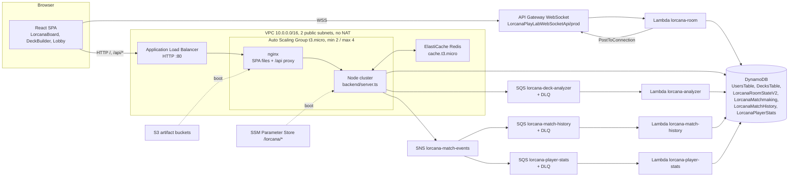

# Disney Lorcana PlayLab Cloud: รายงานวิเคราะห์ Codebase

วันที่ตรวจ: 2026-10-11 Branch: `claude/laughing-ramanujan-8o8olp` ที่ commit `384cab2`
วิธีการ: อ่านโค้ดในรีโพสิทอรีแบบ static เท่านั้น ไม่ได้ build, ติดตั้งแพ็กเกจ, deploy หรือเรียกใช้บริการบน AWS ใด ๆ โคลนที่ใช้ตรวจเป็นแบบ shallow (`git rev-parse --is-shallow-repository` ได้ผล `true` เห็นเพียง 50 commit) ข้อสรุปที่อิงประวัติ git จึงครอบคลุมเฉพาะ commit เหล่านั้น

ป้ายกำกับที่ใช้ในเอกสารนี้

- **ยืนยันแล้ว**: อ่านเจอในซอร์สโค้ดตามไฟล์และบรรทัดที่อ้างถึง
- **อนุมาน**: ข้อสรุปที่สมเหตุสมผลจากโค้ด แต่มองไม่เห็นโดยตรง
- **ไม่ทราบ / ต้องตรวจสอบ**: ขึ้นกับสถานะจริงบน AWS หรือพฤติกรรมตอนรัน ซึ่งอ่านจากรีโพสิทอรีไม่ได้

เลขบรรทัดอ้างอิงไฟล์ ณ commit ข้างต้น

**อัปเดต (วันเดียวกัน หลัง merge `t15-e2e-final-report`):** PR ถัดมาแก้ S1 (role admin ตามชื่อผู้ใช้), S7 (ข้อความ error ภายใน), S9 (race ตอนสมัคร), ตารางอันดับที่อ่านแค่ 100 รายการ, การสับไพ่ลำเอียงบนกระดาน, บั๊ก quest `lore || 1`, กฎกลับเข้าห้องของ WebSocket ตอน dev, TC-E2E-08, ไฟล์ `-` และ `.bak` ที่หลงมา และเพิ่ม CI สิ่งที่พบด้านล่างบรรยายโค้ดก่อนการแก้เหล่านั้น **อัปเดต 2026-10-12:** สร้าง stack ใหม่ด้วยสคริปต์ใน `scripts/` และตรวจจริง: health, cache MISS/HIT, E2E 54 ผ่านและ TC-E2E-23 ผ่านหลังแก้ event source mapping ที่ถูก Disabled (`ensure_pipeline.ps1` เปิดกลับให้อัตโนมัติ, PR #4), Auto Scaling ขยาย 2→3→4 และลดกลับเป็น 2 (`docs/01_Reports/stage3_evidence/`) เลขบรรทัดอ้างอิงใน handler ของกระดานยังไม่ได้ตรวจซ้ำหลังไฟล์ขยายเป็น 1,623 บรรทัด

---

## ภาพรวมแบบอ่านจบใน 5 นาที

**ระบบนี้คืออะไร** สนามซ้อมเล่นการ์ดเกม Disney Lorcana บนเบราว์เซอร์ สร้างเป็นโปรเจกต์วิชา Cloud Technology (1/2569) ของ KMITL ผู้เล่นค้นดูการ์ดจริง 3,242 ใบ จัดเด็ค เปิดซองการ์ดจำลอง ซ้อมเล่นคนเดียวบนโต๊ะเสมือน และเล่นกับผู้เล่นอีกคนแบบเรียลไทม์ได้ ผลการแข่งขันถูกส่งต่อไปเป็นประวัติการแข่ง สถิติรายผู้เล่น และตารางอันดับที่มีแคช

**ทำไมถึงมีระบบนี้** ตัวเกมเป็นพาหนะ สิ่งที่ถูกให้คะแนนคือสถาปัตยกรรมบน AWS เนื้อหาจำนวนมากในรีโพสิทอรี ทั้งสคริปต์ รายงาน และไฟล์หลักฐาน มีไว้พิสูจน์คุณสมบัติด้านคลาวด์ ได้แก่ Multi-AZ, auto scaling, การแยกส่วนด้วยคิว, การทำแคช, dead-letter queue และการคุมค่าใช้จ่ายให้อยู่ในงบของ AWS Academy Learner Lab

**สร้างอย่างไร สรุปในย่อหน้าเดียว** แอป React 19 แบบ single-page (Vite, Tailwind v4, Zustand) ถูกเสิร์ฟด้วย nginx บน EC2 หลัง Application Load Balancer เครื่องเดียวกันรัน Express server ตัวเดียว (`backend/server.ts` เรียกผ่าน `backend/cluster.ts`) ซึ่งรับทุกคำขอ REST ได้แก่ การยืนยันตัวตน เด็ค ธีมโต๊ะ การรายงานผลแข่ง สถิติ และตารางอันดับ ข้อมูลเก็บใน DynamoDB ส่วนการเล่นเรียลไทม์บน production ไม่แตะ EC2 เลย เบราว์เซอร์คุยกับ API Gateway WebSocket ซึ่งมี Lambda ตัวเดียว (`backend/serverless/room/handler.ts`) คอยส่งต่อข้อความระหว่างผู้เล่นสองคน เมื่อจบเกม ผลจะถูก publish ไปที่ SNS กระจายไปยัง SQS สองคิว แล้ว Lambda สองตัวดึงไปเขียนประวัติการแข่งและสถิติผู้เล่น การวิเคราะห์เด็คผ่าน SQS อีกคิวหนึ่งไปยัง Lambda อีกตัว ตารางอันดับถูกแคชไว้ใน ElastiCache Redis แบบโหนดเดียว

**5 เรื่องที่ควรเข้าใจเป็นอันดับแรก**

1. **เกมไม่ได้ให้ server เป็นผู้ตัดสิน** เบราว์เซอร์แต่ละฝั่งเก็บสถานะกระดานของตัวเองใน React `useState` (`src/components/LorcanaBoard.tsx`) แล้ว broadcast เหตุการณ์อย่าง `CARD_MOVED` หรือ `TURN_PASSED` ออกไป server แค่ส่งต่อ และเบราว์เซอร์ของผู้ชนะเป็นฝ่ายรายงานผล
2. **มีกฎเกมสองชุด** `src/game/engine.ts` เป็น reducer บริสุทธิ์ (`applyAction`) ที่มีเทสต์และเขียนกฎ Lorcana ไว้ครบกว่า แต่กระดานที่ผู้เล่นใช้จริงไม่ได้เรียกมัน กระดานมี handler ของตัวเองและตัวแปลความสามารถการ์ดที่ใช้ regex (`src/components/board/abilityResolver.ts`) โดยดึงเพียง helper ไม่กี่ตัวจาก `src/game`
3. **มีระบบเรียลไทม์สองชุด** production ใช้ API Gateway WebSocket + Lambda ส่วนตอนพัฒนาบนเครื่องใช้ `ws` server ภายใน `backend/server.ts` (บรรทัด 736-1166) ทั้งสองรับชื่อข้อความชุดเดียวกันแต่พฤติกรรมต่างกันเล็กน้อย
4. **REST ทุกเส้นอยู่ในไฟล์เดียว** `backend/server.ts` คือศูนย์กลาง และ `AGENTS.md` ระบุว่าตั้งใจให้เป็นแบบนี้ ("Unified Backend")
5. **โครงสร้างพื้นฐานถูกสร้างด้วยสคริปต์ PowerShell ไม่ใช่เครื่องมือ IaC แบบประกาศสถานะ** `scripts/deploy_ec2_vpc_asg.ps1`, `scripts/ensure_pipeline.ps1`, `scripts/ensure_cache.ps1` และ `scripts/lab.ps1` สร้าง อัปเดต และลบทุกอย่างด้วยการเรียก AWS CLI ส่วน SAM template ใน `backend/serverless/template.yaml` บรรยายโครงสร้างแบบ serverless ล้วนรุ่นเก่า ไม่ตรงกับที่ deploy อยู่ตอนนี้

**ระดับความพร้อม** เป็น MVP ที่ใช้งานได้ พร้อมผลทดลองด้านคลาวด์ที่วัดจริง (`docs/01_Reports/STAGE3_EXPERIMENT_RESULTS.md`) แต่ยังไม่พร้อมสำหรับ production เพราะไม่มี HTTPS, ทราฟฟิก WebSocket ไม่ยืนยันตัวตน, ผลแข่งรายงานจากฝั่งผู้เล่น, ไม่มี CI pipeline และคอมโพเนนต์กระดานยาว 1,599 บรรทัด

---

## 1. บทสรุปผู้บริหาร

| คำถาม | คำตอบ | หลักฐาน |
|---|---|---|
| ประเภทระบบ | เว็บแอป (SPA) พร้อม REST API, ตัวส่งต่อ WebSocket และ worker เบื้องหลังแบบ event-driven | `src/main.tsx`, `backend/server.ts`, `backend/serverless/*` |
| โดเมน | โต๊ะซ้อมเล่นและเครื่องมือจัดเด็คสำหรับ Disney Lorcana TCG | `README.md`, `src/game/*`, `src/assets/lorcana_cards.json` |
| ผู้ใช้หลัก | ผู้ประเมินรายวิชาเป็นอันดับแรก ผู้เล่น Lorcana เป็นอันดับรอง | `README.md` บรรทัด 18-28, `TEAM_WORKFLOW.md` |
| ระดับความพร้อม | MVP หรือต้นแบบเชิงวิชาการ มีหลักฐานการ deploy บน AWS จริง | `docs/01_Reports/stage3_evidence/*` |
| ภาษาหลัก | TypeScript (frontend, backend, Lambda), PowerShell (infra), Bash (บูต EC2), Python (สร้างรายงาน) | โครงสร้างไฟล์ |
| จุดแข็งที่สุด | เรื่องราวด้านคลาวด์ชัดเจนและมีผลทดลองรองรับ, ฟังก์ชัน `analyzeDeck` บริสุทธิ์ใช้ร่วมกันทั้ง EC2, Lambda และเบราว์เซอร์ | `backend/shared/deckAnalysis.ts` บรรทัด 1-3 |
| จุดอ่อนที่สุด | โมเดลความเชื่อถือ: ฝั่งผู้เล่นเป็นผู้กำหนดสถานะเกมและผลแข่ง และชั้น WebSocket ไม่มีการยืนยันตัวตน | `backend/serverless/README.md`, `backend/server.ts` บรรทัด 549-614 |

ความสามารถที่มีอยู่จริงในโค้ด: สมัครสมาชิกและเข้าสู่ระบบด้วย bcrypt และ JWT, จัดเด็คพร้อมตัวกรองและกฎห้ามเกิน 4 ใบ, บันทึก แสดงรายการ ลบ และวิเคราะห์เด็ค, จำลองการเปิดซอง, ดูการ์ดแบบ 3D, โหมดซ้อมคนเดียว, ห้องส่วนตัวรหัส 6 หลัก, คิวจับคู่, กลับเข้าห้องได้ภายใน 60 วินาที, โหวตย้อนการกระทำ, แชตในเกม, ทอยลูกเต๋าเลือกผู้เริ่ม, mulligan, publish ผลแข่ง, ประวัติการแข่ง, สถิติผู้เล่น, ตารางอันดับแบบ cache-aside บน Redis, ธีมโต๊ะผูกกับบัญชี, UI ภาษาไทยและอังกฤษ, ยกสิทธิ์ admin ด้วยรหัสผ่านพิเศษพร้อมหน้าค่าใช้จ่ายแบบตัวเลขคงที่

---

## 2. วัตถุประสงค์ของโปรเจกต์และกรณีใช้งานหลัก

### อธิบายแบบภาษาคน

Lorcana เป็นเกมการ์ดสำหรับสองคน แต่ละคนใช้เด็ค 60 ใบ วางการ์ดบางใบคว่ำลงเป็น "ink" ซึ่งเป็นทรัพยากร ใช้ ink ลงตัวละคร แล้วส่งตัวละครไป "quest" เพื่อเก็บ "lore" ใครได้ 20 lore ก่อนชนะ ตัวละครยัง "challenge" ตัวละครฝ่ายตรงข้ามที่ถูก exert อยู่เพื่อสร้างความเสียหายได้ด้วย

แอปนี้ช่วยให้ผู้ใช้

1. ค้นดูการ์ดใดก็ได้และอ่านข้อความบนการ์ด เป็นภาษาอังกฤษหรือคำแปลภาษาไทย
2. จัดเด็คและดูการตรวจสุขภาพเด็คเบื้องต้น เช่น เส้นค่าร่าย สีหมึก สัดส่วนตัวละคร
3. ซ้อมบนโต๊ะเสมือนโดยไม่มีคู่แข่ง
4. เล่นกับคนจริงออนไลน์ ทั้งแบบแชร์รหัสห้องหรือเข้าคิวจับคู่
5. ดูสถิติแพ้ชนะและอันดับของตัวเอง

### กรณีใช้งานหลัก

| กรณีใช้งาน | ผู้กระทำ | ผลลัพธ์ |
|---|---|---|
| สมัคร / เข้าสู่ระบบ | ผู้เยี่ยมชม | JWT เก็บใน `sessionStorage` และข้อมูลผู้ใช้ใน DynamoDB `UsersTable` |
| จัดและบันทึกเด็ค | ผู้ใช้ที่ล็อกอิน | รายการเด็คใน `DecksTable` พร้อมผลวิเคราะห์ฝังอยู่ |
| วิเคราะห์เด็ค | ผู้ใช้ที่ล็อกอิน | คำนวณแบบ synchronous ตอนบันทึก, คำนวณซ้ำแบบ asynchronous ผ่าน SQS/Lambda และคำนวณในเบราว์เซอร์เมื่อเปิดดู |
| ซ้อมในโหมด sandbox | ทุกคน | กระดานอยู่ในเครื่องอย่างเดียว คู่แข่งจำลองด้วย timer ที่เพิ่ม lore ทีละ 1 ต่อเทิร์น |
| เล่นออนไลน์ | ผู้ใช้สองคน (lobby ยอมให้ guest เข้า) | ข้อความถูกส่งต่อผ่าน API Gateway WebSocket และสถานะสะท้อนอยู่ในเบราว์เซอร์แต่ละฝั่ง |
| รายงานผลแข่ง | เบราว์เซอร์ของผู้ชนะ | เกิด event บน SNS แล้ว Lambda เขียนแถวประวัติและสถิติ |
| ดูตารางอันดับ | ทุกคน | 25 อันดับแรกจาก `LorcanaPlayerStats` แคชใน Redis 60 วินาที |
| หน้าค่าใช้จ่ายของ admin | ผู้ใช้ที่มีรหัส admin | ตัวเลขค่าใช้จ่ายคงที่ ไม่ใช่ข้อมูลสดจาก AWS |

### คุณค่าที่ส่งมอบ

สำหรับผู้เล่น: ลองเด็คกับเพื่อนผ่านเบราว์เซอร์ได้ฟรี สำหรับรายวิชา: ระบบขนาดกะทัดรัดที่ได้ใช้บริการ AWS แทบทุกตัวที่หลักสูตรกำหนด ภายใต้งบที่จำกัด

---

## 3. Technology Stack

เวอร์ชันในตารางคือเวอร์ชันที่ resolve แล้วจาก `package-lock.json` และ `backend/package-lock.json`

| ชั้น                            | เทคโนโลยี                                                                     | เวอร์ชัน                                                     | หน้าที่                                                                   | หลักฐาน                                                        |
| ------------------------------- | ----------------------------------------------------------------------------- | ------------------------------------------------------------ | ------------------------------------------------------------------------- | -------------------------------------------------------------- |
| ภาษา                            | TypeScript                                                                    | 5.9.3                                                        | โค้ดแอปทั้งหมด                                                            | `tsconfig.json`, `backend/tsconfig.json`                       |
| Frontend framework              | React                                                                         | 19.2.8                                                       | UI                                                                        | `src/main.tsx`                                                 |
| Build tool / dev server         | Vite                                                                          | 6.4.3                                                        | bundle และใส่ hash ให้ไฟล์ข้อมูลการ์ดด้วย `?url`                          | `vite.config.ts`, `src/data/cardPool.ts` บรรทัด 8              |
| Styling                         | Tailwind CSS v4 ผ่าน `@tailwindcss/vite`                                      | 4.3.3                                                        | utility class และ theme token ใน `@theme`                                 | `src/index.css` บรรทัด 1-29                                    |
| Animation                       | framer-motion                                                                 | 12.43.0                                                      | การเคลื่อนการ์ดและ modal                                                  | `src/components/LorcanaBoard.tsx` บรรทัด 2                     |
| Icons                           | lucide-react                                                                  | 0.474.0                                                      | ไอคอน                                                                     | `src/App.tsx` บรรทัด 18                                        |
| Client state                    | Zustand                                                                       | 5.0.14                                                       | auth, เด็คที่กำลังแก้, ธีมโต๊ะ, ภาษา                                      | `src/store/*`                                                  |
| กราฟิก                          | WebGL (native)                                                                | n/a                                                          | shader พื้นหลังแบบเคลื่อนไหว                                              | `src/components/GoldInkShaderCanvas.tsx`                       |
| HTTP client                     | `fetch` (native)                                                              | n/a                                                          | เรียก REST                                                                | `src/services/api.ts`                                          |
| Realtime client                 | `WebSocket` (native)                                                          | n/a                                                          | ทราฟฟิกในแมตช์                                                            | `src/services/websocket.ts`                                    |
| Backend runtime                 | Node.js                                                                       | 20 (Docker image, Lambda runtime), bundle ตั้ง target node18 | server และ Lambda                                                         | `Dockerfile` บรรทัด 4, `scripts/lab.ps1` บรรทัด 95             |
| Backend framework               | Express                                                                       | 4.22.2                                                       | routing ของ REST                                                          | `backend/server.ts` บรรทัด 1                                   |
| WebSocket server (dev เท่านั้น) | ws                                                                            | 8.21.3                                                       | ส่งต่อข้อความเรียลไทม์บนเครื่อง                                           | `backend/server.ts` บรรทัด 736-737                             |
| โมเดล process                   | Node `cluster`                                                                | stdlib                                                       | หนึ่ง worker ต่อ vCPU                                                     | `backend/cluster.ts`                                           |
| Auth                            | bcryptjs + jsonwebtoken (HS256)                                               | 2.4.3 / 9.0.3                                                | hash รหัสผ่านและออก token                                                 | `backend/server.ts` บรรทัด 168, 252-256                        |
| ฐานข้อมูล                       | Amazon DynamoDB ผ่าน `@aws-sdk/lib-dynamodb`                                  | 3.1110.0                                                     | ข้อมูลถาวรทั้งหมด                                                         | `backend/server.ts` บรรทัด 8-28                                |
| คิว                             | Amazon SQS                                                                    | 3.1110.0                                                     | งานวิเคราะห์เด็ค, ปลายทางของ fan-out ผลแข่ง, DLQ                          | `backend/server.ts` บรรทัด 378, `scripts/ensure_pipeline.ps1`  |
| Pub/sub                         | Amazon SNS                                                                    | 3.1142.0                                                     | กระจาย event `match.finished`                                             | `backend/server.ts` บรรทัด 592-611                             |
| แคช                             | ElastiCache Redis (โหนดเดียว `cache.t3.micro`) ผ่าน ioredis                   | 6.0.0                                                        | cache-aside ของตารางอันดับ                                                | `backend/shared/cache.ts`, `scripts/ensure_cache.ps1`          |
| Serverless compute              | AWS Lambda (Node 20)                                                          | n/a                                                          | ส่งต่อห้อง WebSocket, analyzer, ประวัติแข่ง, สถิติ และ auth/deck รุ่นเก่า | `backend/serverless/*`                                         |
| ช่องทางเรียลไทม์ (prod)         | API Gateway WebSocket API `LorcanaPlayLabWebSocketApi` stage `prod`           | n/a                                                          | ส่งต่อข้อความในแมตช์                                                      | `backend/serverless/README.md`, `scripts/lab.ps1` บรรทัด 85-92 |
| Web server                      | nginx                                                                         | แพ็กเกจของ Amazon Linux 2023                                 | เสิร์ฟ SPA, reverse proxy `/api/`, gzip, cache header                     | `scripts/ec2_user_data.sh` บรรทัด 58-119                       |
| Compute                         | EC2 `t3.micro` ใน Auto Scaling Group (ต่ำสุด 2 สูงสุด 4)                      | n/a                                                          | ชั้นเว็บและ API                                                           | `scripts/deploy_ec2_vpc_asg.ps1`                               |
| Load balancer                   | Application Load Balancer, health check ที่ `/api/health`                     | n/a                                                          | ทางเข้าแบบ Multi-AZ                                                       | `scripts/deploy_ec2_vpc_asg.ps1` บรรทัด 119                    |
| เครือข่าย                       | VPC 10.0.0.0/16, public subnet 2 ชุด, ไม่มี NAT gateway                       | n/a                                                          | ประหยัดค่าใช้จ่าย                                                         | `scripts/deploy_ec2_vpc_asg.ps1` บรรทัด 9-11                   |
| Secret                          | SSM Parameter Store (`/lorcana/*`)                                            | n/a                                                          | JWT secret, รหัส admin, URL คิว, ARN ของ topic, endpoint แคช              | `scripts/ec2_user_data.sh` บรรทัด 14-22                        |
| ที่เก็บไฟล์ build               | S3 bucket `lorcana-playlab-static-<acct>` และ `lorcana-playlab-assets-<acct>` | n/a                                                          | SPA ที่ build แล้วและ bundle ของ backend ถูกดึงตอนบูต                     | `scripts/ec2_user_data.sh` บรรทัด 10-11                        |
| Monitoring                      | CloudWatch alarm แบบ target tracking (CPU 60%) และ alarm `UnHealthyHostCount` | n/a                                                          | หลักฐานด้าน scaling และ HA                                                | `scripts/deploy_ec2_vpc_asg.ps1` บรรทัด 215-228                |
| Logging                         | `console.log` ออก stdout (journald บน EC2, CloudWatch Logs บน Lambda)         | n/a                                                          | ดีบัก                                                                     | `backend/server.ts` บรรทัด 76                                  |
| Unit test                       | Vitest + jsdom + Testing Library                                              | 4.1.11                                                       | เทสต์ frontend และ backend                                                | `vitest.config.ts`                                             |
| E2E test                        | Playwright                                                                    | 1.62.1                                                       | เทสต์บนเบราว์เซอร์ ทั้งบนเครื่องและยิงไปที่ ALB                           | `playwright.config.ts`                                         |
| เครื่องมือ infra                | PowerShell + AWS CLI, esbuild ผ่าน `npx`                                      | n/a                                                          | deploy, publish, destroy                                                  | `scripts/*.ps1`                                                |
| Container                       | Docker (multi-stage)                                                          | node:20-alpine                                               | มีไฟล์แต่ไม่ใช่เส้นทาง deploy จริง                                        | `Dockerfile`, `docker-compose.yml`                             |
| CI/CD                           | GitHub Actions (check: tsc, vitest, build)                                                             | n/a                                                          | `.github/workflows/ci.yml` (เพิ่มใน PR #2)                                                  | root ของรีโพสิทอรี                                             |

ชิ้นส่วนเหล่านี้ทำงานร่วมกันอย่างไร: Vite build SPA โดยตั้ง `VITE_WS_ENDPOINT` ชี้ไปที่ API Gateway และ `VITE_API_BASE_URL=/api` (`scripts/lab.ps1` บรรทัด 91-92) esbuild รวม `backend/cluster.ts` เป็น `server.cjs` ทั้งสองถูกอัปโหลดขึ้น S3 ตอนบูต EC2 จะดึงไฟล์ลงมา เขียน `/etc/lorcana.env` จาก SSM แล้วเริ่ม backend ด้วย systemd

สิ่งที่ปรากฏในรีโพสิทอรีแต่ไม่ได้ใช้งานจริง

- **Docker**: `Dockerfile` build image ของ backend ได้ แต่ EC2 รัน `server.cjs` ตรง ๆ ผ่าน systemd ส่วน `docker-compose.yml` อ้างถึง `Dockerfile.backend` และ `Dockerfile.frontend` ซึ่งไม่มีอยู่จริง ขณะที่ `AGENTS.md` ยังระบุ Docker ไว้ในบรรทัดสถาปัตยกรรม (ยืนยันแล้ว)
- **SAM template**: `backend/serverless/template.yaml` นิยามตารางชื่อ `LorcanaUsers`, `LorcanaDecks`, `LorcanaRoomState` และ HTTP API แต่โค้ดที่รันจริงใช้ `UsersTable`, `DecksTable`, `LorcanaRoomStateV2` ให้ถือว่า template นี้เป็นประวัติ (ยืนยันแล้ว)
- **Chart.js**: ถูกกล่าวถึงใน `TEAM_WORKFLOW.md` แต่ไม่ได้เป็น dependency กราฟทั้งหมดเขียนเอง
- **S3 static website hosting / CloudFront**: CloudFront ถูกบล็อกใน Learner Lab (`STAGE3_EXPERIMENT_RESULTS.md` หัวข้อ 12 ข้อ 8) S3 ใช้เป็นที่เก็บไฟล์ build เท่านั้น

---

## 4. แผนที่รีโพสิทอรี

### ระดับบนสุด

| Path | หน้าที่ |
|---|---|
| `src/` | React SPA, service ฝั่ง client, store, game engine, เทสต์ |
| `backend/` | Express server, จุดเริ่ม cluster, โมดูลที่ใช้ร่วมกัน, ซอร์ส Lambda, เทสต์ backend |
| `scripts/` | วงจรชีวิตโครงสร้างพื้นฐาน (PowerShell), user data ของ EC2 (Bash), สคริปต์วัดผล, สคริปต์สร้างรายงาน |
| `e2e/` | Playwright spec |
| `qa/` | Playwright reporter ที่เขียนเอง, master test sheet, AWS runner, dashboard server |
| `docs/` | รายงาน (LaTeX, PDF, DOCX, Markdown), สไลด์, แผน QA, PDF กติกา, log หลักฐาน, spec |
| `public/` | รูปภาพ static: หลังการ์ด, สัญลักษณ์หมึก, artwork, โลโก้ |
| `SymbolDisneylorcana/` | สำเนาซ้ำของรูปสัญลักษณ์หมึกที่มีอยู่ใน `public/SymbolDisneylorcana/` แล้ว |
| `scratch/` | บันทึกการวางแผน อยู่ใน `.gitignore` แต่ยังถูก track |
| `-` | ไฟล์ DOCX ขนาด 11 KB ที่ commit ไว้ภายใต้ชื่อไฟล์ `-` (ยืนยันจาก header `PK`/`[Content_Types].xml`) น่าจะเป็นอุบัติเหตุ |
| เอกสารที่ root | `README.md`, `AGENTS.md`, `CASE_STUDY.md`, `PLAN_PROJECT.md`, `TEAM_WORKFLOW.md`, `design.md` |
| config ที่ root | `package.json`, `vite.config.ts`, `vitest.config.ts`, `playwright.config.ts`, `tsconfig.json`, `nginx.conf`, `Dockerfile`, `docker-compose.yml`, `.env.example` |

ส่วนที่เป็นไฟล์ที่สร้างขึ้นหรือขนาดใหญ่ซึ่งข้ามได้: `docs/01_Reports/*.pdf|.docx`, `docs/04_References/extracted_ref_images/`, `docs/02_Slides/*.html`, `src/assets/lorcana_cards.json` (ข้อมูล 2.28 MB), `src/components/LorcanaBoard.tsx.bak`

### Frontend: `src/`

| ไฟล์ | หน้าที่ | export หลัก | ถูก import โดย | พึ่งพา | ความสำคัญ |
|---|---|---|---|---|---|
| `main.tsx` | mount React ใน `StrictMode` | ไม่มี | `index.html` | `App.tsx`, `index.css` | จุดเริ่มต้น |
| `App.tsx` | layout ระดับบนและทำหน้าที่ "router" | `App` | `main.tsx` | คอมโพเนนต์ทุกหน้า, `webSocketService`, store | การนำทางเป็น `useState` ชื่อ `activeTab` (บรรทัด 21) ตั้งค่าเริ่มจาก `?tab=` |
| `services/api.ts` | REST client | `apiService` | หน้าต่าง ๆ, store | `fetch`, `types/lorcana` | ทุกการเรียก HTTP ผ่านไฟล์นี้ base URL มาจาก `VITE_API_BASE_URL` (บรรทัด 3) |
| `services/websocket.ts` | WebSocket client แบบ singleton | `webSocketService` | lobby, กระดาน, ลูกเต๋า, แชต, navbar | `WebSocket` native | การเชื่อมต่อ, คิวข้อความ, reconnect, heartbeat, pub/sub ตามชื่อ action |
| `store/useAuthStore.ts` | สถานะ auth | `useAuthStore` | คอมโพเนนต์ส่วนใหญ่ | `sessionStorage`, `localStorage` | แหล่งของ `token` และ `user` |
| `store/useDeckStore.ts` | เด็คที่กำลังแก้ | `useDeckStore` | `DeckBuilder`, `AnalyticsDashboard` | Zustand | บังคับไม่เกิน 4 ใบต่อการ์ด (บรรทัด 31) |
| `store/usePlaymatStore.ts` | ธีมโต๊ะที่เลือก | `usePlaymatStore` | `App`, กระดาน | `apiService`, `useAuthStore` | บันทึกไว้ที่ server ไม่ใช่ในเบราว์เซอร์ |
| `store/useLanguageStore.ts` | ข้อความไทย/อังกฤษ | `useLanguageStore` | คอมโพเนนต์ส่วนใหญ่ | Zustand | key แปลภาษา 598 บรรทัด |
| `game/types.ts` | type ของ engine | `GameState`, `GameAction`, `GamePrompt` ฯลฯ | engine, กระดาน, เทสต์ | `types/lorcana` | สัญญาของ engine บริสุทธิ์ |
| `game/rules.ts` | ตรวจความถูกต้องตามกติกา | `isCardInkable`, `canInkCard`, `canPlayCard`, `canQuest`, `canChallenge` | engine, กระดาน | `keywords.ts` | ใช้ร่วมกันระหว่าง engine และกระดาน |
| `game/keywords.ts` | แยก keyword 14 ตัวจากข้อความการ์ด | `parseCardKeywords`, `getEffectiveStrength`, `getEffectiveDamage` | engine, rules, กระดาน | ไม่มี | regex ที่ใช้ word boundary |
| `game/abilities.ts` | แยกจังหวะและผลของความสามารถ | `parseAbility`, `parseCardAbilities` | engine, สคริปต์วัด coverage | `keywords.ts` | ฐานของตัวเลข "full support 16.16%" |
| `game/engine.ts` | reducer บริสุทธิ์ `applyAction(state, action)` | `applyAction`, `createInitialState` | เทสต์เท่านั้น (ยืนยันด้วย grep) | rules, keywords, abilities | โครงสร้างดี แต่ไม่ได้ต่อกับ UI |
| `components/LorcanaBoard.tsx` | โต๊ะเล่นเกม (1,623 บรรทัด ณ 2026-10-12) | `LorcanaBoard`, `LorcanaCard`, `SavedBoardState` | `App.tsx` | คอมโพเนนต์ย่อย 20 ตัว, store, service, helper จาก `src/game` | เป็นเจ้าของสถานะเกมทั้งหมดขณะเล่น |
| `components/board/useLorcanaWebSocket.ts` | subscribe event WS ราว 30 ชนิดให้กระดาน | `useLorcanaWebSocket` | `LorcanaBoard` | `webSocketService`, `apiService` | แปลงข้อความจากอีกฝั่งเป็นสถานะในเครื่อง |
| `components/board/abilityResolver.ts` | ผลของความสามารถแบบ regex สำหรับกระดานจริง | `resolveCardAbilities` | `LorcanaBoard` | `parseCardKeywords`, `webSocketService` | การแปลความสามารถชุดที่สอง |
| `components/board/*` (ที่เหลือ) | ส่วนแสดงผล: แถบบน, สนามสองฝั่ง, มือการ์ด, inkwell, modal, แชต, log, โหวต undo, overlay เมื่อหลุด | หลายตัว | `LorcanaBoard` | props | ผลจากการ refactor (`scripts/refactor_board.py`) |
| `components/MatchLobby.tsx` | สร้าง/เข้าห้อง, จับคู่, กลับเข้าห้อง | `MatchLobby` | `App` | `webSocketService`, `apiService`, `matchSession` | ทางเข้าสู่การเล่นออนไลน์ |
| `components/DeckBuilder.tsx` | ค้นการ์ด, แก้เด็ค, บันทึก, poll ผลวิเคราะห์ | `DeckBuilder` | `App` | `useDeckStore`, `apiService`, card pool | ฟีเจอร์เด็คหลัก |
| `components/AnalyticsDashboard.tsx` | หน้าวิเคราะห์เด็ค | `AnalyticsDashboard` | `App` | `analyzeDeck` ที่ import จาก `backend/shared` (บรรทัด 7) | ฟังก์ชันเดียวกับ server และ Lambda |
| `components/UserDashboard.tsx` | โปรไฟล์, เด็ค, ประวัติแข่ง, สถิติ, ตารางอันดับ, ฟอร์มล็อกอิน | `UserDashboard` | `App` | `apiService` | ฝั่งอ่านของ event pipeline |
| `components/AdminBillingDashboardModal.tsx` | รหัส admin และหน้าค่าใช้จ่าย | modal | `UserDashboard` | `apiService` | แสดงข้อมูลคงที่ |
| `components/BoosterPackModal.tsx` | เปิดซองด้วย Fisher-Yates shuffle | modal | `DeckBuilder` | card pool | Fisher-Yates แท้ที่เดียวใน codebase (บรรทัด 59) |
| `components/Card3DInspectorModal.tsx`, `DeckViewerModal.tsx`, `DiceDuelModal.tsx`, `GameOverModal.tsx`, `MulliganModal` | modal ของฟีเจอร์ต่าง ๆ | modal | หลายที่ | framer-motion, WS service | ชั้น UX |
| `components/GameHub.tsx`, `Navbar.tsx`, `RulesGuide.tsx`, `PatchNotesModal.tsx`, `ArtworkCarousel.tsx`, `GoldInkShaderCanvas.tsx` | หน้าแรก, การนำทาง, เนื้อหาคงที่, ภาพประกอบ | คอมโพเนนต์ | `App` | store | การตลาด/UX |
| `data/cardPool.ts` | โหลดและ normalize ข้อมูลการ์ด 3,242 ใบครั้งเดียว | `fetchRawDataset`, `fetchCardPool`, `toPoolCard`, `enrichCard`, `STARTER_POOL` | กระดาน, deck builder | `assets/lorcana_cards.json?url` | ใช้ promise ดาวน์โหลดร่วมกัน (บรรทัด 13-26) |
| `data/recommendedDecks.ts`, `playmats.ts`, `lorcanaKeywords.ts`, `patchNotes.ts` | ข้อมูลคงที่ | ค่าคงที่ | หลายที่ | ไม่มี | เนื้อหา |
| `utils/cardTranslator.ts` | แปลข้อความความสามารถเป็นไทย | ฟังก์ชันแปล | กระดาน, หน้าดูการ์ด | ไม่มี | ตารางแปล 662 บรรทัด |
| `utils/matchSession.ts` | key สำหรับกลับเข้าห้องแยกตามบัญชี | `activeSessionKey` | `App`, lobby | ไม่มี | กันสองแท็บใช้ข้อมูลกลับเข้าห้องปนกัน |
| `utils/copyText.ts` | คัดลอกข้อความ พร้อมทางสำรองสำหรับ HTTP | `copyText` | lobby | DOM | จำเป็นเพราะ ALB เสิร์ฟผ่าน HTTP ธรรมดา |
| `types/lorcana.ts` | type ที่ใช้ทั้งแอป | `LorcanaCard`, `UserProfile`, type ของ payload WS | ทุกที่ | ไม่มี | สัญญาฝั่ง frontend |
| `__tests__/*`, `tests/setup.ts`, `tests/mocks/awsMocks.ts` | unit test, component test, polyfill ของ jsdom | n/a | Vitest | n/a | ดูหัวข้อ 13 |

### Backend: `backend/`

| ไฟล์ | หน้าที่ | หมายเหตุ |
|---|---|---|
| `cluster.ts` | จุดเริ่มบน production fork หนึ่ง worker ต่อ `os.availableParallelism()` ถ้า worker ใดตาย primary จะออกด้วย เพื่อให้ systemd รีสตาร์ตทั้ง service | บรรทัด 6-15 เพิ่มหลังวัดได้ว่า CPU ติดเพดาน 50% บนเครื่อง 2 vCPU |
| `server.ts` | REST ทุกเส้น, middleware auth, rate limiter ของ login ในหน่วยความจำ, ตัวส่งต่อ WebSocket สำหรับ dev | 1,178 บรรทัด router ถูก mount ทั้งที่ `/` และ `/api` (บรรทัด 732-733) |
| `shared/deckAnalysis.ts` | ฟังก์ชันบริสุทธิ์ `analyzeDeck(cards, now)` | ถูก import โดย `server.ts`, `serverless/analyzer` และ frontend |
| `shared/cache.ts` | ioredis singleton แบบ lazy, ตั้งให้ล้มเร็ว, get/set ตารางอันดับ | `enableOfflineQueue: false` และ `retryStrategy: () => null` (บรรทัด 33-75) |
| `serverless/room/handler.ts` | Lambda ของ WebSocket บน production | 571 บรรทัด |
| `serverless/analyzer/handler.ts` | consumer ของ SQS: คำนวณผลวิเคราะห์เด็คใหม่ | รายงาน partial batch failure |
| `serverless/match-history/handler.ts` | consumer ของ SQS (จาก SNS): เขียนแถวประวัติสองแถว | ไม่ได้ออกแบบให้ idempotent แต่ `PutCommand` เขียนทับ key เดิม จึงปลอดภัย |
| `serverless/player-stats/handler.ts` | consumer ของ SQS (จาก SNS): เพิ่มตัวนับสถิติแบบ idempotent | แถวกันซ้ำ `DEDUPE#<matchId>` |
| `serverless/auth/*`, `serverless/deck/handler.ts` | Lambda ของ HTTP API รุ่นเก่า | README บอกว่ายัง deploy อยู่ แต่ SPA ปัจจุบันไม่เรียก (ใช้ `/api` origin เดียวกัน) |
| `serverless/template.yaml`, `mkdeckzip.py` | SAM template รุ่นเก่า, ตัวช่วยสร้าง zip | ไม่ตรงกับการ deploy จริง |
| `__tests__/*` | เทสต์ backend | `auth.test.ts` บูต server จริงด้วย `tsx` |

### Infrastructure: `scripts/`

| ไฟล์ | หน้าที่ |
|---|---|
| `deploy_ec2_vpc_asg.ps1` | สร้าง stack ครั้งเดียว: SSM secret (สุ่ม 48 byte), pipeline, VPC, subnet, IGW, security group, ALB, target group, launch template (บังคับ IMDSv2), ASG, scaling policy, alarm จะไม่ทำงานถ้า VPC มีอยู่แล้ว |
| `ensure_pipeline.ps1` | รันซ้ำได้: ตาราง `LorcanaMatchHistory` และ `LorcanaPlayerStats`, คิว SQS พร้อม DLQ (maxReceiveCount 3), SNS topic และ subscription, สร้าง/อัปเดต Lambda, event source mapping ที่เปิด `ReportBatchItemFailures` |
| `ensure_cache.ps1` | subnet group ของ ElastiCache, security group, Redis โหนดเดียว, เขียน `/lorcana/cache-endpoint` |
| `lab.ps1` | `start`, `stop`, `status`, `publish`, `lambdas`, `destroy` โดย `publish` คือ pipeline การ deploy (หัวข้อ 14) |
| `lab_start.ps1`, `lab_stop.ps1`, `lab_destroy.ps1` | wrapper สามบรรทัดที่เรียก `lab.ps1` |
| `ec2_user_data.sh` | บูต EC2: ติดตั้งแพ็กเกจ, ดึงไฟล์ build จาก S3, อ่าน SSM, เขียน systemd unit และ config ของ nginx |
| `stress_test.ps1`, `test_asg_recovery.ps1`, `test_dlq.ps1` | การทดลองด้าน scaling, failover และ DLQ |
| `measure_ability_coverage.ts`, `measure_leaderboard.mjs` | สคริปต์วัดผลที่สร้างไฟล์ JSON หลักฐาน |
| `build_stage2_report_latest.py`, `build_stage3_report.py`, `refactor_board.py` | เครื่องมือใช้ครั้งเดียว |

---

## 5. ภาพรวมสถาปัตยกรรม

### รูปแบบ

โค้ดเป็น **ระบบ client-server ที่ใช้ modular monolith สำหรับ REST, ใช้ serverless relay สำหรับเรียลไทม์ และใช้ back end แบบ event-driven สำหรับข้อมูลที่คำนวณต่อ** ฝั่ง frontend เป็น **thick client** คือมีตรรกะของเกมอยู่ในตัวและเป็นแหล่งความจริงของสถานะแมตช์

ในโค้ดไม่ใช่ Clean Architecture หรือ Hexagonal Architecture แม้ `CASE_STUDY.md` จะบรรยายว่าเป็น "Hexagonal Architecture (Ports & Adapters)" route handler เรียก DynamoDB client ตรง ๆ ไม่มีชั้น port/adapter รอยต่อที่สะอาดจุดเดียวคือ `backend/shared/deckAnalysis.ts` ซึ่งเป็นฟังก์ชันบริสุทธิ์ที่รับเวลาเข้ามาเป็นพารามิเตอร์

### แผนภาพ



### ชั้นต่าง ๆ และหน้าที่

| ชั้น | เป็นเจ้าของ | ไม่ได้เป็นเจ้าของ |
|---|---|---|
| SPA (`src/`) | UI, การนำทาง, กติกาเกมตามที่เล่นจริง, สถานะแมตช์, การตัดสินผู้ชนะ | การเก็บข้อมูลถาวร, การตัดสินเรื่องสิทธิ์ |
| nginx | ไฟล์ static, การบีบอัด, cache header, proxy `/api/`, security header | ตรรกะทางธุรกิจ |
| Express (`backend/server.ts`) | ตรวจข้อมูลเข้า, ตรวจ JWT, อ่านเขียน DynamoDB สำหรับผู้ใช้/เด็ค/ธีมโต๊ะ, publish event, cache-aside ของตารางอันดับ | การส่งต่อเรียลไทม์บน production, การเขียนประวัติและสถิติ |
| Room Lambda | สมาชิกในห้อง, การจับคู่, ส่งต่อข้อความใด ๆ, บันทึกการหลุดและกลับเข้าห้อง | กติกาเกม, การยืนยันตัวตน |
| Worker Lambda | วิเคราะห์เด็ค, แถวประวัติแข่ง, ตัวนับสถิติ | งานแบบ synchronous ทุกชนิด |
| DynamoDB | สถานะถาวรทั้งหมด | transaction ข้ามรายการ (ไม่ได้ใช้) |

### ทิศทางการพึ่งพา

`src/components` → `src/services`, `src/store`, `src/game`, `src/data` ส่วน `src/game` ไม่พึ่งอะไรนอกตัวเองนอกจาก `src/types` frontend ยัง import `backend/shared/deckAnalysis.ts` ด้วย (เป็นการข้ามขอบเขตขึ้นไปจุดเดียว ตั้งใจเพื่อใช้โค้ดร่วมกัน) โมดูล backend พึ่ง `backend/shared` และไม่มีโมดูลใดพึ่ง `src/components`

### จุดแข็ง

- ชั้นเว็บบน EC2 ไม่เก็บสถานะ: session เป็น JWT ส่วนเรียลไทม์อยู่นอกเครื่อง จึงปิดเครื่องใดก็ได้โดยแมตช์ไม่หลุด ยืนยันด้วยการทดลอง failover (`STAGE3_EXPERIMENT_RESULTS.md` หัวข้อ 4)
- ฟังก์ชันวิเคราะห์บริสุทธิ์ตัวเดียวใช้ได้สามสภาพแวดล้อม
- เส้นทาง asynchronous มี DLQ และรายงาน partial batch failure
- client ของแคชล้มเร็ว เมื่อ Redis ล่มระบบจึงถอยไปใช้ DynamoDB แทนที่จะค้าง

### จุดอ่อนและการผูกติดกัน

- `LorcanaBoard.tsx` ผูก UI, กติกา, เครือข่าย, การเก็บข้อมูล และ undo ไว้ในคอมโพเนนต์เดียวที่มี `useState` ประมาณ 60 ตัว
- ชื่อข้อความเป็น string ที่ใช้ร่วมกันแบบไม่เป็นทางการในสี่ที่: `websocket.ts`, `useLorcanaWebSocket.ts`, ส่วน WS ใน `server.ts` และ `room/handler.ts` ไม่มี enum หรือ schema กลาง
- ทุกข้อความขาออกใส่ค่าเดียวกันลงใน `action`, `gameAction`, `realAction` และ `type` (`websocket.ts` บรรทัด 338-354) ฝั่งรับก็ตรวจทั้งสี่ช่อง เป็นการป้องกันซ้ำซ้อนที่หลงเหลือจากปัญหา route ไม่ตรงกันในอดีต
- กติกาเกมสองชุด (หัวข้อ 11)
- infra เป็นแบบ imperative และเริ่มเห็นความไม่ตรงกันระหว่างสคริปต์, SAM template และ README แล้ว

---

## 6. รายการฟีเจอร์ทั้งหมด

สถานะที่ใช้: **มีครบ**, **บางส่วน**, **ข้อมูลคงที่/จำลอง**, **รุ่นเก่า**, **dev เท่านั้น**

| ฟีเจอร์ | จุดประสงค์ | สถานะ | จุดเข้า | คอมโพเนนต์หลัก | API / ข้อมูลที่พึ่ง |
|---|---|---|---|---|---|
| สมัครสมาชิก | สร้างบัญชี | มีครบ | `AuthModal`, `UserDashboard` | `apiService.register` | `POST /auth/register` → `UsersTable` |
| เข้าสู่ระบบ | รับ JWT | มีครบ | `AuthModal`, `UserDashboard` | `apiService.login`, `useAuthStore.setAuth` | `POST /auth/login` |
| ค้นดูการ์ด | หาการ์ด | มีครบ | `DeckBuilder` | `fetchFullDataset`, ตัวกรองใน `useDeckStore` | ไฟล์ JSON ที่มี hash |
| แก้ไขเด็ค | จัดเด็ค 60 ใบ | มีครบ | `DeckBuilder` | `useDeckStore.addCard/removeCard` | ในหน่วยความจำ |
| บันทึกเด็ค | เก็บเด็คถาวร | มีครบ (แต่สร้างเด็คใหม่ทุกครั้ง) | `DeckBuilder` | `apiService.saveDeck` | `POST /decks` → `DecksTable` + SQS |
| รายการ/ลบเด็ค | จัดการเด็ค | มีครบ | `UserDashboard`, `MatchDeckSelect` | `getUserDecks`, `deleteDeck` | `GET /decks`, `DELETE /decks/:id` |
| วิเคราะห์เด็ค | เส้นค่าร่าย, สีหมึก, คะแนน synergy | มีครบ (สามเส้นทาง) | `DeckBuilder`, `AnalyticsDashboard` | `analyzeDeck` | `POST /decks/:id/analyze`, `GET /decks/:id/analysis`, SQS analyzer |
| เด็คแนะนำ | รายการเด็คเริ่มต้น | มีครบ (ข้อมูลคงที่) | `DeckBuilder` / dashboard | `data/recommendedDecks.ts` | ไม่มี |
| เปิดซองการ์ด | จำลองการเปิดซอง | มีครบ (ฝั่ง client อย่างเดียว) | `DeckBuilder` | `BoosterPackModal` | ข้อมูลการ์ด |
| ดูการ์ด 3D | เอียงการ์ดและเอฟเฟกต์ฟอยล์ | มีครบ | `DeckBuilder`, `DeckViewerModal` | `Card3DInspectorModal` | ไม่มี |
| โหมดซ้อม | ซ้อมคนเดียว | มีครบ | แท็บ `board` ใน `App` โดยไม่มี `matchInfo` | `LorcanaBoard` (`matchMode=false`) | ไม่มี คู่แข่งจำลองเพิ่ม lore 1 ต่อเทิร์น |
| ห้องส่วนตัว | เล่นกับเพื่อน | มีครบ | `MatchLobby` | `createRoom`, `joinRoomWithDeck` | WS `CREATE_ROOM`, `JOIN_ROOM` |
| คิวจับคู่ | จับคู่อัตโนมัติ | มีครบ (จับคู่กับรายการแรกที่ scan เจอ) | `MatchLobby` | `findMatch`, `cancelMatchmaking` | WS `MATCHMAKING_JOIN/LEAVE`, ตาราง `LorcanaMatchmaking` |
| ทอยลูกเต๋าเลือกผู้เริ่ม | กำหนดลำดับเทิร์น | มีครบ | `DiceDuelModal` | WS `DICE_*`, `FIRST_PLAYER_CHOSEN` | ส่งต่ออย่างเดียว |
| Mulligan | จั่วมือเริ่มใหม่ | มีครบ (ในเครื่อง) | `MulliganModal` | สถานะกระดาน | ไม่มี |
| การเล่นในแมตช์ | ink, ลงการ์ด, quest, challenge, จบเทิร์น | มีครบ (กติกาฝั่ง client) | `LorcanaBoard` | handler บรรทัด 799-1218 | WS relay |
| การแปลความสามารถการ์ด | ทำตามข้อความบนการ์ด | บางส่วน | `abilityResolver.ts`, `ManualResolvePanel` | ผลแบบ regex + เครื่องมือจัดการเอง | ไม่มี |
| โหวต undo | ย้อนการกระทำล่าสุดเมื่ออีกฝ่ายยอม | มีครบ, 2 ครั้งต่อแมตช์ | `UndoVoteModal` | `requestUndo`, `respondUndo` | WS `UNDO_REQUESTED/RESOLVED` |
| แชต | คุยกันในแมตช์ | มีครบ | `BoardChatPanel` | `sendChat` | WS `CHAT_MESSAGE` |
| หลุด/กลับเข้าห้อง | รอดจากเน็ตหลุด | มีครบ, ผ่อนผัน 60 วินาที | `OpponentDisconnectOverlay`, การกลับเข้าห้องใน lobby | `REJOIN_ROOM`, `REQUEST_STATE_SYNC`, snapshot กระดานใน `localStorage` | `LorcanaRoomStateV2` |
| ออกจากแมตช์ | ออกโดยตั้งใจ | มีครบ | `App.handleExitMatch` | `leaveRoom` | WS `LEAVE_ROOM` |
| บันทึกผลแข่ง | เก็บผลลัพธ์ | มีครบ, รายงานจาก client | `LorcanaBoard.handleTriggerGameOver` | `apiService.recordMatch` | `POST /matches` → SNS |
| ประวัติการแข่ง | แสดง 20 รายการล่าสุด | มีครบ | `UserDashboard` | `getMatches` | `GET /matches` → `LorcanaMatchHistory` |
| สถิติผู้เล่น | ชนะ/แพ้/จำนวนเกม | มีครบ | `UserDashboard` | `getPlayerStats` | `GET /users/:u/stats` |
| ตารางอันดับ | 25 อันดับแรกตามจำนวนชนะ | มีครบ | `UserDashboard` | `getLeaderboard` | `GET /leaderboard`, Redis TTL 60 วินาที |
| ธีมโต๊ะ | ธีมโต๊ะต่อบัญชี | มีครบ | `PlaymatSelectorModal` | `usePlaymatStore` | `GET/PUT /users/me/playmat` |
| สลับภาษา | ไทย / อังกฤษ | มีครบ | Navbar, กระดาน | `useLanguageStore`, `cardTranslator` | ไม่มี |
| คู่มือกติกา | เรียนรู้วิธีเล่น | มีครบ (ข้อมูลคงที่) | `RulesGuide` | เนื้อหาคงที่ | ไม่มี |
| Patch notes | ประวัติเวอร์ชัน | มีครบ (ข้อมูลคงที่) | `PatchNotesModal` | `data/patchNotes.ts` | ไม่มี |
| ยกสิทธิ์ admin | ให้สิทธิ์ admin | มีครบ | `AdminBillingDashboardModal` | `elevateToAdmin` | `POST /admin/elevate` |
| ค่าใช้จ่ายสำหรับ admin | แสดงต้นทุน | ข้อมูลคงที่ | เช่นเดียวกัน | `getAdminBilling` | `GET /admin/billing` ส่งตัวเลขที่เขียนตายตัว (`server.ts` บรรทัด 320-354) |
| HTTP API รุ่นเก่า | auth/deck แบบ serverless เดิม | รุ่นเก่า | ไม่มีใน SPA ปัจจุบัน | `serverless/auth`, `serverless/deck` | API Gateway HTTP API |
| WS relay บนเครื่อง | เรียลไทม์ตอน dev | dev เท่านั้น | `npm run dev` + backend | `server.ts` บรรทัด 736-1166 | ตารางห้องใน DynamoDB |

### รายละเอียดของ flow ที่สำคัญที่สุด

**บันทึกและวิเคราะห์เด็ค**
1. ผู้ใช้กดบันทึกใน `DeckBuilder`
2. `apiService.saveDeck(deckName, currentDeck, token)` ส่ง `{ name, cards }` โดย `cards` มีรูป `{ card, count }[]`
3. `POST /decks` (`server.ts` บรรทัด 357) ต้องมี JWT สร้าง `deckId = deck_${Date.now()}` (บรรทัด 361) คำนวณ `analyzeDeck` ทันที เขียนรายการลงตาราง แล้วส่งข้อความเข้า SQS โดยไม่รอผล (บรรทัด 378-387)
4. จากนั้น `DeckBuilder` เรียก `POST /decks/:id/analyze` (คำนวณและเขียนซ้ำอีกรอบ ตอบ 202) แล้ว poll `GET /decks/:id/analysis`
5. ระหว่างนั้น analyzer Lambda รับข้อความจาก SQS และเขียนผลวิเคราะห์เดิมเป็นครั้งที่สาม
- กฎทางธุรกิจ: ไม่เกิน 4 ใบต่อการ์ด (ฝั่ง client เท่านั้น) ขนาด 60 ใบไม่ได้ถูกบังคับที่ server
- ช่องว่าง: ไม่มีเส้นทางอัปเดต การบันทึกแต่ละครั้งจึงได้เด็คใหม่ server ไม่ตรวจรูปแบบหรือขนาดของ `cards` และมีผู้เขียนสามรายที่คำนวณค่าเดียวกัน

**วงจรชีวิตแมตช์ออนไลน์** อธิบายเป็น sequence ในหัวข้อ 7

**ตารางอันดับ**
1. `GET /leaderboard` (ไม่ต้องล็อกอิน)
2. ลองอ่าน Redis key `lorcana:leaderboard:v1` ถ้าเจอ ตอบพร้อม `X-Cache: HIT`
3. ถ้าไม่เจอ: `Scan` สูงสุด 100 รายการจาก `LorcanaPlayerStats` ตัดแถว `DEDUPE#` ทิ้ง เรียงตามจำนวนชนะแล้วตามอัตราชนะ เก็บ 25 อันดับ เขียนลง Redis TTL 60 วินาทีโดยไม่รอ แล้วตอบพร้อม `X-Cache: MISS`
4. ถ้าฐานข้อมูลล้มเหลว ตอบ HTTP 200 พร้อมรายการว่างและ `source: 'fallback'`
- ช่องว่าง: `Scan` ที่ `Limit: 100` อ่าน 100 รายการแรกตามลำดับการจัดเก็บ ไม่ใช่ 100 ผู้เล่นอันดับต้น เมื่อตารางมีเกิน 100 รายการ (รวมผู้เล่นและแถวกันซ้ำ) ตารางอันดับอาจตกหล่นผู้นำตัวจริง ยืนยันในโค้ด (`server.ts` บรรทัด 678-683)

---

## 7. เส้นทางการทำงานสำคัญ

### 7.1 การเริ่มระบบ (production)

1. ASG เปิดเครื่องจาก launch template
2. `scripts/ec2_user_data.sh` ทำงาน: `yum update -y` และติดตั้ง nginx, Node, git, AWS CLI (บรรทัด 2-3)
3. ดึง SPA จาก `s3://lorcana-playlab-static-<acct>` และ `server.cjs` จาก assets bucket (บรรทัด 10-11) ทั้งสองคำสั่งต่อท้ายด้วย `|| true` ถ้าดาวน์โหลดไม่สำเร็จการบูตก็ไม่หยุด
4. อ่าน `/lorcana/jwt-secret`, `/lorcana/admin-passcode`, `/lorcana/sqs-url` (บังคับ) และ topic ARN กับ cache endpoint (ไม่บังคับ) จาก SSM ลงไฟล์ `/etc/lorcana.env` ด้วย `umask 077` (บรรทัด 14-23)
5. เขียนและเริ่ม `lorcana-backend.service` ที่ตั้ง `Restart=always` (บรรทัด 27-56) ถ้าไม่ได้เขียน `/etc/lorcana.env` systemd จะเริ่ม unit ไม่ได้ ซึ่งเป็นพฤติกรรม fail-closed ที่ตั้งใจไว้
6. `server.cjs` คือ `cluster.ts` ที่ bundle แล้ว: primary fork หนึ่ง worker ต่อ vCPU และแต่ละ worker รัน `server.ts`
7. `server.ts` ตรวจ `NODE_ENV=production` และออกด้วยรหัส 1 ถ้าขาด `JWT_SECRET` หรือ `ADMIN_PASSCODE` (บรรทัด 40-46) เมื่อเริ่มฟังพอร์ตจะเรียก `warmCache()` เพื่อเปิดการเชื่อมต่อ Redis ก่อนคำขอแรก (บรรทัด 1169)
8. nginx เสิร์ฟ `/` และ proxy `/api/` ไปที่ `127.0.0.1:3001/` (เครื่องหมาย `/` ท้ายตัด prefix `/api` ออก และ router ก็ mount ที่ `/api` ไว้เป็นทางสำรอง)
9. health check ของ ALB เรียก `/api/health` ซึ่งไปถึง Node ดังนั้นถ้า process Node ตาย เครื่องจะถูกมาร์กว่าไม่ healthy

### 7.2 การเริ่มระบบ (เบราว์เซอร์)

`index.html` → `main.tsx` → `App` แล้ว `useAuthStore` คืนค่า token และ user จาก `sessionStorage` โดยใช้ `localStorage` เป็นทางสำรอง (บรรทัด 6-13) ถ้ามี token `App` จะโหลดธีมโต๊ะจาก server (`App.tsx` บรรทัด 49-52) ข้อมูลการ์ดถูกดึงครั้งเดียวเมื่อใช้ครั้งแรกผ่าน `fetchRawDataset()`

### 7.3 การยืนยันตัวตน

```
AuthModal submit
  → apiService.login(username, password)             src/services/api.ts:30
  → POST /api/auth/login                             nginx → Express
  → router.post('/auth/login')                       backend/server.ts:197
      rate-limit key `${ip}:${username}`, 5 fails → 5 min lockout (per process)
      GetCommand UsersTable { username }
      bcrypt.compare
      jwt.sign({ username, email, role, iss }, JWT_SECRET, 7d, HS256)
  ← { token, user }
  → useAuthStore.setAuth(user, token)                 sessionStorage only
```

ข้อมูลเข้า: ชื่อผู้ใช้และรหัสผ่านเป็น JSON ธรรมดาผ่าน HTTP ข้อมูลออก: JWT อายุ 7 วัน การ logout ล้างทั้งสอง storage แต่ไม่มีการเพิกถอน token ที่ฝั่ง server

### 7.4 แมตช์ออนไลน์: สร้าง เข้าร่วม เล่น จบ

```mermaid
sequenceDiagram
  participant A as Browser A (host)
  participant B as Browser B (guest)
  participant GW as API Gateway WS
  participant L as Lambda lorcana-room
  participant R as DynamoDB LorcanaRoomStateV2
  participant API as Express /api
  participant SNS as SNS match-events
  participant Q as SQS history + stats
  participant W as Lambdas history/stats
  participant S as DynamoDB History/Stats

  A->>GW: CREATE_ROOM {username, deckId}
  GW->>L: $default route
  L->>R: Query random 6-digit roomId until free, Put player1
  L-->>A: ROOM_CREATED {roomId}
  B->>GW: JOIN_ROOM {roomId, username}
  L->>R: getOccupyingMembers (purge expired grace), Put player2
  L-->>A: ROOM_STATE, GAME_START
  L-->>B: ROOM_STATE, GAME_START
  A->>GW: DICE_ROLLED / FIRST_PLAYER_CHOSEN / CARD_MOVED / TURN_PASSED ...
  L->>R: Query room members
  L-->>B: same message relayed
  Note over A,B: Each browser applies the event to its own useState board
  A->>A: lore reaches 20, handleTriggerGameOver('me')
  A->>GW: GAME_OVER (relayed to B)
  A->>API: POST /matches {matchId, winner, loser, lore, turns} + JWT
  API->>API: validate, require caller is winner or loser
  API->>SNS: Publish match.finished
  SNS->>Q: fan-out to 2 queues
  Q->>W: SQS event batch
  W->>S: 2 history rows; dedupe marker + ADD wins/losses/games
```

โค้ดในแต่ละขั้น

| ขั้น | ไฟล์และสัญลักษณ์ |
|---|---|
| เชื่อมต่อ | `webSocketService.connect` (`websocket.ts` บรรทัด 72) endpoint มาจาก `VITE_WS_ENDPOINT` |
| สร้างห้อง | `MatchLobby` → `webSocketService.createRoom` (บรรทัด 199) → `room/handler.ts` บรรทัด 284-313 |
| เข้าห้อง | `joinRoomWithDeck` (บรรทัด 211) → handler บรรทัด 316-378 |
| จาก lobby ไปกระดาน | `MatchLobby` subscribe `GAME_START` → `App.handleStartMatch` (`App.tsx` บรรทัด 32) → `LorcanaBoard` ใน `matchMode` |
| การกระทำในเกม (ตัวอย่าง quest) | `LorcanaBoard.handleQuest` (บรรทัด 904): exert การ์ด เพิ่ม lore ส่ง `CARD_EXERTED`, `LORE_UPDATED`, `QUEST_DONE` |
| ส่งต่อ | handler บรรทัด 464-512: ข้อความใดที่มี `roomId` จะถูกส่งต่อให้สมาชิกคนอื่นทุกคน |
| รับ | subscription ใน `useLorcanaWebSocket` (บรรทัด 190-710) แปลงข้อความเป็นการเรียก setter เช่น `setOpponentLore` |
| จบเทิร์น | `handleEndTurn` (บรรทัด 1130) ส่ง `TURN_PASSED` พร้อม ink, lore, แผนที่การ์ดที่ exert และการ์ดบนสนามของผู้ส่ง |
| จบเกม | `handleTriggerGameOver` (บรรทัด 259): เฉพาะผู้ชนะส่ง `GAME_OVER` และเรียก `recordMatch` ครั้งเดียว (`matchReportedRef`) |
| Publish | `POST /matches` (`server.ts` บรรทัด 549-614) |
| ประวัติ | `match-history/handler.ts`: `Put` สองครั้งด้วย key `userId` + `finishedAt#matchId` |
| สถิติ | `player-stats/handler.ts`: put แบบมีเงื่อนไขของ `DEDUPE#<matchId>` TTL 7 วัน แล้ว `ADD` ตัวนับ |

### 7.5 การหลุดและการกลับเข้าห้อง

- เน็ตหลุด: API Gateway เรียก `$disconnect` Lambda จะ scan `LorcanaRoomStateV2` ทั้งตารางเพื่อหาการเชื่อมต่อนั้น (handler บรรทัด 40-46) มาร์กแถวเป็น `disconnected` พร้อม `disconnectedAt` แล้วส่ง `OPPONENT_DISCONNECTED` ไปหาอีกฝ่าย
- ฝั่ง client: `onclose` ใน `websocket.ts` เริ่ม reconnect แบบ exponential backoff สูงสุด 5 ครั้ง เพดาน 10 วินาที (บรรทัด 374-386) เมื่อเปิดใหม่ได้ ถ้ายังจำห้องไว้ จะส่ง `REJOIN_ROOM` และส่ง `PLAYER_RECONNECTED` ผ่าน relay ด้วย (บรรทัด 267-288)
- ฝั่ง server: `REJOIN_ROOM` หาที่นั่งจาก **ชื่อผู้ใช้อย่างเดียว** (handler บรรทัด 151 มีคอมเมนต์อธิบายบั๊กเดิมตอนจับคู่ด้วย role) แทนที่ connection id แล้วแจ้งทั้งสองฝั่ง
- การกู้สถานะ: กระดานบันทึก snapshot ไว้ใน `localStorage` ที่ key `lorcana_board_state_<roomId>_<username>` และกู้คืนถ้าอายุไม่เกิน 2 ชั่วโมง (`LorcanaBoard.tsx` บรรทัด 139-153) และยังขอข้อมูลจากอีกฝ่ายด้วย `REQUEST_STATE_SYNC` ซึ่งอีกฝ่ายตอบกลับด้วย `STATE_SYNC_RESPONSE`
- ระยะผ่อนผัน: `JOIN_ROOM` ถือว่าสมาชิกที่หลุดนานกว่า 60 วินาทีออกไปแล้วและลบทิ้ง (handler บรรทัด 531-553) แถวต่าง ๆ หมดอายุผ่าน DynamoDB TTL หลัง 2 ชั่วโมง
- ออกโดยตั้งใจ: `LEAVE_ROOM` ลบแถวทันทีและส่ง `OPPONENT_LEFT`

### 7.6 การส่งต่อ error

- method ใน `apiService` จับ error ทุกชนิดแล้วคืน object `{ error }` ไม่ throw คอมโพเนนต์ต้องตรวจ `res.error` เอง
- handler ใน Express ห่อด้วย `try/catch` และตอบ `500` พร้อม `error.message` (อาจหลุดข้อความภายในของ AWS SDK ออกไป)
- การอ่านบางเส้นตั้งใจตอบ `200` พร้อมข้อมูลว่างเมื่อล้มเหลว (`GET /matches`, `GET /users/:u/stats`, `GET /leaderboard`) ทำให้ UI ดูสงบ แต่ซ่อนปัญหาไม่ให้ client และ metric ของ ALB เห็น
- consumer ของ SQS คืน `batchItemFailures` หลังรับครบ 3 ครั้ง ข้อความจะไปที่ DLQ (เก็บ 14 วัน)
- การส่ง WebSocket ที่ล้มเหลวด้วย HTTP 410 (การเชื่อมต่อค้าง) ถูก log แล้วข้ามไป (handler บรรทัด 556-571)

---

## 8. API และการเชื่อมต่อภายนอก

### 8.1 REST endpoint (อยู่ใน `backend/server.ts`)

ทุกเส้นเรียกได้ทั้งที่ `/<path>` และ `/api/<path>` บน production เบราว์เซอร์ใช้ `/api/...`

| Method และ path | Auth | Request | Response | การตรวจและ error | DynamoDB / ปลายทาง | บรรทัด |
|---|---|---|---|---|---|---|
| `GET /health`, `GET /api/health` | ไม่มี | ไม่มี | `{status, timestamp, uptime, service, nodeVersion}` | ไม่มี | ไม่มี | 111-122 |
| `POST /auth/register` | ไม่มี | `{username, email, password}` | 201 `{message, user}` | username 3-30 ตัว, email ตาม regex, password อย่างน้อย 6 ตัว, 409 ถ้ามีอยู่แล้ว | `Get` + `Put` UsersTable | 128-194 |
| `POST /auth/login` | ไม่มี | `{username, password}` | 200 `{token, user}` | 400 ขาดฟิลด์, 401 ข้อมูลผิด (หน่วง 150 ms), 429 หลังผิด 5 ครั้ง | `Get` UsersTable | 197-267 |
| `POST /admin/verify-passcode` | ไม่มี | `{passcode}` | 200 `{valid, role}` หรือ 401 | ไม่มี rate limit | ไม่มี | 270-277 |
| `POST /admin/elevate` | JWT | `{passcode}` | 200 `{token}` ที่มี `role: admin` | 401 รหัสผิด | `Update` ฟิลด์ `role` ใน UsersTable | 280-317 |
| `GET /admin/billing` | JWT + admin | ไม่มี | object คงที่ `source: 'static-snapshot'` | 403 ถ้าไม่ใช่ admin | ไม่มี | 320-354 |
| `POST /decks` | JWT | `{name, cards[]}` | 201 `{deckId, deck}` | ไม่ตรวจ `cards` | `Put` DecksTable, ส่ง SQS แบบไม่รอ | 357-398 |
| `GET /decks` | JWT | ไม่มี | `{decks}` | query GSI `userId-index` ถ้าผิดพลาดด้วยเหตุใดจะถอยไปใช้ `Scan` + filter | Query/Scan DecksTable | 401-428 |
| `DELETE /decks/:deckId` | JWT | path | `{message}` | ไม่มี (ตอบ 200 เสมอถ้าไม่เกิด exception) | `Delete` key `{deckId, userId}` | 431-448 |
| `POST /decks/:deckId/analyze` | JWT | path | 202 `{analysis}` | 404 ถ้าไม่ใช่เจ้าของ | `Get` + `Update` | 451-481 |
| `GET /decks/:deckId/analysis` | JWT | path | `{analysis}` | 404 | `Get` | 484-500 |
| `GET /users/me/playmat` | JWT | ไม่มี | `{playmatId}` | ไม่มี | `Get` แบบ projection | 505-516 |
| `PUT /users/me/playmat` | JWT | `{playmatId}` | `{playmatId}` | `^[a-z0-9-]{1,64}$`, 404 ถ้าไม่มีผู้ใช้ (update แบบมีเงื่อนไข) | `Update` UsersTable | 518-544 |
| `POST /matches` | JWT | `{matchId, winner, loser, winnerLore, loserLore, turns}` | `{ok, matchId, status}` | ตรวจชนิดข้อมูล, ผู้เรียกต้องเป็น winner หรือ loser (403) | SNS publish | 549-614 |
| `GET /matches` | JWT | ไม่มี | `{matches}` (ไม่เกิน 20 ใหม่สุดก่อน) | error ตอบ 200 `[]` | `Query` LorcanaMatchHistory | 616-633 |
| `GET /users/:username/stats` | ไม่มี | path | `{stats}` | error ตอบค่าศูนย์ | `Get` LorcanaPlayerStats | 635-650 |
| `GET /leaderboard` | ไม่มี | ไม่มี | `{leaderboard, source, count, durationMs}` + `X-Cache` | error ตอบ 200 `[]` | Redis แล้วจึง `Scan` | 655-729 |

middleware JWT (`authenticateToken` บรรทัด 81-98) รับ `Authorization: Bearer <token>` ล็อก algorithm เป็น HS256 และแนบ payload ไว้ที่ `req.user` ไม่มีไลบรารีตรวจ schema การตรวจเขียนเองทีละ route

### 8.2 ข้อความ WebSocket (production: `backend/serverless/room/handler.ts`)

การเลือก route ใช้ `$request.body.action` (SAM template บรรทัด 98) ข้อความจาก SPA ใส่ชื่อ event ไว้ใน `action` ซึ่งไม่ตรงกับ custom route ใดนอกจาก `sendAction` จึงเข้าทาง `$default` แล้ว handler อ่าน `gameAction || realAction || type || action`

| Client → server | ผลที่เกิด | Server → client |
|---|---|---|
| `$connect` | รับเข้าโดยไม่ยืนยันตัวตน | ไม่มี |
| `$disconnect` | scan หาการเชื่อมต่อ มาร์ก `disconnected` แจ้งอีกฝ่าย | `OPPONENT_DISCONNECTED` |
| `CREATE_ROOM` | หารหัส 6 หลักที่ว่าง (ลอง 10 ครั้ง) แล้ว put `player1` | `ROOM_CREATED` |
| `JOIN_ROOM` | ตรวจจำนวนคนในห้องและกฎห้ามชื่อซ้ำ แล้ว put `player2` | `ROOM_STATE`, `GAME_START` ให้ทั้งสองฝ่าย หรือ `ERROR` ถ้าห้องเต็ม ไม่พบห้อง หรือเข้าห้องตัวเอง |
| `MATCHMAKING_JOIN` | scan รายการที่รออยู่ จับคู่กับผู้ใช้อื่นรายแรกหรือเข้าคิว | `MATCH_FOUND` ให้ทั้งสองฝ่าย หรือ `WAITING` |
| `MATCHMAKING_LEAVE` | ลบรายการในคิว | ไม่มี (dev server บน EC2 ตอบ `MATCHMAKING_LEFT`) |
| `LEAVE_ROOM` | ลบแถวสมาชิก | `OPPONENT_LEFT` |
| `REJOIN_ROOM` | ผูกที่นั่งใหม่ตามชื่อผู้ใช้ | `PLAYER_RECONNECTED` (ตัวเองและอีกฝ่าย) หรือ `ERROR` |
| `REQUEST_UNDO` / `UNDO_REQUESTED` | ส่งต่อให้อีกฝ่าย | `UNDO_REQUESTED` |
| `RESPOND_UNDO` / `UNDO_RESOLVED` | broadcast ให้ทุกคนในห้อง | `UNDO_RESOLVED` |
| ข้อความอื่นที่มี `roomId` (เช่น `CARD_MOVED`, `CARD_EXERTED`, `CARD_DRAWN`, `INK_PLAYED`, `LORE_UPDATED`, `QUEST_DONE`, `CHALLENGE_DONE`, `TURN_PASSED`, `CHAT_MESSAGE`, `DICE_*`, `FIRST_PLAYER_CHOSEN`, `GAME_RESTART`, `GAME_OVER`, `REQUEST_STATE_SYNC`, `STATE_SYNC_RESPONSE`, `ACTION_PLAYED`, `ABILITY_TRIGGERED`) | ส่งต่อแบบไม่แก้ไขให้สมาชิกคนอื่นทุกคน | ข้อความเดิม |
| `PING` (ทุก 20 วินาที) | เรียก Lambda หนึ่งครั้ง ไม่มี `roomId` จึงหลุดไปจนจบ | ไม่มี (dev server บน EC2 ตอบ `PONG`) |

ความแปลกสองจุดใน handler: `JOIN_ROOM` และส่วน relay ตั้งค่า `roomId` เริ่มต้นเป็นสตริง `'108249'` เมื่อ body ไม่มีค่า (บรรทัด 317, 490) เป็นโค้ดทดสอบที่หลงเหลืออยู่

ความต่างระหว่าง Lambda บน production กับ `ws` server ตอน dev ใน `server.ts`

| พฤติกรรม | Lambda | Dev server |
|---|---|---|
| จับคู่ที่นั่งตอนกลับเข้าห้อง | ชื่อผู้ใช้อย่างเดียว | ชื่อผู้ใช้ **หรือ** role (บรรทัด 1056) ซึ่งคือบั๊กที่ Lambda แก้ไปแล้ว |
| แคชสถานะสำหรับกลับเข้าห้อง | ไม่มี อาศัยการซิงก์จากอีกฝ่ายและ localStorage | map `roomGameStates` ในหน่วยความจำ |
| ล้างสมาชิกที่เกินระยะผ่อนผันตอนเข้าห้อง | มี | ไม่มี (กรองแค่ `disconnected`) |
| ตอบ `PONG` | ไม่ | ใช่ |

### 8.3 การเชื่อมต่อกับบริการภายนอก

| บริการ | วิธีตั้งค่า | หมายเหตุ |
|---|---|---|
| DynamoDB | ชื่อตารางจาก env (`USERS_TABLE` ฯลฯ), region `us-east-1`, สิทธิ์จาก instance profile `LabInstanceProfile` บน EC2 หรือ role `LabRole` บน Lambda | ไม่มี access key ในโค้ด |
| SQS | `LORCANA_SQS_URL` จาก SSM `/lorcana/sqs-url` | ค่าว่างจะปิดการส่ง |
| SNS | `MATCH_EVENTS_TOPIC_ARN` จาก SSM | ค่าว่างจะ log แล้วตอบสำเร็จ (โหมด dev) |
| ElastiCache | `CACHE_ENDPOINT` (`host:port`) จาก SSM | ค่าว่างจะปิดแคช |
| API Gateway WebSocket | `VITE_WS_ENDPOINT` ถูกฝังลงใน SPA ตอน build | ID ของ endpoint เขียนไว้ใน `backend/serverless/README.md` |
| CDN รูปของ Ravensburger | ฟิลด์ `imageUrl` ในข้อมูลการ์ดชี้ไป `api.lorcana.ravensburger.com` | รูปโหลดตรงจากบุคคลที่สาม โปรเจกต์ควบคุมความพร้อมใช้งานไม่ได้ |
| ฟอนต์ | ตระกูลฟอนต์ประกาศไว้ใน `index.css` | ไม่ได้ตรวจว่าไฟล์ฟอนต์มาจากที่ใด |

ไม่ได้อ่านหรือคัดลอกค่า secret ใด ๆ ลงในเอกสารนี้ ระบุเฉพาะชื่อ: `/lorcana/jwt-secret`, `/lorcana/admin-passcode`, `/lorcana/sqs-url`, `/lorcana/match-events-topic-arn`, `/lorcana/cache-endpoint`

---

## 9. ฐานข้อมูลและโมเดลข้อมูล

### เทคโนโลยีจัดเก็บ

DynamoDB (on-demand) สำหรับข้อมูลถาวรทั้งหมด Redis สำหรับค่าที่แคชหนึ่งค่าและ sorted set หนึ่งชุด `localStorage`/`sessionStorage` ของเบราว์เซอร์สำหรับ token, ชื่อ guest, ข้อมูลกลับเข้าห้อง และ snapshot กระดาน

### ตาราง

schema ของ key ด้านล่าง ยืนยันแล้วเมื่อมีสคริปต์หรือ expression `Key:` แสดงไว้ ที่เหลือเป็นการอนุมาน ตารางหกตัวที่ใช้ตอนรันไม่ได้ถูกสร้างโดยสคริปต์ในรีโพสิทอรีทั้งหมด: `UsersTable`, `DecksTable`, `LorcanaRoomStateV2` และ `LorcanaMatchmaking` มีอยู่ในบัญชีอยู่แล้ว (ต้องตรวจสอบ)

| ตาราง | Partition key | Sort key | Index | สร้างโดย | ความมั่นใจ |
|---|---|---|---|---|---|
| `UsersTable` | `username` (S) | ไม่มี | ไม่มี | ไม่อยู่ในรีโพ | อนุมานจาก `Key: { username }` (`server.ts` บรรทัด 159) |
| `DecksTable` | น่าจะเป็น `deckId` (S) | น่าจะเป็น `userId` (S) | GSI `userId-index` (ถูก query ที่บรรทัด 408) | ไม่อยู่ในรีโพ | อนุมาน โค้ดใช้ `Key: { deckId, userId }` และการ query GSI จะสมเหตุสมผลก็ต่อเมื่อ `userId` ไม่ใช่ partition key ตาราง `LorcanaDecks` ใน SAM template เรียงกลับกันและไม่มี GSI จึงไม่ได้บรรยายตารางนี้ |
| `LorcanaRoomStateV2` | `roomId` (S) | `connectionId` (S) | ไม่มี | ไม่อยู่ในรีโพ | ยืนยันจาก `Key: { roomId, connectionId }` และ `Query` ด้วย `roomId` |
| `LorcanaMatchmaking` | `connectionId` (S) | ไม่มี | ไม่มี | ไม่อยู่ในรีโพ | ยืนยันจาก `Key: { connectionId }` |
| `LorcanaMatchHistory` | `userId` (S) ตามที่ตั้งใจ | `finishedAt#matchId` (S) ตามที่ตั้งใจ | ไม่มี | `ensure_pipeline.ps1` บรรทัด 57 | ยืนยันได้แค่ schema ที่ตั้งใจ commit `7d36af0` พบว่าบน PowerShell 7 argument ที่ไม่ใส่เครื่องหมายคำพูดทำให้ตารางถูกสร้างด้วย key ชื่อ `$PkName` ตรง ๆ ต้องตรวจตารางที่ deploy อยู่ |
| `LorcanaPlayerStats` | `userId` (S) ตามที่ตั้งใจ | ไม่มี | ไม่มี | `ensure_pipeline.ps1` บรรทัด 58 | ข้อควรระวังเดียวกับแถวบน |

TTL: รายการห้องและคิวจับคู่มี `ttl` = เวลาปัจจุบัน + 2 ชั่วโมง แถวกันซ้ำมี `ttl` = เวลาปัจจุบัน + 7 วัน ส่วนการเปิด TTL บนตารางเหล่านั้นใน AWS ต้องตรวจสอบ (README อ้างว่าเปิดแล้ว)

### รูปร่างของรายการ

```
UsersTable        { username, email, password (bcrypt hash), createdAt, role: 'user'|'admin', playmatId? }
DecksTable        { deckId: 'deck_<ms>', userId, name, cards: [{ card: LorcanaCard, count }], totalCards, analysis: DeckAnalysis, updatedAt }
LorcanaRoomStateV2{ roomId, connectionId, username, role: 'player1'|'player2', deckId, deckName, status?: 'active'|'disconnected', joinedAt, disconnectedAt?, rejoinedAt?, ttl }
LorcanaMatchmaking{ connectionId, username, deckId, deckName, status: 'waiting', queuedAt, ttl }
LorcanaMatchHistory { userId, 'finishedAt#matchId', matchId, opponent, result: 'WIN'|'LOSS', myLore, opponentLore, turns, finishedAt }
LorcanaPlayerStats  { userId, wins, losses, games, updatedAt }   and   { userId: 'DEDUPE#<matchId>', matchId, processedAt, ttl }
Redis              lorcana:leaderboard:v1 (JSON string, TTL 60s); lorcana:leaderboard:zset (sorted set by wins, TTL 60s)
```

### ER diagram

DynamoDB ไม่มี foreign key ความสัมพันธ์ด้านล่างเป็นเชิงตรรกะ บังคับโดยโค้ดของแอปเท่านั้น

```mermaid
erDiagram
  USERS ||--o{ DECKS : "owns (DecksTable.userId = username)"
  USERS ||--o{ ROOM_MEMBERS : "seated as (by username, not enforced)"
  ROOMS ||--|{ ROOM_MEMBERS : "roomId, max 2"
  USERS ||--o| MATCHMAKING : "waiting entry (by username)"
  USERS ||--o{ MATCH_HISTORY : "userId = username"
  USERS ||--o| PLAYER_STATS : "userId = username"
  MATCH_EVENT ||--|{ MATCH_HISTORY : "creates 2 rows"
  MATCH_EVENT ||--|| DEDUPE_MARKER : "DEDUPE#matchId"

  USERS { string username PK; string email; string password; string role; string playmatId }
  DECKS { string deckId PK; string userId; json cards; json analysis; string updatedAt }
  ROOM_MEMBERS { string roomId PK; string connectionId SK; string username; string role; string status; number ttl }
  MATCHMAKING { string connectionId PK; string username; string status; number ttl }
  MATCH_HISTORY { string userId PK; string finishedAt_matchId SK; string opponent; string result; number myLore; number opponentLore }
  PLAYER_STATS { string userId PK; number wins; number losses; number games }
  DEDUPE_MARKER { string userId PK; string matchId; number ttl }
```

`ROOMS` และ `MATCH_EVENT` ไม่ใช่ตาราง ห้องคือชุดของแถว `ROOM_MEMBERS` ที่มี `roomId` เดียวกัน และ match event มีอยู่แค่ในรูปข้อความบน SNS/SQS

### รูปแบบการเก็บข้อมูลและความสอดคล้อง

- ใช้ `Put`/`Get`/`Update`/`Delete`/`Query` ทีละรายการ ไม่มี `TransactWriteItems`
- ตัวนับแบบ atomic ด้วย `ADD` สำหรับสถิติ และทำ idempotency ด้วยการเขียนแถวกันซ้ำแบบมีเงื่อนไขก่อนเพิ่มค่า ถ้าเขียนแถวกันซ้ำสำเร็จแต่การเพิ่มค่าล้มเหลว รอบ retry จะถูกมองว่าซ้ำและถูกข้าม สถิติจึงอาจขาดไปหนึ่งแมตช์ โอกาสเกิดต่ำแต่เป็นช่องว่างจริง
- `PlayerStats` เก็บแถวกันซ้ำและแถวผู้เล่นไว้ในตารางเดียว ตารางอันดับต้องกรอง `DEDUPE#` ตอนอ่าน
- การสร้างห้องตรวจรหัสที่ว่างด้วย `Query` แล้วเขียนด้วย `Put` ธรรมดา ผู้สร้างสองคนพร้อมกันอาจได้รหัสชนกัน (มีรหัสทั้งหมด 900,000 ค่า โอกาสต่ำ) การ put แบบมีเงื่อนไข `attribute_not_exists` จะปิดช่องนี้ได้
- การจับคู่ใช้ `Scan` ทั้งตารางแล้วลบ ผู้เล่นสองคนที่เข้าคิวพร้อมกันอาจเลือกคู่แข่งที่รออยู่คนเดียวกัน ไม่มีการลบแบบมีเงื่อนไขป้องกัน
- การตรวจชื่อซ้ำตอนสมัครใช้ `Get` แล้ว `Put` โดยไม่มีเงื่อนไข การสมัครชื่อเดียวกันพร้อมกันอาจเขียนทับกัน ใส่ `ConditionExpression: attribute_not_exists(username)` จะแก้ได้

### Migration และข้อมูลตั้งต้น

ไม่มีเครื่องมือ migration ตารางถูกสร้างด้วยมือหรือด้วยสคริปต์ที่รันซ้ำได้ ไม่มีสคริปต์ seed ข้อมูลการ์ดเป็นไฟล์ JSON คงที่ฝั่ง frontend ข้อมูลทดสอบเขียนไว้ในไฟล์เทสต์และ `src/tests/mocks/awsMocks.ts`

### ข้อกังวลด้านประสิทธิภาพ

- `$disconnect` scan ตารางห้องทั้งตารางทุกครั้งที่มีคนหลุด
- การจับคู่ scan ทั้งตารางทุกครั้งที่มีคนเข้าคิว
- ตารางอันดับใช้ `Scan` จำกัด 100 รายการ (ข้อกังวลด้านความถูกต้องดูหัวข้อ 6)
- รายการเด็คถอยไปใช้ `Scan` แบบเงียบ ๆ ถ้า query GSI ล้มเหลวด้วยเหตุใดก็ตาม
- ทุกข้อความในเกมที่ถูกส่งต่อต้อง `Query` ห้องก่อน นั่นคือการอ่าน DynamoDB หนึ่งครั้งและการเรียก Lambda หนึ่งครั้งต่อการกระทำหนึ่งครั้ง บวกการเรียก Lambda หนึ่งครั้งต่อ ping ทุก 20 วินาทีต่อ client ที่เชื่อมต่ออยู่

---

## 10. การยืนยันตัวตน การกำหนดสิทธิ์ และความปลอดภัย

### กลไกที่มีอยู่

| การควบคุม | การทำ | หลักฐาน |
|---|---|---|
| hash รหัสผ่าน | bcryptjs cost 10 | `server.ts` บรรทัด 168 |
| Token | JWT HS256 อายุ 7 วัน ล็อก algorithm ตอนตรวจ | บรรทัด 91, 252-256 |
| ที่เก็บ token | `sessionStorage` แยกตามแท็บ อ่าน `localStorage` เป็นทางสำรอง | `useAuthStore.ts` บรรทัด 6-13, 39-49 |
| ป้องกัน route | middleware `authenticateToken`, `requireAdmin` | บรรทัด 81-108 |
| ความเป็นเจ้าของ | การดำเนินการกับเด็คใช้ key `{deckId, userId}` โดย userId มาจาก token | บรรทัด 436-441, 456 |
| จำกัดการล็อกอิน | map ในหน่วยความจำ ผิด 5 ครั้งต่อ IP+username ล็อก 5 นาที | บรรทัด 58-66, 207-223 |
| secret บน production | อ่านจาก SSM SecureString และ process ออกทันทีถ้าไม่มี | `ec2_user_data.sh` บรรทัด 14-22, `server.ts` บรรทัด 41-46 |
| CORS | ปิดบน production (origin เดียวกัน) เปิดกว้างตอน dev | บรรทัด 71 |
| Instance metadata | บังคับ IMDSv2, hop limit 1 | `deploy_ec2_vpc_asg.ps1` บรรทัด 167 |
| เครือข่าย | ALB รับพอร์ต 80 จากทุกที่ ส่วน EC2 รับพอร์ต 80 จาก security group ของ ALB เท่านั้น | บรรทัด 102, 106 |
| Header | `X-Frame-Options DENY`, `nosniff`, `Referrer-Policy`, `X-XSS-Protection` แบบเก่า | `ec2_user_data.sh` บรรทัด 72-76 |
| การเข้าเครื่อง | ใช้ SSM ไม่มี rule สำหรับ SSH | `AGENTS.md`, สคริปต์ deploy |
| จุดเสี่ยง XSS | ไม่มี `dangerouslySetInnerHTML`, `innerHTML` หรือ `eval` ใน `src/` (ตรวจด้วย grep) | ยืนยันแล้ว |

### สิ่งที่พบ

ระดับความรุนแรงพิจารณาจากผลกระทบในบริบทของแอปนี้ ระดับความมั่นใจสะท้อนว่าการอ่านโค้ดแน่นอนเพียงใด

| # | สิ่งที่พบ | ความรุนแรง | ความมั่นใจ | หลักฐาน | เงื่อนไขที่ใช้โจมตีได้ | ผลกระทบ | วิธีแก้ |
|---|---|---|---|---|---|---|---|
| S1 | **ชื่อผู้ใช้ที่เท่ากับ "admin" โดยไม่สนตัวพิมพ์ จะได้ role admin ตอนสมัคร** key ของตารางแยกตัวพิมพ์ ดังนั้น `admin`, `Admin`, `ADMIN` เป็นบัญชีต่างกัน และทุกบัญชีได้ `role: 'admin'` | สูง (ด้านสิทธิ์) / ต่ำ (ขอบเขตความเสียหายปัจจุบัน) | ยืนยันในโค้ด | `server.ts` บรรทัด 170, ทางสำรองตอน login บรรทัด 250 | สมัครด้วยรูปแบบตัวพิมพ์ของ "admin" ที่ยังว่างอยู่ | เข้าถึง route ของ admin ได้ ปัจจุบันมีแค่หน้าค่าใช้จ่ายแบบคงที่ แต่ route admin ที่เพิ่มในอนาคตจะรับช่องโหว่นี้ไปด้วย | ลบกฎที่อิงชื่อ ให้สิทธิ์ admin ผ่านรหัส admin หรือแก้ในฐานข้อมูลด้วยมือเท่านั้น และแปลงชื่อผู้ใช้เป็นตัวพิมพ์เล็กก่อนใช้เป็น key |
| S2 | **ผลแข่งรายงานเอง** ผู้เรียกต้องเป็นแค่ `winner` หรือ `loser` ผู้ใช้จึงส่งผลว่าตัวเองชนะชื่อใดก็ได้ ด้วยคะแนน lore ใดก็ได้ และเปลี่ยน `matchId` ใหม่ทุกครั้งได้ | ปานกลาง | ยืนยันในโค้ด | `server.ts` บรรทัด 549-614, ยอมรับไว้ใน `STAGE3_EXPERIMENT_RESULTS.md` หัวข้อ 12 ข้อ 7 | ผู้ใช้ที่ล็อกอินคนใดก็ได้พร้อม `curl` | ปลอมตารางอันดับและสถิติได้ และทำให้ประวัติของเหยื่อเลอะ | ให้ room Lambda ซึ่งเห็นการเชื่อมต่อของทั้งสองฝ่ายเป็นผู้บันทึกผล หรือบังคับให้ผู้เล่นทั้งสองส่งผลที่ตรงกัน หรือย้ายสถานะเกมไปไว้ที่ server |
| S3 | **ชั้น WebSocket ไม่ยืนยันตัวตน** `$connect` รับทุกคน และเชื่อค่า `username`, `role`, `roomId` ในข้อความ | ปานกลาง | ยืนยันในโค้ด, ยอมรับไว้ใน `backend/serverless/README.md` | `room/handler.ts` บรรทัด 32-34, 133-211, 464-512 | รู้หรือเดารหัสห้อง 6 หลัก (900,000 ค่า) และชื่อผู้ใช้ของผู้เล่น (เห็นใน UI) | ส่งการเดินปลอม แชตปลอม `GAME_OVER` ปลอม หรือยึดที่นั่งด้วย `REJOIN_ROOM` โดยใช้ชื่อของเหยื่อ | ส่ง JWT เป็น query parameter ตอนเชื่อมต่อแล้วตรวจด้วย Lambda authorizer เก็บชื่อผู้ใช้ที่ตรวจแล้วคู่กับ `connectionId` และไม่เชื่อตัวตนที่ client ส่งมา |
| S4 | **ไม่มี TLS** ALB ฟังเฉพาะ HTTP รหัสผ่านและ JWT จึงเดินทางเป็นข้อความเปล่า | สูงในการ deploy จริง | ยืนยันในเอกสารและสคริปต์ deploy | `STAGE3_EXPERIMENT_RESULTS.md` หัวข้อ 12 ข้อ 1 | อยู่บนเส้นทางเครือข่ายเดียวกับผู้ใช้ | ขโมยรหัสผ่านและ token | เพิ่ม certificate จาก ACM และ HTTPS listener เมื่อมีโดเมน แล้ว redirect 80 ไป 443 |
| S5 | **การตรวจรหัส admin ไม่มี rate limit** เรียก `/admin/verify-passcode` และ `/admin/elevate` ซ้ำได้ไม่จำกัด | ต่ำ (รหัสบน production เป็นค่าสุ่ม 48 byte) | ยืนยันแล้ว | บรรทัด 270-317 | ส่งคำขอได้ไม่จำกัด | การเดารหัสที่สุ่มมาแบบนี้ทำไม่ได้จริง จะเป็นปัญหาเมื่อใช้รหัสที่อ่อนเท่านั้น | ใช้ limiter ตัวเดียวกัน และพิจารณาลบ `verify-passcode` เพราะ `elevate` ครอบคลุมอยู่แล้ว |
| S6 | rate limit ของ login แยกตาม process จำนวนครั้งที่ลองได้จริงจึงคูณด้วยจำนวน worker และเครื่อง | ต่ำ | ยืนยันแล้ว มีคอมเมนต์ `ponytail` กำกับไว้ | บรรทัด 63 | เดารหัสแบบกระจาย | การล็อกอ่อนลง | เก็บตัวนับใน DynamoDB พร้อม TTL หรือใน Redis |
| S7 | ส่งข้อความ error ภายใน (`error.message`) กลับให้ client | ต่ำ | ยืนยันแล้ว | เช่น บรรทัด 192, 265, 396 | ทำให้ AWS SDK เกิด error | รั่วชื่อตารางและรายละเอียด SDK | ตอบข้อความทั่วไป และ log รายละเอียดฝั่ง server |
| S8 | server ไม่ตรวจข้อมูลเด็คนอกจาก parse JSON (จำกัด 2 MB) | ต่ำ | ยืนยันแล้ว | บรรทัด 72, 357-398 | ส่ง array `cards` ขนาดใหญ่หรือรูปแบบผิด | รายการเกิน 400 KB ของ DynamoDB จะได้ 500 และ JSON อะไรก็ได้ถูกเก็บแล้วนำไปแสดงภายหลัง | ตรวจรูปแบบ จำนวนการ์ด และขนาด |
| S9 | การสมัครมี race แบบตรวจก่อนแล้วค่อยเขียน | ต่ำ | ยืนยันแล้ว | บรรทัด 156-184 | สมัครพร้อมกันสองคำขอ | การเขียนครั้งที่สองทับบัญชีแรก | put แบบมีเงื่อนไข |
| S10 | ไม่มี Content-Security-Policy | ต่ำ | ยืนยันด้วย grep | config ของ nginx | ต้องมีบั๊ก XSS ก่อน | ขยายผลของ XSS ในอนาคต เพราะ token อยู่ใน web storage | เพิ่ม CSP ที่อนุญาต origin WSS ของ API Gateway และโฮสต์รูปการ์ด |
| S11 | secret ของ Lambda อยู่ใน environment variable แบบข้อความเปล่า | ต่ำ | มีในเอกสาร | `STAGE3_EXPERIMENT_RESULTS.md` หัวข้อ 12 ข้อ 4, `lab.ps1` บรรทัด 110-121 | มีสิทธิ์อ่าน configuration ของ Lambda | secret หลุดไปถึงทุกคนที่มีสิทธิ์ IAM อ่าน | อ่านจาก SSM ตอน cold start |
| S12 | AWS account ID เขียนตายตัวใน response ค่าใช้จ่ายและในชื่อ bucket ของสคริปต์บูต | ข้อมูลประกอบ | ยืนยันแล้ว | `server.ts` บรรทัด 323, `ec2_user_data.sh` บรรทัด 10-11 | admin เห็นใน response | account ID ไม่ใช่ความลับ แต่ช่วยการสำรวจเป้าหมาย | อ่านจาก environment |
| S13 | ค่า default ตอน dev ของ `JWT_SECRET` และ `ADMIN_PASSCODE` อยู่ในรีโพ รวมถึงใน `docker-compose.yml` | ต่ำ | ยืนยันแล้ว | `server.ts` บรรทัด 47-48 | รันโดยไม่ได้ตั้ง `NODE_ENV` นอกเส้นทาง EC2 | ปลอม token ได้ | มีการป้องกันบน production อยู่แล้ว ควรให้ล้มเหลวเมื่อค่าเท่ากับ default ของ dev ด้วย |

สิ่งที่ตรวจแล้วและยอมรับได้: การลบเด็คข้ามผู้ใช้ไม่ได้เพราะ key มีชื่อผู้ใช้จาก token, การอัปเดตธีมโต๊ะสร้างรายการผู้ใช้ใหม่ไม่ได้ (update แบบมีเงื่อนไข บรรทัด 531), JWT แบบ `alg: none` ถูกกันไว้ด้วยการล็อก algorithm

---

## 11. การจัดการสถานะและตรรกะทางธุรกิจ

### สถานะอยู่ที่ไหน

| ประเภท | ที่อยู่ | ตัวอย่าง |
|---|---|---|
| สถานะส่วนกลางฝั่ง client | Zustand store | `useAuthStore` (token, user), `useDeckStore` (เด็คที่กำลังแก้, ตัวกรอง), `usePlaymatStore`, `useLanguageStore` |
| สถานะของ service แบบ singleton | อินสแตนซ์ `webSocketService` | ห้อง role ชื่อผู้ใช้ปัจจุบัน, คิวข้อความ, listener, ตัวนับ reconnect |
| สถานะในคอมโพเนนต์ | `useState` ใน `LorcanaBoard` (ประมาณ 60 ตัว) | lore, ink, มือ, เด็ค, สนาม, แผนที่การ์ด exert, แผนที่ความเสียหาย, เทิร์น, phase, mulligan, snapshot สำหรับ undo, แชต |
| สำเนาสำหรับ callback | `useRef` ที่สำเนาสถานะ | `turnNumberRef`, `handCardsRef`, `playerRoleRef` (บรรทัด 243-257) กัน closure ค้างค่าเก่าใน handler ของ WS |
| สถานะการนำทาง | `activeTab` ใน `App` และ `?tab=` ตอนโหลดครั้งแรก | ไม่ได้เขียนกลับลง URL |
| ที่เก็บในเบราว์เซอร์ | `sessionStorage` | `lorcana_token`, `lorcana_user` |
| | `localStorage` | `lorcana_guest_name`, `lorcana_active_session_<user>`, `lorcana_board_state_<room>_<user>` |
| สถานะโดเมนฝั่ง server | DynamoDB | ผู้ใช้, เด็ค, ห้อง, คิว, ประวัติ, สถิติ |
| สถานะที่คำนวณต่อฝั่ง server | Redis | ตารางอันดับ |

### กฎทางธุรกิจและเจ้าของ

| กฎ | เจ้าของ | ซ้ำซ้อนหรือไม่ |
|---|---|---|
| ไม่เกิน 4 ใบต่อการ์ด | `useDeckStore.addCard` | server ไม่ได้บังคับ |
| ink ได้เทิร์นละใบ และเฉพาะการ์ดที่ ink ได้ | `LorcanaBoard.handleAddToInkwell` (บรรทัด 939) และ `rules.canInkCard` | ซ้ำ มีสองชุด |
| จ่าย ink เพื่อลงการ์ด | `handlePlayCard` (บรรทัด 995) และ `rules.canPlayCard` | ซ้ำ |
| ตัวละครที่หมึกยังไม่แห้ง quest ไม่ได้ | `handleQuest` ตรวจ `card.isWet` ส่วน engine ใช้ `isDrying` | ซ้ำ และชื่อฟิลด์ต่างกัน |
| lore จากการ quest | กระดาน: `card.lore || 1` (บรรทัด 911) ตัวละครที่ lore เป็น 0 จึงยังได้ 1 | engine ใช้ `card.lore` ถูกต้อง สองชุดให้ผลไม่ตรงกัน |
| ความถูกต้องของ challenge (Evasive, Bodyguard, เป้าหมายต้อง exert) | `rules.canChallenge` ที่กระดาน import ไปใช้ | ใช้ร่วมกัน |
| ผู้เริ่มก่อนไม่จั่วในเทิร์นแรก | `handleStartTurn` (บรรทัด 1175) และ `START_TURN` ใน engine | ซ้ำ |
| ได้ 20 lore ชนะ | กระดาน, `abilityResolver`, engine | ซ้ำสามที่ |
| แพ้เพราะการ์ดหมดกอง | engine เท่านั้น (`PASS_TURN`) | ไม่พบในกระดาน |
| ผลของความสามารถ | กระดาน: `abilityResolver.ts` ใช้ regex กับข้อความตัวพิมพ์เล็ก (จั่ว, ได้ lore, banish ตัวที่เลือก, ทำดาเมจ, exert) ส่วน engine: ตัวแยก `abilities.ts` + `processAbilities` | ซ้ำ ตัวเลข "full support 16.16%" ที่รายงาน (`STAGE3_EXPERIMENT_RESULTS.md` หัวข้อ 11) วัดจากตัวแยกของ engine (`scripts/measure_ability_coverage.ts` บรรทัด 4) ไม่ใช่สิ่งที่กระดานจริงรัน |
| การวิเคราะห์เด็ค | `backend/shared/deckAnalysis.ts` | ใช้ร่วมกันทั้งสามสภาพแวดล้อม |
| การสับไพ่ | กระดาน: `sort(() => Math.random() - 0.5)` (บรรทัด 222, 333, 394) ซึ่งเป็นการสับแบบลำเอียง ส่วนการเปิดซองใช้ Fisher-Yates | `CASE_STUDY.md` อ้างว่า engine ใช้ Fisher-Yates แต่มีเพียงการเปิดซองที่ใช้ |

### โมเดลการซิงก์

ระหว่างแมตช์ไม่มีแหล่งความจริงเดียว client แต่ละฝั่งทำการกระทำของตัวเองในเครื่องแล้ว broadcast ส่วนต่างออกไป ฝั่งรับนำส่วนต่างนั้นไปใส่ในสถานะ "ฝั่งตรงข้าม" `TURN_PASSED` แนบ snapshot บางส่วนไปด้วย (ink, lore, แผนที่การ์ด exert, การ์ดบนสนาม) ให้ฝั่งรับใช้แก้ความคลาดเคลื่อน หลัง reconnect จะขอ snapshot เต็มจากอีกฝ่าย วิธีนี้ใช้ได้ระหว่าง client สองฝั่งที่ซื่อสัตย์บนการเชื่อมต่อที่เสถียร แต่เมื่อแพ็กเก็ตหายหรือกระทำพร้อมกัน ไม่มีการเรียงลำดับ ไม่มีเลขลำดับ และไม่มีการแก้ข้อขัดแย้ง กระดานสองฝั่งจึงอาจไม่ตรงกันจนกว่า `TURN_PASSED` ครั้งถัดไปจะแก้ได้บางส่วน

---

## 12. วิเคราะห์ UI/UX

ข้อสังเกตทั้งหมดมาจากซอร์สโค้ดเท่านั้น คุณภาพด้านภาพ การตอบสนองต่อขนาดจอ และ contrast ต้องตรวจยืนยันกับ build ที่รันจริง

### การนำทางและหน้าจอ

แท็บใน `App.tsx`: `hub` (หน้าแรก), `match` (lobby), `board` (โต๊ะ), `deckbuilder`, `analytics`, `rules`, `dashboard` navbar ถูกซ่อนระหว่างแมตช์ออนไลน์เพื่อให้กระดานเต็มจอ (`isFullscreenMatch`) ปุ่ม Back ของเบราว์เซอร์ไม่ย้อนระหว่างแท็บ เพราะการเปลี่ยนแท็บไม่ได้ push ลง history และ deep link ใช้ได้เฉพาะตอนโหลดครั้งแรกผ่าน `?tab=`

### Design system

- token ประกาศไว้ใน `@theme` ของ `src/index.css` (สเกล paper/ink แบบ OKLCH, สีหมึกหกสี, ฟอนต์สามตระกูล, ค่ามุมโค้ง) และมีเอกสารใน `design.md` ("Dark Editorial Storybook" ล็อกไว้ 2026-08-13)
- คอมโพเนนต์ยังใช้ค่า hex ตรง ๆ จำนวนมาก (`App.tsx` บรรทัด 71: `bg-[#0B0F19]/60`, `text-[#F1F5F9]`, `text-[#F59E0B]`) token กับค่าตายตัวจึงอยู่ปนกัน การเปลี่ยนธีมต้องแก้ทั้งสองที่
- ฟอนต์: Cinzel สำหรับหัวเรื่อง, Outfit สำหรับเนื้อหา, Bai Jamjuree เป็นทางสำรองสำหรับภาษาไทย

### สถานะและการตอบสนองต่อผู้ใช้

- กำลังโหลด: การวิเคราะห์เด็คแสดงการ poll ส่วน lobby แสดง `WAITING` หลายรายการแสดง array ว่างเมื่อเครือข่ายล้ม เพราะ `apiService` กลืน error ไว้ "ไม่มีข้อมูล" กับ "บริการล่ม" จึงดูเหมือนกันในหลายที่ (อนุมานจากรูปแบบใน `api.ts`)
- การแจ้งเตือน: กระดานใช้ toast `showNotice(msg, type)` และแถบ log การกระทำ
- การยืนยันการกระทำที่ย้อนไม่ได้ใช้ `window.confirm` ตอนออกจากแมตช์ (`App.tsx` บรรทัด 63) ซึ่งไม่ได้ตกแต่งและไม่ได้แปลภาษา
- ข้อความหลายข้อความในกระดานเขียนเป็นภาษาอังกฤษตายตัว (สตริงใน `showNotice`) ขณะที่ UI ส่วนอื่นแปลแล้ว โหมดภาษาไทยจึงแสดงสองภาษาปนกัน

### สัญญาณด้าน accessibility

- มี attribute `aria-*` หรือ `role=` 92 จุดในคอมโพเนนต์ (นับด้วย grep) และกระดานมี keyboard handler (บรรทัด 485)
- มีการอ้างถึง reduced motion 3 จุดใน `src/` พื้นหลัง WebGL ที่หนักถูกหยุดบนแท็บกระดาน แต่หน้าอื่นเคลื่อนไหวตลอด
- การลากการ์ดไปลงมีทางเลือกแบบคลิก (`HandActionModal`) ช่วยผู้ใช้คีย์บอร์ดและจอสัมผัส
- contrast และการมองเห็น focus: ต้องตรวจในเบราว์เซอร์ (ธีมมืดกับสีทองน่าจะผ่านสำหรับตัวอักษรใหญ่ แต่ตัวอักษรเล็กสี `#64748B` บน `#0B0F19` ใน footer ควรตรวจเทียบเกณฑ์ WCAG AA 4.5:1)

### จุดที่ผู้ใช้สะดุด

- การเล่นผ่าน HTTP ธรรมดาทำให้ `navigator.clipboard` ใช้ไม่ได้ `copyText.ts` จึงถอยไปใช้ `execCommand` ซึ่งเป็น API ที่เลิกแนะนำแล้ว
- guest ได้ชื่อสุ่ม `Illumineer_XXXX` เก็บใน `localStorage` ตารางอันดับและประวัติใช้ได้เฉพาะผู้ที่ล็อกอิน แต่ lobby ยอมให้ guest เข้า อาจสับสนเมื่อ guest ชนะแล้วไม่มีอะไรถูกบันทึก
- การบันทึกเด็คแต่ละครั้งสร้างเด็คใหม่ รายการเด็คจึงยาวขึ้นด้วยเด็คที่เกือบซ้ำกัน

---

## 13. การทดสอบและคุณภาพ

รายงานนี้ **ไม่ได้รันเทสต์** เพราะไม่มี `node_modules` ในทั้งสองแพ็กเกจ และการติดตั้งอยู่นอกขอบเขตงาน ตัวเลขด้านล่างคือจำนวนการเรียก `it(`/`test(` ไม่ใช่ผลผ่าน

| ชุดเทสต์ | ไฟล์ | จำนวน test case | ครอบคลุมอะไร |
|---|---|---|---|
| Unit/component ฝั่ง frontend (`src/__tests__`) | 12 | 85 | reducer ของ engine, keyword, ความสามารถ, กติกาการ์ด, shift/location/song/item, store, service (mock fetch), หน้า analytics, dashboard, UX ของกระดาน, overlay ตอนหลุด, เทสต์กันไม่ให้โค้ด mock กลับเข้ามา |
| Backend (`backend/__tests__`) | 8 | 43 | Auth (บูต server จริงด้วย `tsx` ในโหมด production), การตรวจ route ผลแข่ง, การวิเคราะห์เด็ค, helper ของแคช, การ warm แคช, analyzer, handler ของประวัติและสถิติที่ mock SDK client |
| E2E (`e2e/`) | 10 | 40 | การนำทางหน้าแรก, deck builder, กลไกกระดาน, layout แบบ responsive, ซิงก์เรียลไทม์ระหว่างสองเบราว์เซอร์, header ของแคช, เกมสามเทิร์น, แคมเปญ UX/UI |

การตั้งค่า

- `vitest.config.ts`: สภาพแวดล้อม jsdom, ไฟล์ setup มี polyfill ของ matchMedia, ResizeObserver และ WebGL, ตั้ง reporter coverage แบบ v8 ไว้ (ไม่มีเกณฑ์ขั้นต่ำ)
- `playwright.config.ts`: worker เดียว, Desktop Chrome ขนาด 1440x900, ยิงไปที่ ALB ได้ด้วย `E2E_BASE_URL`, reporter ที่เขียนเอง `qa/qa-reporter.cjs`
- lint คือ `tsc --noEmit` ไม่พบ config ของ ESLint หรือ Prettier
- CI อยู่ที่ `.github/workflows/ci.yml` (job `check`: tsc, vitest, build) ส่วน E2E ยังรันด้วยมือ

ช่องว่างของการทดสอบเรียงตามคุณค่า

1. **ตรรกะของกระดานที่ใช้จริง** (handler ใน `LorcanaBoard.tsx`) มีแค่เทสต์ระดับ UX ขณะที่ engine ที่มีเทสต์ดีไม่ใช่สิ่งที่ผู้ใช้รัน
2. **room Lambda บน production** (`room/handler.ts`) ไม่มี unit test และ `ws` server ตอน dev ทำงานต่างจากมัน (หัวข้อ 8.2) การรัน E2E กับ dev server บนเครื่องจึงไม่ได้ทดสอบโค้ดเรียลไทม์บน production
3. การทำงานพร้อมกันในการจับคู่และการสร้างห้อง
4. พฤติกรรมของ `GET /leaderboard` เมื่อมีรายการสถิติเกิน 100 รายการ
5. การถดถอยด้านความปลอดภัย: กฎ admin ตามชื่อ (S1) และการรายงานชนะเอง (S2) ไม่มีเทสต์ที่ยืนยันพฤติกรรมที่ตั้งใจ

ตัวเลขในเอกสารไม่ตรงกัน: README ระบุ "Vitest Unit Suite (33/33 pass rate)" และ E2E "49/50" แต่ตอนนี้รีโพสิทอรีมี Vitest 135 case ใน 22 ไฟล์ (รันจริง 2026-10-12 ผ่านทั้งหมด จำนวนต่อชุดในตารางด้านบนยังเป็นตัวเลขก่อนแก้ ไม่ได้นับแยกใหม่) ตัวเลขใน README จึงล้าสมัย

---

## 14. Build, Deployment และการดูแลระบบ

### การพัฒนาบนเครื่อง (ยืนยันจากสคริปต์)

```bash
npm install                     # root: frontend + test tooling
npm run dev                     # Vite on :3000 (vite.config.ts)
cd backend && npm install
npm run dev                     # tsx server.ts on :3001 (REST + local ws relay)
npm test                        # vitest run (frontend + backend tests)
npm run test:e2e                # Playwright; starts Vite on :5173 unless E2E_BASE_URL is set
```

อนุมาน: config ของ Vite ไม่มี proxy SPA บนเครื่องที่พอร์ต :3000 จึงเรียก `/api` ไปที่ :3000 และได้หน้า SPA กลับมา เว้นแต่ตั้ง `VITE_API_BASE_URL=http://localhost:3001` ตอน dev backend เปิด CORS ให้ทุก origin ซึ่งรองรับการตั้งค่าแบบนี้ ส่วน WebSocket client ตั้งค่าเริ่มต้นเป็น `ws://<host ของหน้า>/ws` เรียลไทม์บนเครื่องจึงต้องตั้ง `VITE_WS_ENDPOINT=ws://localhost:3001` ด้วย ต้องตรวจยืนยันด้วยการรันจริง

backend บนเครื่องต้องมี AWS credential ที่เข้าถึง DynamoDB ได้ เพราะไม่มีการต่อกับฐานข้อมูลบนเครื่องหรือ emulator

### Environment variable (ระบุชื่อเท่านั้น)

| ชื่อ | ใช้โดย | จำเป็นหรือไม่ |
|---|---|---|
| `PORT`, `AWS_REGION`, `NODE_ENV` | backend | มีค่าเริ่มต้น |
| `USERS_TABLE`, `DECKS_TABLE`, `ROOM_TABLE`, `MATCHMAKING_TABLE`, `MATCH_HISTORY_TABLE`, `PLAYER_STATS_TABLE` | backend, Lambda | มีค่าเริ่มต้น |
| `JWT_SECRET`, `ADMIN_PASSCODE` | backend | จำเป็นบน production |
| `LORCANA_SQS_URL`, `MATCH_EVENTS_TOPIC_ARN`, `CACHE_ENDPOINT` | backend | ไม่บังคับ ถ้าว่างฟีเจอร์นั้นจะปิด |
| `VITE_API_BASE_URL` (หรือ `VITE_API_ENDPOINT`), `VITE_WS_ENDPOINT` | ตอน build SPA | ค่าเริ่มต้นคือ `/api` และ `/ws` บน host เดียวกัน |
| `E2E_BASE_URL` | Playwright | ไม่บังคับ |

`.env.example` ระบุไว้เพียงบางส่วน ขาด `ADMIN_PASSCODE`, `MATCH_EVENTS_TOPIC_ARN`, `CACHE_ENDPOINT`, `MATCH_HISTORY_TABLE`, `PLAYER_STATS_TABLE` ส่วน `src/vite-env.d.ts` ประกาศ `VITE_WS_URL` ซึ่งไม่มีโค้ดใดอ่าน

### วงจรการ deploy (PowerShell + AWS CLI)

1. **สร้าง**: `scripts/deploy_ec2_vpc_asg.ps1` (ครั้งเดียว) แล้ว `scripts/ensure_cache.ps1` สำหรับ Redis
2. **Publish โค้ด**: `scripts/lab.ps1 publish`
   1. หา endpoint ของ WebSocket API จากชื่อ
   2. `npm run build` โดยตั้ง `VITE_WS_ENDPOINT` และ `VITE_API_BASE_URL=/api`
   3. `npx esbuild backend/cluster.ts --bundle --platform=node --target=node18` → `server.cjs`
   4. อัปโหลด `dist/` และ `server.cjs` ขึ้น S3
   5. คัดลอก JWT secret จาก SSM ไปใส่ environment ของ Lambda รุ่นเก่า
   6. bundle และ deploy `lorcana-analyzer`, `lorcana-match-history`, `lorcana-player-stats`
   7. สร้าง launch template version ใหม่ถ้า `ec2_user_data.sh` เปลี่ยน
   8. เปลี่ยนเครื่องทีละเครื่องแล้วรอ target healthy (Learner Lab ไม่อนุญาต Instance Refresh)
3. **คุมค่าใช้จ่ายรายวัน**: `lab.ps1 stop` (desired 0) และ `lab.ps1 start` (desired 2) ALB ยังคิดเงินแม้หยุดเครื่องแล้ว
4. **รื้อทิ้ง**: `lab.ps1 destroy` ลบ ElastiCache, ASG, ALB, target group, launch template, security group, subnet, VPC, Lambda และ SSM parameter พร้อม retry เมื่อ dependency ยังปล่อยไม่ทัน

สิ่งที่ไม่มีสคริปต์ใดในรีโพสิทอรี deploy: `lorcana-room` (Lambda ของ WebSocket), API Gateway WebSocket API, `lorcana-auth-*`, `lorcana-deck` โค้ดที่ deploy อยู่ลงวันที่ 2026-08-25 ตาม `backend/serverless/README.md` การแก้ `room/handler.ts` จะไม่ไปถึง AWS ผ่าน `lab.ps1 publish` ต้องตรวจสอบเวอร์ชันที่ deploy อยู่

ช่องว่างของ dependency สำหรับ build Lambda: handler import type ของ `aws-lambda` และ `@aws-sdk/client-apigatewaymanagementapi` แต่ไม่มี `package.json` ใดประกาศไว้ ส่วน `esbuild` ถูกเรียกผ่าน `npx` โดยไม่ได้ประกาศเป็น dependency เวอร์ชันที่ได้จึงเป็นอะไรก็ตามที่ `npx` ดึงมา

### Health, logging, scaling

- Health: `/api/health` สำหรับ ALB ส่วน `/health` ของ nginx ตอบ 200 โดยไม่แตะ Node (ใช้ดีบักได้ แต่ทำให้เข้าใจผิดถ้าใช้เป็นสัญญาณ health ซึ่งเป็นเหตุผลที่ ALB ใช้ path ของ API)
- Logging: ทุกคำขอ HTTP ถูก log พร้อม method และ URL (`server.ts` บรรทัด 76) ไม่มี request ID ไม่มี structured log และไม่ได้ตั้งการส่ง log บน EC2 ออกไป (อนุมาน: อยู่ใน journald อย่างเดียว)
- Scaling: target tracking ที่ CPU เฉลี่ย 60% ต่ำสุด 2 สูงสุด 4 วัดได้ว่า scale-out จาก 2 เป็น 4 ที่ T+4:41 ภายใต้โหลด login ที่ใช้ bcrypt หนัก (`STAGE3_EXPERIMENT_RESULTS.md` หัวข้อ 5) ยังไม่ได้ทดสอบ scale-in
- การกู้คืน: วัดได้ 2.8 ถึง 3.9 นาที ส่วนใหญ่เป็นเวลาบูตและ `yum update -y` ใน user data
- การคุม process: worker ใดล่ม primary ของ cluster จะออก แล้ว systemd รีสตาร์ตทั้งหมดหลัง 5 วินาที คำขอเดียวที่ทำ worker ล่มจึงทำให้ API ทั้งเครื่องหยุดชั่วขณะ

---

## 15. หนี้ทางเทคนิคและคำแนะนำเรียงตามลำดับความสำคัญ

ลำดับความสำคัญ: P0 = แก้ก่อนใครจะพึ่งพาข้อมูลหรือก่อนเปิดใช้งานสาธารณะ, P1 = รอบถัดไป, P2 = จัดเก็บกวาดตามแผน, P3 = ทำหรือไม่ทำก็ได้

### ความถูกต้องและความปลอดภัย

| ปัญหา | หลักฐาน | ผลกระทบ | ลำดับ | สิ่งที่ควรทำ | ประโยชน์ | ความซับซ้อน |
|---|---|---|---|---|---|---|
| ให้ role admin ตามชื่อผู้ใช้ | `server.ts` บรรทัด 170 | ยกระดับสิทธิ์ได้ | P0 | ลบกฎตามชื่อ และแปลงชื่อผู้ใช้เป็นตัวพิมพ์เล็กก่อนใช้เป็น key | ปิด S1 | ต่ำ |
| ผลแข่งรายงานเอง | `server.ts` บรรทัด 549-614 | ปลอมตารางอันดับได้ | P0 (ถ้าตารางอันดับมีความหมาย) | ให้ room Lambda ส่ง `match.finished` หลังจาก client ทั้งสองส่ง `GAME_OVER` ที่ข้อมูลตรงกัน | สถิติเชื่อถือได้ | ปานกลาง |
| WebSocket ไม่ยืนยันตัวตน | `room/handler.ts` | ยึดที่นั่ง, ส่งการเดินปลอม | P1 | Lambda authorizer ตรวจ JWT ตอน `$connect` และเก็บชื่อผู้ใช้คู่กับการเชื่อมต่อ | มีตัวตนในระบบเรียลไทม์ | ปานกลาง |
| ตารางอันดับอ่านแค่ 100 รายการแรก | `server.ts` บรรทัด 678-683 | อันดับผิดเมื่อข้อมูลเยอะ | P1 | scan แบบแบ่งหน้า หรือให้ Lambda สถิติดูแล sorted set ใน Redis | ตารางอันดับถูกต้อง | ต่ำถึงปานกลาง |
| race ในการจับคู่และรหัสห้อง | handler บรรทัด 284-313, 380-450 | จับคู่ซ้ำ, รหัสชนกัน | P2 | delete และ put แบบมีเงื่อนไข | ความสอดคล้อง | ต่ำ |
| race ตอนสมัคร | `server.ts` บรรทัด 156-184 | บัญชีถูกเขียนทับ | P1 | `attribute_not_exists(username)` | ความถูกต้องของข้อมูล | ต่ำ |
| lore จาก quest ใช้ `|| 1` | `LorcanaBoard.tsx` บรรทัด 911 | กติกาผิดสำหรับตัวละครที่ lore เป็น 0 | P2 | ใช้ `card.lore ?? 0` | กติกาถูกต้อง | ต่ำ |
| การสับไพ่ลำเอียง | `LorcanaBoard.tsx` บรรทัด 222, 333, 394 | ลำดับเด็คไม่สม่ำเสมอ | P2 | นำ Fisher-Yates จาก `BoosterPackModal` มาทำเป็น util กลาง | การจั่วยุติธรรม | ต่ำ |
| ไม่มี HTTPS | สคริปต์ deploy | ข้อมูลล็อกอินรั่ว | P1 เมื่ออยู่นอก Learner Lab | ACM + HTTPS listener | ความปลอดภัยระหว่างทาง | ต่ำเมื่อมีโดเมน |

### สถาปัตยกรรมและการดูแลรักษา

| ปัญหา | หลักฐาน | ผลกระทบ | ลำดับ | สิ่งที่ควรทำ | ประโยชน์ | ความซับซ้อน |
|---|---|---|---|---|---|---|
| กติกาเกมสองชุด | `src/game/engine.ts` ไม่ได้ถูก UI ใช้, `abilityResolver.ts` | การแก้และเทสต์ในชุดหนึ่งไม่ช่วยอีกชุด ตัวเลข coverage อธิบายเกมจริงผิด | P1 | ให้ `LorcanaBoard` ขับเคลื่อนด้วย `applyAction` ผ่าน `useReducer` แสดงผลจาก `GameState` และ broadcast `GameAction` แทนส่วนต่างของ UI | กติกามีแหล่งเดียว เกมทดสอบได้ และเป็นฐานสำหรับโหมด server-authoritative ภายหลัง | สูง |
| คอมโพเนนต์กระดาน 1,623 บรรทัด | `LorcanaBoard.tsx` | แก้ไขอย่างปลอดภัยได้ยาก | P1 (ได้ผลตามมาจากข้อข้างบน) | ย้ายสถานะไปไว้ใน reducer ให้คอมโพเนนต์ย่อยเป็นแค่ส่วนแสดงผล | อ่านง่ายขึ้น | ปานกลางถึงสูง |
| server เรียลไทม์สองตัวที่ทำงานไม่เหมือนกัน | WS ใน `server.ts` เทียบกับ `room/handler.ts` | เทสต์ตอน dev ไม่สะท้อน production | P1 | ให้ dev บนเครื่องเรียกตรรกะของ room handler (แยกเป็นโมดูลกลางแล้วห่อทั้งสำหรับ `ws` และ Lambda) หรือชี้ dev ไปที่ WS API | ทำงานเหมือนกัน | ปานกลาง |
| protocol ข้อความเป็น string และซ้ำในสี่ฟิลด์ | `websocket.ts` บรรทัด 338-354 | ไม่ตรงกันแบบเงียบ ๆ | P2 | ใช้ฟิลด์ `type` เดียว และ union type กลางใน TypeScript ที่ทั้งสองฝั่ง import | บั๊กด้าน protocol น้อยลง | ปานกลาง |
| room Lambda deploy จากรีโพไม่ได้ | `$lambdaFns` ใน `lab.ps1` | ซอร์สกับ production คลาดกันได้ | P1 | เพิ่ม `lorcana-room` ใน `Publish-Lambdas` และประกาศ dependency ของมัน | deploy ซ้ำได้ผลเหมือนเดิม | ต่ำ |
| ไฟล์ค้าง: SAM template, `docker-compose.yml` ที่ชี้ไปไฟล์ที่ไม่มี, `Dockerfile` ที่ไม่ได้ใช้, ไฟล์ `.bak`, ไฟล์ `-` ที่หลงมา, `scratch/` ที่ถูก track, `SymbolDisneylorcana/` ที่ซ้ำ | ระบุไว้ในหัวข้อ 4 | ทำให้นักพัฒนาใหม่สับสน | P2 | ลบหรือทำเครื่องหมายว่าเก็บถาวร | ชัดเจนขึ้น | ต่ำ |
| README อ้างว่า "100% AWS Serverless" และใช้จำนวนเทสต์เก่า | `README.md` บรรทัด 3, 123 | เอกสารทำให้เข้าใจผิด | P2 | อัปเดตเป็นคำอธิบายแบบผสมตามที่ใช้ใน `STAGE3_EXPERIMENT_RESULTS.md` | onboarding ถูกต้อง | ต่ำ |
| `apiService` กลืน error และ endpoint ตอบ 200 เมื่อล้มเหลว | `api.ts`, `server.ts` บรรทัด 629-631, 646-648, 719-728 | ระบบล่มดูเหมือนแค่ไม่มีข้อมูล | P2 | ตอบ status code ที่ถูกต้อง และแสดงสถานะ error | สังเกตปัญหาได้ | ต่ำ |
| ~~ไม่มี CI~~ แก้แล้ว (PR #2) | มี `.github/workflows/ci.yml` | เจอการถดถอยช้า | P1 | GitHub Actions: `npm ci`, `tsc --noEmit`, `vitest run` ทุกครั้งที่ push | มีตาข่ายรองรับ | ต่ำ |

### ประสิทธิภาพและค่าใช้จ่าย

| ปัญหา | หลักฐาน | ผลกระทบ | ลำดับ | สิ่งที่ควรทำ | ความซับซ้อน |
|---|---|---|---|---|---|
| ping ทุก 20 วินาทีเรียก room Lambda | `websocket.ts` บรรทัด 119-125 | Lambda ถูกเรียกหนึ่งครั้งต่อ client ทุก 20 วินาที | P3 | idle timeout ของ API Gateway WebSocket คือ 10 นาที จึง ping ทุกไม่กี่นาทีพอ หรือให้ `PING` ไปที่ mock integration | ต่ำ |
| `$disconnect` และการจับคู่ scan ทั้งตาราง | handler บรรทัด 40-46, 388-395 | ค่าใช้จ่ายและเวลาโตตามขนาดตาราง | P3 ที่ขนาดปัจจุบัน | GSI บน `connectionId` และคิวที่ใช้ status เป็น key | ต่ำ |
| คำนวณผลวิเคราะห์เด็คสามรอบ | `server.ts` บรรทัด 364, 462, analyzer Lambda | เขียนซ้ำเปล่า ๆ | P3 | เลือกเส้นทางเดียว เก็บเส้น async ไว้ถ้ารายวิชาต้องการ | ต่ำ |
| `yum update -y` ตอนบูต | `ec2_user_data.sh` บรรทัด 2 | กู้คืนช้าลง | P3 | อบ AMI ไว้ล่วงหน้า หรือเลิก update ตอนบูต | ปานกลาง |

---

## 16. คู่มือเริ่มต้นสำหรับนักพัฒนาใหม่

### ลำดับการอ่าน

1. `README.md` แล้วตามด้วย `docs/01_Reports/STAGE3_EXPERIMENT_RESULTS.md` หัวข้อ 1 และ 12 เอกสารหลังเป็นคำอธิบายที่ตรงที่สุดว่าอะไร deploy อยู่และมีข้อจำกัดอะไร
2. `AGENTS.md` สำหรับธรรมเนียมของทีม (คอมเมนต์ `// ponytail:` ใช้ทำเครื่องหมายทางลัดที่รู้อยู่, ห้ามใช้ NAT gateway, ใช้ SSM แทน SSH)
3. `src/App.tsx` เพื่อเห็นทุกหน้าจอ
4. `src/services/api.ts` และ `src/services/websocket.ts` เพื่อเห็นทุกช่องทางที่ client คุยกับ server
5. route ใน `backend/server.ts` (บรรทัด 110-733) ข้ามส่วน WebSocket ในรอบแรกได้
6. `backend/serverless/room/handler.ts` สำหรับเรียลไทม์บน production
7. `src/components/LorcanaBoard.tsx`: อ่าน handler `handleQuest`, `handleAddToInkwell`, `handlePlayCard`, `handleEndTurn`, `handleStartTurn` (บรรทัด 904-1218)
8. `src/components/board/useLorcanaWebSocket.ts` เพื่อดูว่า event จากอีกฝั่งเปลี่ยนกระดานอย่างไร
9. `src/game/types.ts`, `rules.ts`, `engine.ts` เพื่อดูโมเดลกติกาที่ตั้งใจไว้
10. `scripts/ec2_user_data.sh` และ `scripts/lab.ps1` เพื่อดูว่าโค้ดไปถึง AWS อย่างไร

### ไล่ตามฟีเจอร์หนึ่งตัวตั้งแต่ต้นจนจบ (แบบฝึก)

เลือก "quest เพื่อรับ lore" เริ่มที่ `handleQuest` ใน `LorcanaBoard.tsx` จดข้อความสามข้อความที่มันส่ง หาว่า `QUEST_DONE` ถูก subscribe ที่ไหนใน `useLorcanaWebSocket.ts` แล้วหาว่า branch ใดใน `room/handler.ts` ส่งต่อมัน (คือ relay ทั่วไป) สุดท้ายเทียบกับ `case 'QUEST'` ใน `src/game/engine.ts` แล้วจดความต่าง แบบฝึกนี้แสดงโมเดล thick client ทั้งหมดในเวลาประมาณ 30 นาที

### ทำความเข้าใจโมเดลข้อมูล

อ่านหัวข้อ 9 ในรายงานนี้ แล้วดู object `Key:` ใน `server.ts` และ Lambda worker ทั้งสามตัว ถ้ามีสิทธิ์เข้า AWS ให้รัน `aws dynamodb describe-table` กับสี่ตารางที่สคริปต์ไม่ได้สร้าง เพื่อยืนยัน key และการตั้ง TTL

### เพิ่มฟีเจอร์เล็ก ๆ อย่างปลอดภัย

ตัวอย่าง: แสดงจำนวนชนะติดต่อกันบน dashboard

1. ตัดสินใจว่าข้อมูลมาจากไหน `LorcanaMatchHistory` มีผลเรียงตามเวลาต่อผู้ใช้อยู่แล้ว
2. คำนวณค่าใน `UserDashboard` จากผลของ `getMatches` ไม่ต้องแก้ backend
3. เพิ่ม component test ข้าง ๆ `src/__tests__/dashboard.test.tsx`
4. รัน `npm test` และ `npm run lint`

ถ้าต้องแก้ backend: เพิ่ม route ใน `server.ts` (ตาม `AGENTS.md`), grep หาผู้เรียกทั้งหมดก่อนแก้ฟังก์ชันที่ใช้ร่วมกัน, เพิ่มเทสต์ที่บูต server แบบ `backend/__tests__/auth.test.ts` แล้ว deploy ด้วย `lab.ps1 publish`

### ดีบักปัญหาที่พบบ่อย

| อาการ | สิ่งที่ตรวจก่อน |
|---|---|
| ล็อกอินบน AWS ไม่ได้แต่บนเครื่องได้ | `/etc/lorcana.env` มีอยู่บนเครื่องหรือไม่ (ผ่าน SSM Session Manager), `journalctl -u lorcana-backend`, JWT secret มีใน SSM หรือไม่ |
| ALB แสดง target ไม่ healthy | `curl localhost:3001/health` บนเครื่อง, สถานะ systemd, ดาวน์โหลด `server.cjs` สำเร็จหรือไม่ (การบูตใช้ `|| true`) |
| อีกฝ่ายไม่เห็นการเดิน | SPA ถูก build ด้วย `VITE_WS_ENDPOINT` ที่ถูกหรือไม่, CloudWatch log ของ `lorcana-room`, ทั้งสอง client อยู่ใน `roomId` เดียวกันหรือไม่ |
| กลับเข้าห้องแล้วได้ที่นั่งผิด | key `lorcana_active_session_<user>` ใน `localStorage` และผู้เล่นทั้งสองต้องใช้ชื่อผู้ใช้ต่างกัน |
| ตารางอันดับไม่อัปเดต | TTL ของ Redis คือ 60 วินาที, header `X-Cache`, DLQ ของ Lambda สถิติ |
| ไม่มีผลวิเคราะห์เด็ค | DLQ ของ analyzer (`lorcana-deck-analyzer-dlq`), `scripts/test_dlq.ps1` |

### ธรรมเนียมที่ต้องรู้ก่อนแก้โค้ด

- REST ทั้งหมดอยู่ใน `server.ts` ส่วน Lambda ใช้เฉพาะเรียลไทม์และ consumer ของคิว
- คอมเมนต์ `// ponytail:` ทำเครื่องหมายทางลัดที่ยอมรับไว้ พร้อมเงื่อนไขที่ควรกลับมาแก้
- ทุกข้อความ WS ใส่ชื่อ event ไว้สี่ฟิลด์ และฝั่งรับอ่านจากฟิลด์ใดก็ได้
- กระดานใช้ `card.id` ต่อการ์ดแต่ละใบจริง (`<baseId>-<i>-<random>`) และใช้ `baseCardId` สำหรับการ์ดที่พิมพ์
- การวิเคราะห์เด็คต้องเป็นฟังก์ชันบริสุทธิ์ (ไม่มี I/O, รับเวลาเป็นพารามิเตอร์) เพราะรันในสามสภาพแวดล้อม

---

## 17. อภิธานศัพท์และบันทึกจากพี่เลี้ยง

### อภิธานศัพท์

| คำ | ความหมายในโปรเจกต์นี้ |
|---|---|
| Ink / inkwell | ทรัพยากรของ Lorcana การ์ดที่วางคว่ำเพิ่ม ink หนึ่งหน่วยต่อเทิร์น |
| Exert / ready | หมุนการ์ดตะแคงเพื่อใช้งาน / หมุนกลับตั้งตรงตอนเริ่มเทิร์น |
| Quest | exert ตัวละครเพื่อรับ lore ตามค่าบนการ์ด |
| Challenge | การต่อสู้ระหว่างตัวละครที่เป้าหมายต้องถูก exert อยู่ |
| Drying / wet | ตัวละครที่ลงในเทิร์นนี้ quest หรือ challenge ไม่ได้ (เว้นแต่มี Rush) |
| SPA | แอปหน้าเดียว คือหน้า HTML หน้าเดียวที่ JavaScript สลับเนื้อหา |
| JWT | token ที่ลงลายเซ็นไว้ มีชื่อผู้ใช้และ role อยู่ข้างใน server เชื่อได้โดยไม่ต้องค้นฐานข้อมูล |
| ALB | load balancer ที่กระจายทราฟฟิก HTTP ไปหลายเครื่องและตัดเครื่องที่ไม่ healthy ออก |
| ASG | กลุ่มที่รักษาจำนวนเครื่อง EC2 ตามเป้า และเพิ่มเครื่องเมื่อโหลดสูง |
| Fan-out | event ที่ publish ครั้งเดียวแล้วถูกส่งไปหลายคิวที่เป็นอิสระต่อกัน |
| DLQ | dead-letter queue คือที่ที่ข้อความไปอยู่หลังประมวลผลล้มเหลวเกินจำนวนครั้งที่กำหนด |
| Idempotent | ประมวลผลข้อความเดิมสองครั้งได้ผลเหมือนครั้งเดียว |
| Cache-aside | อ่านจากแคชก่อน ถ้าไม่เจอให้อ่านฐานข้อมูลแล้วเติมแคช |
| Thick client | เบราว์เซอร์ถือตรรกะและสถานะสำคัญไว้ server ทำหน้าที่เก็บและส่งต่อเป็นหลัก |
| Server-authoritative | server เป็นผู้ตัดสินว่าอะไรถูกกติกาและสถานะเป็นอย่างไร client ส่งแค่ความตั้งใจ |

### บันทึกจากพี่เลี้ยงเรื่องแนวคิดหลัก

**1. ชั้นเว็บที่ไม่เก็บสถานะ**
แบบภาษาคน: server ตัวไหนก็ตอบคำขอใดก็ได้ เพราะไม่มีอะไรเกี่ยวกับผู้ใช้ถูกจำไว้ในหน่วยความจำของ server ในโปรเจกต์นี้: JWT บรรจุตัวตน, DynamoDB เก็บข้อมูล, เรียลไทม์อยู่ที่อื่น ตัวอย่าง: `authenticateToken` ถอดรหัส token ทุกคำขอ (`server.ts` บรรทัด 81-98) โดยไม่มี session store ทำไมสำคัญ: ASG ปิดและเปลี่ยนเครื่องได้อิสระ ซึ่งการทดลอง failover แสดงให้เห็นแล้ว ถ้าเปลี่ยนผิดจะเกิดอะไร: การเพิ่มสถานะในหน่วยความจำที่ต้องใช้ร่วมกัน (เช่น rate limiter ของ login หรือ map `roomGameStates` ตอน dev) จะทำงานต่างกันในแต่ละเครื่องแบบเงียบ ๆ ทีมจึงทำเครื่องหมาย rate limiter ด้วยคอมเมนต์ `ponytail` ไว้แล้วด้วยเหตุผลนี้

**2. Thick client เทียบกับเกมที่ server เป็นผู้ตัดสิน**
แบบภาษาคน: ในการออกแบบนี้ เบราว์เซอร์ของผู้เล่นแต่ละคนเก็บสำเนาเกมของตัวเองและเชื่อรายงานจากเบราว์เซอร์อีกฝั่ง ในโปรเจกต์นี้: `LorcanaBoard` ถือสถานะ ส่วน room Lambda แค่ส่งต่อ ตัวอย่าง: `handleQuest` เพิ่ม lore ของเรา แล้วบอกคะแนนใหม่ให้คู่แข่งรู้ ทำไมสำคัญ: สร้างได้เร็วและแทบไม่เสียค่า compute ถ้าผิดพลาดจะเกิดอะไร: client ที่ถูกดัดแปลงอ้างว่าได้ 20 lore ได้ และข้อความที่หายทำให้กระดานไม่ตรงกัน engine ใน `src/game/engine.ts` คือชิ้นที่จะช่วยให้ server (หรือ Lambda) เล่นซ้ำการกระทำและตัดสินความถูกต้องได้ การต่อมันเข้าระบบจึงเป็นการ refactor ที่คุ้มที่สุด

**3. การแยกส่วนด้วย SNS และ SQS**
แบบภาษาคน: แทนที่ API จะเขียนประวัติและสถิติเอง มันแค่ประกาศว่า "แมตช์จบแล้ว" แล้วทำงานต่อ worker แยกต่างหากจะมารับไปทำทีหลัง ในโปรเจกต์นี้: `POST /matches` publish ครั้งเดียว และแต่ละคิวได้สำเนาของตัวเอง ตัวอย่าง: `player-stats/handler.ts` กับ `match-history/handler.ts` ทำงานแยกกัน ทำไมสำคัญ: API ตอบเร็ว และถ้า worker สถิติล่ม ข้อความจะรออยู่ในคิวแทนที่จะหายไป ถ้าผิดพลาดจะเกิดอะไร: คิวส่งข้อความแบบอย่างน้อยหนึ่งครั้ง worker จึงอาจเห็นข้อความเดิมสองครั้ง worker สถิติรับมือด้วยแถวกันซ้ำ worker ประวัติเขียนทับ key เดิมจึงปลอดภัยเช่นกัน ถ้าเพิ่ม consumer ใหม่ที่เพิ่มตัวนับโดยไม่ตรวจซ้ำ ตัวเลขจะนับเบิ้ล

**4. Cache-aside แบบล้มเร็ว**
แบบภาษาคน: เก็บสำเนาคำตอบที่คำนวณแพงไว้ 60 วินาที ถ้าแคชเสียก็ถามฐานข้อมูลไปเลย ในโปรเจกต์นี้: `shared/cache.ts` ใช้ `enableOfflineQueue: false` และไม่ retry ตัวอย่าง: เมื่อ Redis ล่ม คำขอตารางอันดับทุกครั้งจะกลายเป็นการ scan DynamoDB แทนที่จะค้าง ทำไมสำคัญ: แคชทำให้ API ล่มไม่ได้ ถ้าผิดพลาดจะเกิดอะไร: เมื่อปิด offline queue คำขอแรกก่อนการเชื่อมต่อเปิดเสร็จจะพลาดแคช `warmCache()` ตอนเริ่มระบบมีไว้แก้ตรงนี้ (`server.ts` บรรทัด 1169)

**5. ฟังก์ชันบริสุทธิ์ที่ใช้ร่วมกันข้ามสภาพแวดล้อม**
แบบภาษาคน: เขียนการคำนวณครั้งเดียว โดยไม่มีเครือข่ายหรือนาฬิกาอยู่ข้างใน แล้วเรียกใช้ได้ทุกที่ ในโปรเจกต์นี้: `analyzeDeck(cards, now)` ตัวอย่าง: EC2 server, Lambda ของ SQS และหน้า analytics import ไฟล์เดียวกัน ทำไมสำคัญ: ผลลัพธ์สามที่ไม่มีทางขัดกัน ถ้าผิดพลาดจะเกิดอะไร: ถ้าเพิ่มการเรียกฐานข้อมูลหรือ `Date.now()` ข้างใน build ฝั่งเบราว์เซอร์จะพัง หรือเทสต์จะไม่เสถียร

**6. โครงสร้างพื้นฐานแบบสคริปต์สั่งงานตามลำดับ**
แบบภาษาคน: การตั้งค่าคลาวด์เป็นรายการคำสั่งที่รันตามลำดับ ไม่ใช่คำบรรยายว่าปลายทางควรเป็นอย่างไร ในโปรเจกต์นี้: PowerShell เรียก AWS CLI พร้อมการตรวจอย่าง "มี VPC อยู่แล้วให้หยุด" ทำไมสำคัญ: ใช้ได้ภายใต้สิทธิ์ของ Learner Lab ที่บล็อกเครื่องมือจัดการบางตัว ถ้าผิดพลาดจะเกิดอะไร: สคริปต์รู้จักเฉพาะสิ่งที่ตัวเองสร้าง ทรัพยากรที่สร้างด้วยมือ (DynamoDB สี่ตาราง, WebSocket API, room Lambda) มองไม่เห็นจากสคริปต์ และ SAM template ก็คลาดจากความจริงไปแล้ว

---

## 18. ข้อเท็จจริงที่ยืนยันแล้ว สิ่งที่อนุมาน สิ่งที่ไม่ทราบ และช่องว่างของการตรวจ

### ยืนยันแล้ว (อ่านเจอในโค้ด)

- REST route, middleware และการตรวจข้อมูลทั้งหมดที่ระบุในหัวข้อ 8.1
- เรียลไทม์บน production คือ API Gateway WebSocket + `lorcana-room` SPA ถูก build ด้วย endpoint นั้น (`lab.ps1` บรรทัด 85-92) และ nginx บน EC2 ไม่มี location `/ws` (คอมเมนต์ที่ `ec2_user_data.sh` บรรทัด 92)
- `applyAction` ไม่ถูกเรียกนอก `src/game` และเทสต์
- สคริปต์วัด coverage วัดจาก `src/game/abilities.ts`
- การให้ role admin ตามชื่อผู้ใช้, ผลแข่งรายงานเอง, WS ไม่ยืนยันตัวตน
- `docker-compose.yml` อ้างถึง Dockerfile ที่ไม่มีอยู่
- dependency ของ Lambda handler ไม่ได้ประกาศใน `package.json`

### อนุมาน

- ลำดับ key ของ `DecksTable` (partition เป็น `deckId`, sort เป็น `userId`) และการมีอยู่ของ GSI `userId-index`
- dev บนเครื่องต้องตั้ง `VITE_API_BASE_URL` และ `VITE_WS_ENDPOINT` เอง เพราะ Vite ไม่ได้ตั้ง proxy
- UI แสดงรายการว่างเมื่อเครือข่ายล้มในหลายหน้าจอ

### ไม่ทราบ / ต้องตรวจสอบ

- key schema และการตั้ง TTL ที่ deploy อยู่จริงของ `UsersTable`, `DecksTable`, `LorcanaRoomStateV2`, `LorcanaMatchmaking`
- `lorcana-room` ที่ deploy อยู่ตรงกับ `backend/serverless/room/handler.ts` หรือไม่
- HTTP API รุ่นเก่าและ Lambda ของมันยังมีทราฟฟิกหรือไม่
- สถานะผ่านหรือไม่ผ่านของเทสต์ในปัจจุบัน (ไม่ได้รัน)
- พฤติกรรมด้านภาพ contrast และ responsive (ไม่ได้ render)
- ประวัติ commit ทั้งหมด (โคลนแบบ shallow)

### ขอบเขตการตรวจครั้งนี้

อ่านครบทั้งไฟล์: `backend/server.ts`, `backend/cluster.ts`, `backend/shared/*`, handler ทั้งหมดใน `backend/serverless/*` (auth และ deck อ่านบางส่วน), SAM template, `src/App.tsx`, `src/main.tsx`, `src/services/*`, store ทั้งหมด, `src/utils/matchSession.ts`, `src/utils/copyText.ts`, `src/game/types.ts`, `src/game/rules.ts`, ส่วนสำคัญของ `src/game/engine.ts`, `keywords.ts`, `abilities.ts`, `scripts/ec2_user_data.sh`, `scripts/ensure_pipeline.ps1`, ส่วนใหญ่ของ `scripts/lab.ps1`, `scripts/deploy_ec2_vpc_asg.ps1`, `scripts/ensure_cache.ps1`, ไฟล์ config ทั้งหมด, README, AGENTS และเอกสารผลทดลอง Stage 3

อ่านบางส่วน (เจาะจงด้วย grep และตัดตอน): `LorcanaBoard.tsx` (ประมาณ 35%), `useLorcanaWebSocket.ts`, `abilityResolver.ts`, `DeckBuilder.tsx`, `AnalyticsDashboard.tsx`, `MatchLobby.tsx`, `AdminBillingDashboardModal.tsx`, `cardPool.ts`, ไฟล์เทสต์

ไม่ได้อ่าน: คอมโพเนนต์แสดงผลส่วนใหญ่ (`GameHub`, `Navbar`, `RulesGuide`, `ArtworkCarousel`, `GoldInkShaderCanvas`, `BoosterPackModal` นอกจากส่วนสับไพ่, `Card3DInspectorModal`, `DiceDuelModal` นอกจากการเรียก WS, คอมโพเนนต์ย่อยของกระดาน), เนื้อหาของ `useLanguageStore` และ `cardTranslator`, `qa/*`, สคริปต์สร้างรายงาน, สไลด์, PDF, `docs/HOW_IT_WORKS.md` นอกจากหัวข้อ, `CASE_STUDY.md` นอกจากหัวข้อ

---

## 19. ภาพรวมความคิดสุดท้าย

ผู้เล่นเปิดเว็บ คำขอวิ่งไปที่ Application Load Balancer ซึ่งเลือกเครื่อง EC2 ขนาดเล็กหนึ่งในอย่างน้อยสองเครื่องที่อยู่ต่าง availability zone nginx บนเครื่องนั้นส่งแอป React กลับมา และนับจากนั้นจะส่งต่อทุกอย่างใต้ `/api/` ไปยัง process Node ที่รัน REST ทุกเส้นจากไฟล์ Express ไฟล์เดียว process นั้นไม่เก็บ session มันเชื่อ JWT ที่ลงลายเซ็นไว้ซึ่งเบราว์เซอร์เก็บใน storage ของแท็บ และอ่านเขียน DynamoDB ด้วย IAM role ของเครื่อง secret ถูกอ่านจาก SSM ตอนเครื่องบูต ส่วนตัวเครื่องถูกสร้างจาก launch template ที่สคริปต์บูตดึง build ล่าสุดจาก S3

เมื่อผู้เล่นจัดเด็ค เบราว์เซอร์เก็บเด็คไว้ใน Zustand store และเมื่อบันทึก server จะเก็บเด็ค ให้คะแนนด้วยฟังก์ชันวิเคราะห์บริสุทธิ์ แล้วส่งข้อความเข้าคิวให้ Lambda ให้คะแนนซ้ำเบื้องหลัง ฟังก์ชันเดียวกันนี้รันในเบราว์เซอร์สำหรับหน้า analytics ด้วย

เมื่อผู้เล่นสองคนเริ่มแมตช์ เบราว์เซอร์เลิกคุยกับ EC2 สำหรับทราฟฟิกเกม แล้วเปิด WebSocket ไปที่ API Gateway Lambda ตัวหนึ่งบันทึกว่าใครนั่งในห้องรหัส 6 หลักไหนไว้ในตาราง DynamoDB และส่งต่อทุกข้อความจากผู้เล่นคนหนึ่งไปอีกคน มันไม่เข้าใจตัวเกม เบราว์เซอร์แต่ละฝั่งรันกติกาเองในคอมโพเนนต์ React ขนาดใหญ่ ทำการเดินของตัวเอง และสะท้อนการเดินของคู่แข่งจากข้อความที่ได้รับ ระบบทนการหลุดได้ 60 วินาที และเบราว์เซอร์ที่กลับมาจะกู้กระดานจาก local storage แล้วขอ snapshot ใหม่จากคู่แข่ง

เมื่อมีคนได้ 20 lore เบราว์เซอร์ของผู้ชนะจะบอกคู่แข่งและส่งผลไปที่ REST API API publish event หนึ่งครั้งไปที่ SNS สองคิวต่างได้รับสำเนา Lambda ตัวหนึ่งเขียนแถวประวัติให้ผู้เล่นแต่ละคน อีกตัวเพิ่มตัวนับชนะแพ้หนึ่งครั้งต่อแมตช์ endpoint ตารางอันดับเสิร์ฟ 25 อันดับแรกจาก Redis ครั้งละ 60 วินาที และถอยไปใช้ DynamoDB ถ้า Redis ล่ม

ทั้งหมดนี้ถูกสร้าง อัปเดต และรื้อด้วยสคริปต์ PowerShell ที่เรียก AWS CLI โดยกำหนดขนาดให้อยู่ในงบห้องแล็บของนักศึกษา ทางเลือกที่ทำให้ระบบถูกและเรียบง่าย (thick client, เรียลไทม์ที่ส่งต่ออย่างเดียว, infra แบบสั่งงาน) ก็เป็นต้นเหตุของความเสี่ยงหลักเช่นกัน ได้แก่ ผลแข่งและตัวตนในระบบเรียลไทม์ถูกเชื่อจากฝั่ง client, engine กติกาที่มีเทสต์ดีไม่ใช่ตัวที่ผู้เล่นใช้ และบางส่วนของระบบที่ deploy อยู่ไม่ได้อยู่ในการดูแลของสคริปต์

---

## ภาคผนวก A. 10 ไฟล์ที่สำคัญที่สุด

1. `backend/server.ts`: REST ทุกเส้นและโมเดลการยืนยันตัวตน
2. `src/components/LorcanaBoard.tsx`: ที่ที่เกมเกิดขึ้นจริง
3. `backend/serverless/room/handler.ts`: เรียลไทม์บน production
4. `src/services/websocket.ts`: เรียลไทม์ฝั่ง client, reconnect, ซองข้อความ
5. `src/components/board/useLorcanaWebSocket.ts`: event จากอีกฝั่งเปลี่ยนสถานะในเครื่องอย่างไร
6. `src/services/api.ts`: ทุกการเรียก REST ของ client
7. `src/game/engine.ts` (คู่กับ `rules.ts`, `keywords.ts`): โมเดลกติกาที่ตั้งใจไว้
8. `backend/shared/deckAnalysis.ts`: รูปแบบฟังก์ชันบริสุทธิ์ที่ใช้ร่วมกัน
9. `scripts/ec2_user_data.sh`: เครื่องหนึ่งกลายเป็น server ได้อย่างไร
10. `scripts/lab.ps1`: โค้ดถูก deploy และรื้ออย่างไร

## ภาคผนวก B. 5 การตัดสินใจเชิงสถาปัตยกรรมที่สำคัญที่สุด

1. ชั้น EC2 ไม่เก็บสถานะ อยู่หลัง ALB และ ASG และย้ายเรียลไทม์ไปไว้ที่ API Gateway WebSocket + Lambda เครื่องหายแมตช์จึงไม่หลุด
2. Thick client: สถานะเกมและกติกาอยู่ในเบราว์เซอร์ server ส่งต่อและเก็บข้อมูล
3. ไฟล์ Express ไฟล์เดียวสำหรับ REST ทุกเส้น (`AGENTS.md` "Unified Backend")
4. ข้อมูลที่คำนวณต่อแบบ event-driven: SNS กระจายไปยังคิว SQS ที่มี DLQ และ consumer แบบ idempotent สำหรับประวัติและสถิติ
5. เครือข่ายและ infra ที่เน้นค่าใช้จ่ายก่อน: ไม่มี NAT gateway, ใช้ public subnet กับ security group ที่รัดกุม, สคริปต์แบบสั่งงานที่ปรับให้เข้ากับข้อจำกัดของ Learner Lab

## ภาคผนวก C. 5 ความเสี่ยงหรือข้อจำกัดที่ใหญ่ที่สุด

1. role admin ถูกให้กับชื่อผู้ใช้ "admin" ทุกรูปแบบตัวพิมพ์ (`server.ts` บรรทัด 170)
2. ผลแข่งที่ client รายงานเองไหลเข้าสู่สถิติและตารางอันดับ (`server.ts` บรรทัด 549-614)
3. ทราฟฟิก WebSocket ไม่ยืนยันตัวตน ทำให้ยึดที่นั่งและส่งการเดินปลอมได้ (`room/handler.ts`)
4. engine ที่มีเทสต์ไม่ได้ถูกใช้โดยกระดานจริง การแก้กติกาและตัวเลข coverage จึงไม่สะท้อนสิ่งที่ผู้เล่นรัน
5. ชิ้นส่วนบน production (room Lambda, WebSocket API, สี่ตาราง) ไม่ได้อยู่ในการดูแลของสคริปต์ในรีโพสิทอรี และการส่งข้อมูลผ่าน HTTP อย่างเดียวทำให้ข้อมูลล็อกอินรั่วได้

## ภาคผนวก D. 5 การปรับปรุงที่คุ้มค่าที่สุด

1. ลบกฎ admin ตามชื่อผู้ใช้ และแปลงชื่อผู้ใช้เป็นตัวพิมพ์เล็ก (แรงต่ำ ปิดปัญหาระดับ P0)
2. (ทำแล้วใน PR #2) เพิ่ม CI ที่รัน `tsc --noEmit` และ `vitest run` ทุกครั้งที่ push (แรงต่ำ)
3. ยืนยันตัวตนการเชื่อมต่อ WebSocket และผูกชื่อผู้ใช้กับ `connectionId` ฝั่ง server (ปานกลาง)
4. ให้ room Lambda สร้างผลแข่งแทนการเชื่อ `POST /matches` จาก client ฝั่งเดียว (ปานกลาง)
5. ให้ `LorcanaBoard` ขับเคลื่อนด้วย `applyAction` และ broadcast `GameAction` แล้วเลิกใช้ `abilityResolver.ts` (แรงสูง แต่ได้ผลระยะยาวมากที่สุด)

## ภาคผนวก E. ก้าวถัดไปสำหรับผู้ที่อยากร่วมพัฒนา

สิ่งแรกที่ทำได้ทันที: เปิด `backend/server.ts` ที่บรรทัด 170 และ `backend/__tests__/auth.test.ts`

งาน 25 นาที: เขียนเทสต์ที่ล้มก่อน โดยสมัครผู้ใช้ชื่อ `ADMIN` แล้วตรวจว่า role ที่ได้คือ `user` จากนั้นแก้บรรทัด 170 (และทางสำรองที่บรรทัด 250) ให้ role ตอนสมัครเป็น `user` เสมอ แล้วรัน `npm run test:backend`

ผลลัพธ์ขั้นต่ำที่ยอมรับได้: commit เดียวที่มีทั้งเทสต์และการแก้สองบรรทัด และเทสต์ผ่านบนเครื่อง
